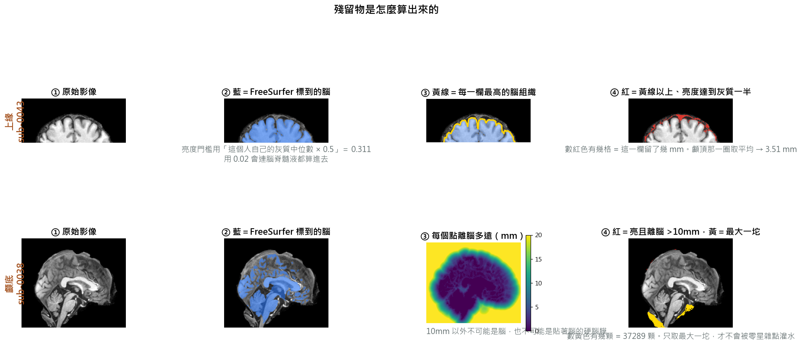
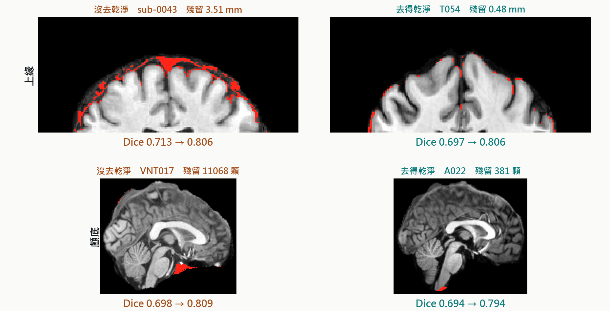
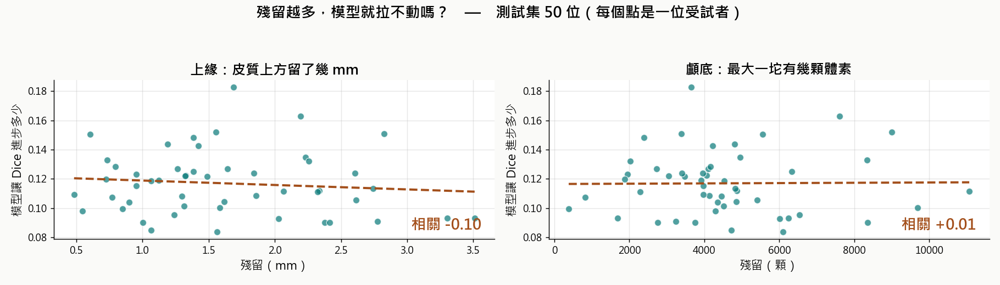
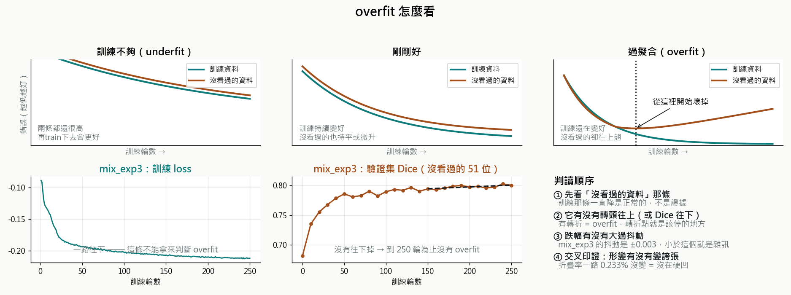
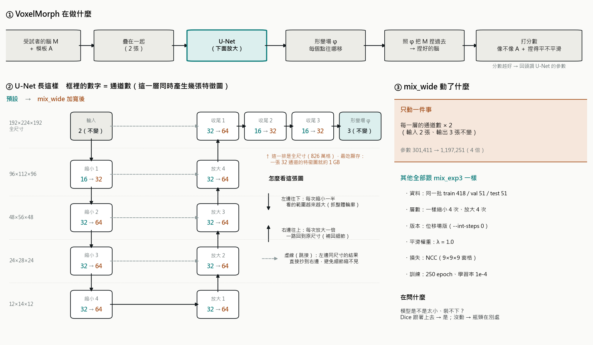
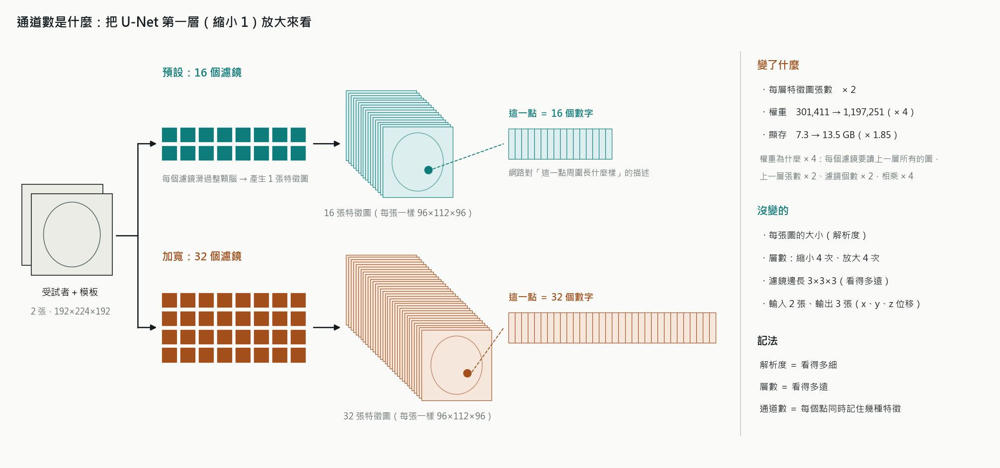

# ASD 資料集：FreeSurfer 產物 → VoxelMorph 訓練實作手冊

何承運 · 2026
建立日期：**2026-08-23**　·　最後更新：**2026-10-23**（§30）

---

> ## 這份文件的定位
>
> 記錄**老師提供的 ASD 資料**從 FreeSurfer 產物接進 VoxelMorph 的完整過程。
> 對照 `IXI/ixi相關手冊.md`（那份是 IXI 那條線）。
>
> - **專案總覽與最新狀態**：`CLAUDE.md`
> - **FreeSurfer 端寫給我們的接入說明**：`FreeSurfer_到_VoxelMorph_交接.md`
> - **FreeSurfer 端的資料品質原始記錄**：`D:\MyHome\MRI\FreeSurfer\docs\ASD_資料品質記錄.md`
>
> ## 現況（2026-09-13）
>
> | 階段 | 狀態 |
> |---|---|
> | 資料把關 | ✅ DICOM 檔頭逐一核對：ASD 170 → **164**；DGM 54 個掃描 = 52 人；VNT 68 人（§15）|
> | 前處理 | ✅ 三包 FreeSurfer（train 258 / test 28）＋ tigerbx 一包（同一個切分），0 失敗 |
> | 訓練 | ✅ mix_exp1（FreeSurfer 標籤）、tiger_exp1（tigerbx 標籤），都在 B 台 |
> | Dice 評估 | ✅ mix 0.7874、tiger 0.8594，折疊率皆 0（§16、§17）|
> | 跟論文比 | ✅ Table I 全表、逐項差異、推論時間實測（§18）|
> | meeting 簡報 | ✅ `meeting報告/ASD延伸實驗_混合訓練與tigerbx_v2.pptx`（29 頁）|
> | 作者模型對照 | ✅ 作者的預訓練模型搬進 PyTorch，在 4 位 OASIS 上 0.598 → 0.753（§19）|
>
> ⚠️ §2–§13 寫於 08-23～09-07（167 顆清單、asd_exp1 時期），保留當歷史。
> 跟 §15 以後衝突時，**以 §15 以後為準**。

---

## 1. 資料來源

| 項目 | 內容 |
|---|---|
| 提供者 | 老師（研究用 ASD 資料） |
| 掃描儀 | Siemens Skyra 3T |
| 序列 | MPRAGE，1mm |
| 原始資料位置 | Ubuntu VM：`/mnt/hgfs/outside/ASD/`（.IMA） |
| FreeSurfer 輸出 | Ubuntu VM：`/home/cheng/workspace/subjects/ASD_result` |
| 資料夾總數 | **170** |
| `recon-all` 跑完 | **167**（9 天 17 小時），0 失敗 |
| **最終可用（FINAL）** | **167** ★ 混掃描檢查通過，異常 0 |

⚠️ **這批不是 IXI。** IXI 是健康成人（20–86 歲、三台機器），ASD 這批是另一個 cohort。
兩者混用或跨批比較的取捨見 §8。

---

## 2. 🔴 資料品質：排除清單

📁 **個案紀錄見 `D:\MyHome\MRI\FreeSurfer\docs\個案筆記.md`**（四包資料唯一的一份，2026-09-17 整併）。

> ⚠️ **A012 這一列是「狀態會變」的活教材。**
> `preprocess_fs.py` 的 `DEFAULT_EXCLUDE` 原本寫死了這四個，A012 修好之後，
> 那份內建表會把 FINAL 清單的 167 **安靜地砍成 166**——不會有任何錯誤訊息。
> 已改成：**有 `--subject-list` 時，清單才是權威**，內建表只提示不砍人
> （會印出「清單裡有 N 個曾被判定有問題的受試者，依清單為準予以保留」）。
> 要覆寫請明寫 `--exclude`。


### 混掃描全面掃描

**A012 是因為疊成 384 層超過 FreeSurfer 的 256 上限才報錯露餡。**
如果某個資料夾也混了兩次掃描、但總層數剛好塞得進 256，**`recon-all` 不會報錯**，
會安靜跑出一顆「兩個人疊在一起」的腦。這種資料餵進訓練會讓模型學到不存在的解剖結構。

### ✅ 狀態：2026-08-23 已完成，通過

| 項目 | 結果 |
|---|---|
| 掃描資料夾 | 167 個 |
| 異常 | **0** |
| 每個資料夾的 .IMA 張數 | 全部恰好 **192** |
| 病人 ID | 每個資料夾只含單一 ID |
| 數字閉合 | 167 × 192 = **32,064**，與 `find` 掃到的檔案總數完全一致 |

同時反證了三件事：A012 的修復確實成功（384 → 192）、**沒有其他資料夾混掃描**、沒有缺切片的。

> ⚠️ **殘餘風險（FreeSurfer 端誠實告知）**：本次驗證的是「檔案數 + 病人 ID 一致性」，
> **沒有逐檔驗證檔案完整性**（例如某張被截斷）。但 167 顆全部通過 `recon-all -all`
> （需要能完整讀取整個序列才可能成功），這是足夠強的旁證。

> 📌 執行細節：第一版指令在 VMware 共享資料夾上跑爆（EAGAIN "Try again"，
> 對 167 個資料夾各跑多次 `ls`，HGFS 撐不住）。改成「`find` 一次性抓清單存檔 →
> 純本機分析」才跑完。之後在 HGFS 上做大量檔案操作要注意這點。

🔓 **閘門條件已滿足**，可加 `--list-is-final` 批次執行。

---

## 3. 受試者歸戶

📁 **個案紀錄見 `D:\MyHome\MRI\FreeSurfer\docs\個案筆記.md`**（四包資料唯一的一份，2026-09-17 整併）。

切分規則（使用者決定）：**一律 `--grouping none`，每個掃描各自算一位受試者，不做歸戶。**
判斷是不是同一人禁止用影像相似度，只能看逐張影像完全相同或 DICOM 檔頭（§15）。

---

## 4. 從 FreeSurfer 端轉檔過來

### 4.1 在 Ubuntu VM 上執行（FreeSurfer 環境）

```bash
export SUBJECTS_DIR=/home/cheng/workspace/subjects/ASD_result
OUT=/mnt/hgfs/outside/fs_for_vxm        # ← 寫到共享資料夾
mkdir -p $OUT/norm $OUT/aseg

for d in $SUBJECTS_DIR/*/; do
  s=$(basename "$d")
  grep -q "finished without error" "$d/scripts/recon-all.log" 2>/dev/null || continue
  mri_convert "$d/mri/norm.mgz" "$OUT/norm/${s}.nii.gz"
  mri_convert "$d/mri/aseg.mgz" "$OUT/aseg/${s}.nii.gz"  -rt nearest
done
```

- 只轉「跑成功」的受試者
- **影像一律用 `norm.mgz`**（見下方「為什麼是 norm 不是 brain」），全體一致，沒有混用
- 實際產出：**167 顆，norm/ + aseg/ 合計 285 MB**

### 🔻 為什麼是 `norm.mgz` 不是 `brain.mgz`（2026-08-23 變更）

| 檔案 | 怎麼來的 |
|---|---|
| `norm.mgz` | `mri_ca_normalize` 的產物：用 **GCA 圖譜**當控制點做亮度正規化，再遮罩 |
| `brain.mgz` | 再多做一次 `mri_normalize -aseg`，改用**該受試者自己的 aseg** 當控制點 |

也就是 `brain` 比 `norm` 多一道、而且更貼身的正規化。

FreeSurfer 端原本推薦 `brain`（跨受試者亮度更一致）；**使用者選 `norm`**
（在 VoxelMorph 生態裡更常見，理由是少一道處理、離原始更近）。

> **兩者都是合理選擇，目前沒有文獻依據說哪個對配準訓練更好。**
> 重點是**全體一致**——這點有做到，167 顆全是 `norm.mgz`。
> 📌 要發表的話，方法學要寫明用的是 `norm.mgz`。

**對前處理的影響：零。** `norm.mgz` 是 uchar（0–255），FreeSurfer 已把白質峰值定錨在 110，
跨受試者一致。第 5 步的 percentile(1,99) clip + min-max 照樣適用，不需要改參數
（其實因為已經正規化過而近乎冗餘，但保留它可以跟 IXI 流程維持一致，**不要拿掉**）。
`aseg.mgz` 完全沒變，已驗證的標籤搬運邏輯不受影響。

### 4.2 搬到 Windows

> 🔴 **重要：資料在「另一台電腦」上。**
> `/mnt/hgfs/outside` 是**跑 FreeSurfer VM 的那台機器**的 VMware 共享資料夾，
> 不是本專案這台。在本機的 `D:` 和 `C:\Users` 都找不到該路徑。
> 所以那 285 MB 需要**跨機器搬運**（隨身碟／區網／雲端都可以，285 MB 不大）。

> ⚠️ **待填**：搬到本機後的路徑 = `______________`

⚠️ **VMware 共享資料夾對大量檔案複製不太可靠**（T085 最初就被懷疑是複製出問題，
後來確認是來源本身缺檔）；而且混掃描檢查時第一版指令就在 HGFS 上跑爆過（EAGAIN）。
搬完務必核對檔案數與大小。
`preprocess_fs.py` 會列出「白名單裡有但 `--img-dir` 找不到」以及「缺對應 aseg」的 ID，
可以當作核對工具。

### 4.3 放到哪

```
ASD/
├── norm/                ← norm.mgz 轉出的 .nii.gz（167 個）
├── aseg/                ← aseg.mgz 轉出的 .nii.gz（167 個）
├── subjects_final.txt   ← ✅ 已就位（FINAL，167 個 ID）
└── groups.txt           ← 只在老師確認 A013/A016 是同一人時才需要
```

> 📌 `.gitignore` 已設定：`ASD/` 底下的**資料檔會被忽略**，但 `*.py` / `*.md` /
> **根目錄的 `*.txt`**（清單、歸戶表）會進版控。清單是重要溯源資料，不要放進子資料夾。

---

## 5. 前處理：`preprocess_fs.py`

### 5.1 和 IXI 的差別

| 步驟 | IXI (`preprocess_ixi.py`) | ASD (`preprocess_fs.py`) |
|---|---|---|
| N4 bias correction | ✅ 做 | ❌ **跳過**（FreeSurfer 的 `nu.mgz` 階段已做）|
| 去顱骨 | ✅ antspynet（最慢的一步）| ❌ **跳過**（`norm.mgz` 已去過）|
| Affine 對到 atlas | ✅ | ✅ **一樣，沿用同一個 atlas** |
| 搬 aseg 標籤 | — | ✅ **新增**（同一變換 + 最近鄰）|
| 正規化 [0,1] | ✅ | ✅ 一樣 |
| 切分 | 檔案層級 shuffle | **受試者層級** |
| npz keys | `vol` | `vol` + **`seg`** |

> `--n4` / `--brain-extract` 可以強制開啟，預設關閉。

⚠️ **不要用 FreeSurfer 的 `talairach.xfm`** —— 它對到 **MNI305**，我們的 atlas 是 **MNI152 09c**，
不是同一個空間。繼續用 `ants.registration()` 對到我們自己的 atlas，這樣 shape (192,224,192)、
正規化方式、既有 IXI 資料全部相容。

### 5.2 🔒 執行閘門

**沒有 `--list-is-final` 旗標時，腳本拒絕批次執行**（exit code 2），
只允許 `--dry-run` 和 `--only <SUBJECT>`。

🔓 **2026-08-23：閘門條件已滿足。** 混掃描檢查通過（異常 0），FreeSurfer 端已交付
標明 FINAL 的清單（167）並明確授權解除。加 `--list-is-final` 即可批次執行。

> 📌 這個閘門的設計目的是「不靠記憶」：資料就緒與否由旗標決定，不是靠人記得有沒有查過。
> 之後若換資料集，同樣的機制可以再用一次。

### 5.3 執行順序

> ✅ **這一節已經執行完畢（2026-08-23）**，輸出在 `data/ASD_preprocessed_v1/`。
> 以下保留完整步驟，供之後換資料或需要重跑時參考。

**最省事的做法是用包裝腳本**，它會自動帶入正確參數（`--grouping none`、
`--list-is-final`）、跑起跑前檢查、顯示切分讓你確認、跑完抽驗 3 顆：

```
python ASD\run_preprocess.py --src-dir data\ASD_data --out-dir data\ASD_preprocessed_v1 --dry-run   # 只看切分
python ASD\run_preprocess.py --src-dir data\ASD_data --out-dir data\ASD_preprocessed_v1             # 正式跑（會問你確認）
```

底下是它實際呼叫的指令，需要自訂參數時可以直接用。

> 清單來源：`D:\MyHome\MRI\FreeSurfer\docs\ASD_可用清單_FINAL.txt`（167 個，檔頭有 `#` 註解，
> 程式會自動跳過）。已複製一份到 `ASD/subjects_final.txt` 進版控。
> ⚠️ 舊的 `ASD_可用清單_暫定.txt`（166）**已被 FreeSurfer 端刪除**，避免誤用。

**① 先看歸戶與切分（不動影像）**
```powershell
python ASD\preprocess_fs.py `
    --img-dir data\ASD_data\norm --seg-dir data\ASD_data\aseg `
    --atlas IXI\atlas_mni152_09c_v3.nii.gz `
    --out-dir data\ASD_preprocessed_v1 `
    --subject-list ASD\subjects_final.txt `
    --grouping none `
    --dry-run
```

用 FINAL 清單（167）實跑的結果：

```
歸戶：167 個掃描 -> 167 位受試者
  --grouping  : none（每個掃描各自成一人，不合併）
[!] 以下 2 組（共 5 個掃描）疑似同一人，但目前被當成不同人：
      ['A013', 'A0131', 'A0132']
      ['A016_1', 'A016_2']
切分（受試者層級，seed=42，test_frac=0.1）：
  train  150 人 / 150 個掃描        ← 切分當下；A016_1 之後於 QC 移出，實際訓練 149
  test    17 人 /  17 個掃描
  [v] 沒有受試者橫跨 train/test
```

**② 驗證 1 顆**（產生 nii 供 ITK-SNAP / Freeview 目視確認）
```powershell
python ASD\preprocess_fs.py `
    --img-dir data\ASD_data\norm --seg-dir data\ASD_data\aseg `
    --atlas IXI\atlas_mni152_09c_v3.nii.gz `
    --out-dir ASD\fs_check --only A001 --save-nii
```
目視要確認三件事：
1. 影像有對到 atlas 空間、shape = (192, 224, 192)
2. **標籤和影像完全疊合**（最重要）
3. 標籤值仍是整數，沒有出現奇怪的中間值

**③ 批次跑（閘門已解除）**
```powershell
python ASD\preprocess_fs.py `
    --img-dir data\ASD_data\norm --seg-dir data\ASD_data\aseg `
    --atlas IXI\atlas_mni152_09c_v3.nii.gz `
    --out-dir data\ASD_preprocessed_v1 `
    --subject-list ASD\subjects_final.txt --list-is-final `
    --grouping none `
    --save-nii > .\log\asd_preprocess.txt 2>&1
```

⚠️ **不要加 `--group-map`**：切分不做歸戶（見 §3）。

### 5.4 輸出

```
data/ASD_preprocessed_v1/
├── train/<subject>.npz    keys: vol (float32 [0,1]) + seg (int16)
├── test/<subject>.npz
├── nii/                   （--save-nii：<subj>.nii.gz + <subj>_seg.nii.gz）
└── split.json             ← 切分結果，可重現、可複核
```

---

## 6. ✅ 已驗證的事實

### 6.1 標籤搬運（`verify_seg_transform.py`）

交接文件第 5 節的程式碼原本標註「未在本環境實測」。已補上驗證：

**測試設計**：用同一個 `reg['fwdtransforms']` 把**影像**和**標籤**都以 nearestNeighbor 搬過去，
再把搬完的影像用原門檻重新量化，與搬完的標籤逐 voxel 比對。最近鄰對兩者取的是同一顆
來源 voxel，所以只要變換真的共用，兩者必然 bit-exact。

**結果（ANTsPy 0.6.3，真實 IXI 影像 + 合成標籤）**：

| 測試 | 結果 |
|---|---|
| 標籤 shape = atlas | ✅ (192,224,192) |
| 搬完仍是整數 | ✅ 與最近整數最大偏差 = **0** |
| 沒產生不存在的標籤值 | ✅ [0,10,17,41] → [0,10,17,41] |
| **影像與標籤逐 voxel 對齊** | ✅ **不一致 0 / 8,257,536** |
| 反證：改用 `linear` | ✅ 捏造出 **1,536,912** 個原標籤集裡沒有的值 |
| 體積變化合理 | ✅ 比值 0.690（Affine 縮放，正常）|

重跑方式：
```powershell
python ASD\verify_seg_transform.py `
    --img IXI\IXI-T1\IXI002-Guys-0828-T1.nii.gz `
    --atlas IXI\atlas_mni152_09c_v3.nii.gz
```

### 6.2 訓練端相容性

- npz 有 `vol` + `seg` 兩個 key 時，`voxelmorph/py/utils.py:63` 走 `npz[np_var]`
  （`np_var` 預設 `'vol'`）→ **正確取到 `vol`，不會拿到 `seg`**
- `train.py` 用作者預設值實跑 2 epoch，正常收斂存檔
- **VoxelMorph 那邊完全不用改**

### 6.3 標籤三鐵則（已寫成程式裡的硬檢查）

1. 必須用**與影像完全相同**的變換 —— 不能各自對位一次
2. 內插必須用**最近鄰** —— `linear` 會在標籤 17 和 10 之間插出 13.5 這種不存在的值
3. 標籤**不正規化、不轉 float** —— 保持 `int16`

> 搬完若出現非整數值，`preprocess_fs.py` 直接 `raise`，不會安靜存進 npz。

---

## 7. 訓練（在 B 台跑）

### 7.1 兩台機器的分工

| | A 台（主機） | B 台（訓練機） |
|---|---|---|
| 路徑 | `C:\Users\h4524\claude_cheng` | `D:\chengyun\TRY_voxelmorph` |
| 負責 | 前處理、評估、視覺化、文件 | **只跑訓練** |
| 需要 ANTs / antspynet | ✅ | ❌ **不用裝** |
| 需要原始 `.IMA` / `norm.mgz` | ✅ | ❌ **不要搬** |

**為什麼這樣切**：前處理只需要做一次，而且 `antspynet` 相依 TensorFlow，
在 Windows 上很麻煩（原生 TF ≥ 2.11 還沒有 GPU）。B 台只要 PyTorch 就夠了。

📌 **順帶的好處**：npz 裡只有 `vol` 和 `seg` 兩個 numpy 陣列，
**沒有 DICOM header、沒有受試者姓名**，檔名也只是 `A001` 這種代碼。
搬 npz 到 B 台等於順便去識別化。**原始 `.IMA` 的檔名與 DICOM 檔頭有真名，不要搬、也不要進 git。**

### 7.2 要搬什麼

程式和文件走 GitHub（`git pull` 就有）。**只有兩樣要另外搬**，因為 `.gitignore` 擋著：

| 從 A 台 | 大小 |
|---|---|
| `data\ASD_preprocessed_v1\` | **1.28 GB** |
| `IXI\atlas_mni152_09c_v3.npz` | 6 MB |

`data/ASD_preprocessed_v1/MANIFEST.json` 有 167 個檔案的名稱與大小，搬完可以核對。

⚠️ **atlas 版本必須跟前處理用的一致**（都是 v3）。混用會報
`Sizes of tensors must match`，或更糟——安靜地訓練出對不準的模型。

### 7.3 在 B 台怎麼跑

```
python ASD\run_train.py --train-dir data\ASD_preprocessed_v1\train --exp-name asd_exp1 --check-only   # 先檢查，不訓練
python ASD\run_train.py --train-dir data\ASD_preprocessed_v1\train --exp-name asd_exp1                # 正式跑
python ASD\run_train.py --train-dir data\ASD_preprocessed_v1\train --exp-name asd_exp1 --resume       # 中斷後續跑
```

`--check-only` 要確認的三行：**python 路徑是不是你的 venv**、
**`ASD_preprocessed_v1\train` 有沒有 149 個 npz**、**GPU 有沒有抓到**。

> 📌 包裝腳本刻意寫成 **Python 而不是 `.ps1`**：
> cmd.exe 不會執行 `.ps1`（只會用預設關聯程式開啟，看起來像「跳出編輯器」），
> PowerShell 還要處理 ExecutionPolicy 與 BOM。
> Python 版在 cmd / PowerShell 都能跑，而且用 `sys.executable`，
> **就是你當下啟動的那個 venv，不可能抓錯**。

`run_train.py` 會自動把指令存成 `log/asd_expN_script.txt`（含機器名稱與資料版本）。

### 7.4 超參數

🔴 **`--image-loss` 預設是 `mse`**，想跑 NCC 一定要明寫。

🔴 **λ 的尺度取決於 `--image-loss`**：論文對 CC 的最佳值是 **≈1–2**，對 MSE 是 0.01–0.02。
`train.py` 預設的 0.01 是為 MSE 設的，**搭 NCC 用等於幾乎沒有正則化**。
IXI 那邊的 exp3–exp8 就是踩了這個（平滑項只佔損失 1–3%）。詳見 `CLAUDE.md`「超參數」節。

**asd_exp1 採用 `ncc` + `λ=1.0`**（使用者決定）。這是本專案第一次把 λ 放到論文建議的尺度。

### 7.5 ⚠️ 沒有 validation set

**現況：train 149 / test 17，沒有 val。**

`train.py` 本身不做任何評估；挑 epoch 是靠 `batch_test_ixi.py` 掃過所有 `.pt`，
在 **test set** 上算指標再取綜合分數最高的（`batch_test_ixi.py:204`）。

> 🔴 **這代表「挑 epoch」和「報成績」用的是同一批資料**，test 實質上變成 validation，
> 報出來的數字會樂觀偏高。
>
> 論文（TMI 2019 §V-A）的做法是 3231 train / **250 validation** / 250 test，
> 「select the network that optimizes Dice on our validation set, and report results on our test set」。

**使用者決定維持 149/17**（跟 IXI 那條線 exp4–exp8 的現行做法一致）。
📌 **要發表的話，這點必須在方法學中明講。**

改的話很便宜：從 `train/` 挪 17 顆出來即可（133/17/17），**不用重跑前處理**——
npz 已經產生好了，只是移動檔案。但訓練資料會從 149 掉到 132。

### 7.6 產出與搬回

| 產出 | 大小 | 要搬回 A 台嗎 |
|---|---|---|
| `models\asd_exp1\0000.pt` … `0250.pt` | 1.16 MB × 251 ≈ **292 MB** | ❌ 只搬最佳的 1~3 個 |
| `epoch_curve.csv` / `.png` | 350 KB | ✅ |
| `log\asd_exp1.txt` | ~2 MB | ✅ |
| `log\asd_exp1_script.txt` | < 1 KB | ✅ |

⚠️ `train.py` **每個 epoch 都存一個 `.pt`，不會自動清理**。
IXI 的 `exp4` 就留下 501 個檔、970 MB。挑完 epoch 記得清。

---

## 8. ⚠️ 研究設計：Dice 要報在哪批資料上（尚未定案）

**這題的決定權在使用者與老師，以下只是取捨依據。**

### 核心問題

IXI 訓練出來的模型拿去 ASD 資料上報 Dice，中間跨了 **cohort 和年齡**的 domain shift。

更尖銳的是**標籤方法本身就是 confound**：
若 IXI 用 SynthSeg 標籤、ASD 用 aseg 標籤，兩邊的 Dice **不能直接比較**——
差異裡混雜了「配準品質差異」和「兩套分割方法的差異」，分不開。

> **規則：在哪一批算 Dice，那批就要用同一套標籤方法。**
> 要跨批比較，兩批都跑 SynthSeg（IXI 跑 aseg 需要 581 × 2 小時 ≈ 48 天，不可行）。

### FreeSurfer 端建議的兩段式

| 段 | 資料 | 標籤 | 角色 |
|---|---|---|---|
| 第一段 | IXI（581）| 統一用 SynthSeg | **主結果**，cohort 一致，好解讀 |
| 第二段 | ASD（167）| aseg | **external validation**，明講跨 cohort / 跨機器 |

好處：保住既有的 581 顆 IXI 和訓練好的模型；ASD 樣本數少，拿去當獨立驗證剛好。
而且如果表現掉了，那本身就是**泛化能力的證據**，是有價值的結論而不是瑕疵。

### 另一個選項

ASD 這批自己 train + test，Dice 內部一致。缺點是樣本數少（167 → train 149 / test 17），
且犧牲了既有的 IXI 主結果。

---

## 9. 實驗記錄

`run_train.py` 會自動把指令存到 `log/asd_expN_script.txt`（含機器名稱與資料版本）。

| 實驗 | 資料 | atlas | epochs | image-loss | λ | int-steps | int-downsize | 最佳 epoch | Dice | %\|J\|≤0 | 備註 |
|---|---|---|---|---|---|---|---|---|---|---|---|
| **asd_exp1** | ASD_preprocessed_v1 | v3 | 250 | **ncc** | **1.0** | 7 | 2 | 0190 | **0.7811** | **0.0000%** | 已跑完（B 台）。基準線 0.6760，+0.105 |
| **mix_exp1** | mixed_preprocessed_v1（三包）| v3 | 250 | ncc | 1.0 | 7 | 2 | 0230 | **0.7874** | **0.0000%** | 2026-09-08，B 台。基準線 0.6753，+0.112（§16）|
| **tiger_exp1** | tigerbx_preprocessed_v1 | v3（seg 用 tigerbx 版）| 250 | ncc | 1.0 | 7 | 2 | 0240 | **0.8594** | **0.0000%** | 2026-09-09，B 台。基準線 0.7376，+0.122（§17）|

📌 **λ=1.0 是這個專案第一次這樣跑，而且確實生效了。**
`log/asd_exp1.txt` 最後一步：`loss: -0.169698 (-0.199097, 0.029399)`，
**平滑佔比 12.9%** —— IXI 那邊的 NCC 實驗（exp4/5/7）只有 1–3%，形同沒有正則化。

### 9.1 asd_exp1 的結果

| 項目 | 值 | 說明 |
|---|---|---|
| 基準線（只有 Affine） | **0.676014** | 模型無貢獻時的 Dice |
| 最佳 epoch | 0190 | **但這是雜訊**，見下 |
| Dice | **0.7811** | 比基準線 +0.105 |
| %\|J\|≤0 | **0.0000%** | 全部 26 個檢查點皆為零 |
| 平滑項佔比 | 12.9% | 最後一步的損失拆項 |

🟢 **評估鏈的 sanity check 通過**：`epoch 0` 的 Dice 等於 `--baseline` 算出的
0.676014。兩者走**完全不同的程式路徑**（一個載模型跑推論、一個直接搬標籤），
數字一致代表標籤搬運與 Dice 計算沒有錯。

🔴 **「最佳 epoch = 190」是雜訊，不要當成結論。**
17 顆測試的標準誤是 **0.0038**（舊版寫 0.0051，2026-09 重算更正），epoch 90 之後各檢查點差距很小。
`dice_curve.csv` 尾段：230 → 0.780848、240 → 0.780899、250 → 0.779413。

🔴 **更正（2026-09-13）：舊版這裡寫「折疊率 0 代表折疊預算沒用到、λ=1.0 可能偏保守」，這個推論不成立。**
我們用的是 repo 預設的**微分同胚版**（`int_steps=7`，速度場積分），這個版本本來就幾乎不會折疊；
論文 Table I 的 0.366% 是**非微分同胚的位移場版本**（`int_steps=0`）。兩者不能比，
折疊率 0 也不能拿來說 λ 太大或模型比較好。λ=0.5 對照仍然可以做，但目的只是「看 Dice 會不會上升」。

⚠️ **不要拿 0.7811 直接跟論文的 0.753 比。** 基準線就不一樣（我們 0.676、論文 0.584），
資料集、標籤來源、atlas 也全都不同。要比的是「比基準線高多少」。

**評估提醒**：
- Dice 用 `voxelmorph-code/data/labels.npz` 的 **30 個 FreeSurfer 標籤 ID**
  （已實際載入確認：`int64`，值為
  `[2,3,4,7,8,10,11,12,13,14,15,16,17,18,24,28,31,41,42,43,46,47,49,50,51,52,53,54,60,63]`），
  正好對應論文 Table I 的 30 個結構
- **只看 Dice 會被「亂折疊硬湊高分」騙，必須同時報 %|J|≤0**
- %|J|≤0 的合理範圍：論文 VoxelMorph(CC) 是 **0.366%**、ANTs SyN 0.185%、NiftyReg 0.793%。
  **0.1% 量級屬正常**，該避開的是 2% 以上

---

## 10. 待辦 / 待確認

### ✅ 已完成

- [x] **混掃描全面檢查** —— 2026-08-23，167 個資料夾異常 0，FINAL 清單（167）已交付
- [x] **資料搬到本機** —— `data/ASD_data/norm` + `aseg`，各 167 個，285 MB，
      gzip 完整性 334/334 通過
- [x] **批次前處理** —— train 150 / test 17，0 失敗、0 個標籤消失（A016_1 之後於 QC 移出 → 149）
- [x] **單顆端到端驗證** —— A001 量化檢查 10/10 通過（含左右翻轉檢查）

- [x] **atlas 的 aseg** —— 補零 → recon-all → 兩段整數切片，5/5 驗證通過（§12）
- [x] **asd_exp1 訓練完成** —— 250 epochs，Dice 0.7811，折疊率 0.0000%（§9.1）
- [x] **Dice 評估腳本** —— `ASD/test_dice.py`（§13.1）
- [x] **視覺化** —— `ASD/visualize_dice.py`（§13.2）

### ✅ 2026-09 完成

- [x] DICOM 檔頭核對、同一人判定（§15）
- [x] DGM、VNT 前處理；三包混合（§16）
- [x] mix_exp1、tiger_exp1 訓練與 Dice 評估（§16、§17）
- [x] 跟論文 Table I 逐項對照、推論時間實測（§18）

### 🔴 下一步

- [ ] **切出 validation set** —— 使用者決定「等下次資料多一點再做」。目前 epoch 是看 test 挑的，數字偏樂觀
- [ ] （可選）λ = 0.5 對照：只看 Dice 會不會上升（**不是**因為折疊率 0，見 §9.1 更正）
- [ ] 訓練可縮成 120 epochs：epoch 90 之後已持平（§16）
- [ ] 頭殼沒切好的影響：沒有直接測試（使用者決定暫不做）。要測就把腦遮罩刻意膨脹／侵蝕，其他條件不變

### 🟠 需要問老師

- [ ] **DGM 2023-04-25 那四位**：資料夾編號與 DICOM ID 差 1
- [ ] **A014 的組別**：DICOM ID 是 T094
- 個案問題 → 見 `D:\MyHome\MRI\FreeSurfer\docs\個案筆記.md`

### 🟡 研究設計

- [ ] **Dice 報在哪批**（§8）—— 目前實際做法是 ASD + DGM + VNT 自己 train / test

---

## 11. 相關檔案

| 檔案 | 用途 |
|---|---|
| `ASD/preprocess_fs.py` | FreeSurfer 產物 → npz（含 seg）|
| `ASD/verify_seg_transform.py` | 驗證 affine 共用 + 最近鄰內插 |
| `ASD/verify_one_subject.py` | 單顆 10 項量化驗證（含左右翻轉檢查）|
| `ASD/make_padded_atlas_input.py` | atlas 補零成 256³，讓 recon-all 零內插（§12.1）|
| `ASD/verify_conform_roundtrip.py` | 量 conform 來回的位移（§12.2）|
| `ASD/make_atlas_seg.py` | atlas aseg 切回訓練空間（§12.3）|
| `ASD/test_dice.py` | ⭐ Dice 評估（§13.1）|
| `ASD/visualize_dice.py` | ⭐ 標籤重疊 / 輪廓 / 逐結構長條圖（§13.2）|
| `ASD/run_preprocess.py` / `run_train.py` | 前處理與訓練的包裝腳本 |
| `ASD/make_mixed_set.py` | 多資料集併成一份（預設實體複製）|
| `ASD/check_dataset.py` | 搬機器後的資料完整性檢查（sha256 manifest）|
| `ASD/author_model.py` | 作者的 Keras 模型（.h5）搬進 PyTorch（§19）|
| `ASD/orient.py` | 依 atlas 標籤判斷方向，畫圖前轉成 RAS（§19.4）|
| `oasis/prepare_author_check.py` | OASIS 受試者轉成 FreeSurfer 編號的 npz（§19.3）|
| `IXI/atlas_mni152_09c_v3_seg_tigerbx.npz` | tigerbx arm 的 atlas 分割（§17）|
| `share_models/{ASD,mix_exp1,tiger_exp1}_good/` | 進版控的最佳模型與 Dice 曲線 |
| `meeting報告/ASD延伸實驗_混合訓練與tigerbx_v2.pptx` | 2026-09 meeting 簡報（29 頁，含備忘稿）|
| `ASD/slides_src/2026-09_mix_tigerbx/` | 上面那份 29 頁簡報的產生器（pptxgenjs）|
| `ASD/slides_src/` | 舊 meeting 簡報原始碼（25 頁 `.dc.html` + `canvas.json`）|
| `meeting報告/講稿.md` | 舊簡報（25 頁）的講稿 |
| `ASD/subjects_final.txt` | 🟡 舊清單（08-23 版）；現行清單是 `data/ASD_data/fs_stats/subjects.txt`（164，隨資料附）|
| `CLAUDE.md` | 專案總覽、超參數、實驗記錄 |
| `FreeSurfer_到_VoxelMorph_交接.md` | FreeSurfer 端寫的接入說明 |
| `D:\MyHome\MRI\FreeSurfer\docs\ASD_資料品質記錄.md` | 品質問題的原始診斷 |
| `D:\MyHome\MRI\FreeSurfer\docs\ASD_可用清單_FINAL.txt` | ★ **最終清單（167）**，混掃描檢查已通過 |
| `D:\MyHome\MRI\FreeSurfer\docs\ASD_全部資料夾清單.txt` | 全部 170 個，含壞掉的 |


---

## 12. atlas 的 aseg：自己跑 FreeSurfer

**為什麼要自己跑**：Dice 要拿受試者的標籤跟 **atlas 自己的標籤**比，
但我們的 MNI152 atlas 是自製的，只有影像沒有標籤。

找過的現成來源，全都不能用：

| 來源 | 內容 | 為什麼不能用 |
|---|---|---|
| MNI 官方發布包 | gm/wm/csf 組織機率圖 + 三張二值遮罩 | **沒有解剖結構標籤** |
| CerebrA | Mindboggle-101 配準 + 人工修 | 定義在 **symmetric** 空間；標記協定與 aseg 不同 |
| Hammers / LPBA40 / AAL | 30–40 位手工描繪配準成機率圖 | 標記協定不同 → 差異會混進 Dice |
| G-Node 公開資料 | 別人對同一模板跑過 recon-all | **未標示 FreeSurfer 版本** |

👉 **結論：自己跑，跟 167 顆同一套方法、同一個版本（7.4.1）。**
這也跟論文一致 —— TMI 2019 §V-A-1 明寫受試者與 atlas 都是 FreeSurfer 分割。

### 12.1 🔴 先補零，否則 recon-all 會內插

`recon-all` 會把輸入 conform 成 **256³ / 1mm / LIA**，並**保留影像中心**。

MNI152 三個邊長都是**奇數**，中心落在半整數體素上，跟目標的 128.0 差半格 —— **會觸發內插**：

```
軸 0　193 → 中心 96.5 　目標 128.0　偏移 −31.5　半整數 ✗
軸 1　229 → 中心 114.5　目標 128.0　偏移 −13.5　半整數 ✗
軸 2　193 → 中心 96.5 　目標 128.0　偏移 −31.5　半整數 ✗
```

`make_padded_atlas_input.py` 先補零成 256³（前 31/13/31、後 32/14/32），
補完三軸中心都是 **128.0，偏移為零**。

> FreeSurfer 的 log 顯示它**仍然跑了三線性內插** —— 但在整數座標上，三線性回傳的就是原值。

### 12.2 驗證：`verify_conform_roundtrip.py`

| 量測 | 值 | 若補零沒生效會是 |
|---|---|---|
| 共用遮罩的強度加權質心位移 | **0.0032 voxel** | 0.5 voxel |
| 相位相關次像素估計 | 0.0001（整數峰值在 0,0,0）| — |
| 轉回後與原圖的相關係數 | 0.999977 | — |

⚠️ **這支腳本一開始寫錯過**：原本用「各自算閾值遮罩」，兩張圖的遮罩因為 uchar 量化差了 1.4%，
量出 0.062 voxel 的**假 FAIL**。改成**共用同一個參考遮罩 + 強度加權質心**才對。

### 12.3 切回訓練空間：`make_atlas_seg.py`

aseg 回來之後是 256³，用**兩段整數切片**切回：

```
256³ ──[31:224, 13:242, 31:224]──> (193,229,193)   # 還原補零
     ──[0:192,   2:226,  0:192 ]──> (192,224,192)  # 跟 atlas 同一套裁切
```

**兩段都是整數切片，voxel 值一個都沒被動過。** 輸出 `IXI/atlas_mni152_09c_v3_seg.npz`。

驗證 5/5 通過，其中最重要的是：**評估用的 30 個結構全部都在，缺 0 個。**

📌 **品質對照**：atlas 的表面破洞 14/12，我們 166 顆受試者的中位數是 12/10 —— 幾乎就在中位數上。
原本擔心平均模板邊界模糊會讓拓撲重建失敗，結果沒有。耗時 2 小時 21 分。

---

## 13. Dice 評估與視覺化

### 📌 視覺化速查（2026-09-15 現行跑法）

每位受試者 **8 張圖**，由兩支腳本各畫一部分，`--out-dir` 給同一個資料夾就會放在一起：

| 腳本 | 出哪幾張 |
|---|---|
| `ASD\visualize_dice.py` | 標籤重疊 `labels_*`、結構輪廓 `contours_*`、逐結構長條圖 `perstruct_*`（3 張）|
| `draw-img\visualize_reg_ixi.py` | 三平面 `reg_*_triplanar`、棋盤格 `checker_*`、形變網格 `grid_*`、疊圖 `overlay_*`、Jacobian `jacobian_*`（5 張）|

**FreeSurfer 組（mix_exp1）**
```powershell
python ASD\visualize_dice.py --model models\mix_exp1\0230.pt --test-dir data\mixed_preprocessed_v1\test `
    --subject T053 --out-dir models\mix_exp1\vis_T053
python draw-img\visualize_reg_ixi.py --model models\mix_exp1\0230.pt --atlas IXI\atlas_mni152_09c_v3.npz `
    --test-dir data\mixed_preprocessed_v1\test --subject T053 --out-dir models\mix_exp1\vis_T053
```

**tigerbx 組（tiger_exp1）** —— `visualize_dice.py` 一定要換 `--atlas-seg`，
否則會拿 tigerbx 標籤去比 FreeSurfer 的 atlas 標籤，Dice 安靜地低掉約 0.14
```powershell
python ASD\visualize_dice.py --model models\tiger_exp1\0240.pt --test-dir data\tigerbx_preprocessed_v1\test `
    --atlas-seg IXI\atlas_mni152_09c_v3_seg_tigerbx.npz --subject T053 --out-dir models\tiger_exp1\vis_T053
python draw-img\visualize_reg_ixi.py --model models\tiger_exp1\0240.pt --atlas IXI\atlas_mni152_09c_v3.npz `
    --test-dir data\tigerbx_preprocessed_v1\test --subject T053 --out-dir models\tiger_exp1\vis_T053
```

**作者模型跑 OASIS**（§19）—— 新受試者要先換標籤編號，已換過的 4 位跳過第一行
```powershell
python oasis\prepare_author_check.py --subject oasis\oasis_npz\test\OASIS_OAS1_0277_MR1.npz --out-dir oasis\author_check
python ASD\visualize_dice.py --model models\vxm_dense_brain_T1_3D_mse.h5 `
    --atlas voxelmorph-code\data\atlas.npz --atlas-seg voxelmorph-code\data\atlas.npz `
    --labels oasis\author_check\labels_eval.npz `
    --subject oasis\author_check\test\OASIS_OAS1_0277_MR1.npz --out-dir models\author_exp1\vis_OAS1_0277
python draw-img\visualize_reg_ixi.py --model models\vxm_dense_brain_T1_3D_mse.h5 --atlas voxelmorph-code\data\atlas.npz `
    --subject oasis\author_check\test\OASIS_OAS1_0277_MR1.npz --out-dir models\author_exp1\vis_OAS1_0277
```

**參數重點**

| 參數 | `visualize_dice.py` | `visualize_reg_ixi.py` |
|---|---|---|
| `--model` | 必填，`.pt` 或作者的 `.h5` 都可以 | 同左 |
| `--test-dir` | 給 ID 時必填；`--subject` 給完整 npz 路徑就不用 | 同左 |
| `--atlas` | 預設 MNI152 v3 | **必填** |
| `--atlas-seg` | 預設 FreeSurfer 版；tigerbx 組、作者 atlas 要換 | 只用來判斷方向，會自動找（npz 裡的 seg 或旁邊的 `<atlas>_seg.npz`），通常不用給 |
| `--labels` | 預設 30 個結構；OASIS 換成 29 個的 `labels_eval.npz` | 沒有這個參數 |
| `--out-dir` | 可省略，預設存到模型旁邊的 `dice_vis\` | **必填** |

- **方向不用管**：兩支都依 atlas 標籤自動轉成 RAS（`ASD\orient.py`），我們的 MNI 和作者的 atlas 畫出來方向一致
- `--gpu` 預設就是 0
- 檔名帶受試者與模型名稱，換人不會互相覆蓋；但建議每位給自己的 `--out-dir`（`vis_<ID>`），比較好找
- 以下 13.1–13.2 是各參數的細節與背景

### 13.1 `ASD/test_dice.py`

**`--test-dir` 必填，直接給路徑**（2026-09-13 改，見 §14 開頭）；atlas、atlas-seg、labels 有預設值。
tigerbx 組要另外給 `--atlas-seg IXI\atlas_mni152_09c_v3_seg_tigerbx.npz`。

三種模式：

```powershell
# ① 基準線：只有 Affine，模型無貢獻
python ASD\test_dice.py --baseline --test-dir data\mixed_preprocessed_v1\test --exp-name mix_exp1

# ② 單一模型
python ASD\test_dice.py --model models\mix_exp1\0230.pt --test-dir data\mixed_preprocessed_v1\test

# ③ 掃整個資料夾，畫 Dice 曲線
python ASD\test_dice.py --model-dir models\mix_exp1 --step 10 --test-dir data\mixed_preprocessed_v1\test
```

輸出 `dice_curve.csv`：`epoch, dice_mean, jneg_pct`。

🟢 **內建的 sanity check**：`epoch 0` 的 Dice 應該等於 `--baseline` 的值。
這兩個數字走**完全不同的程式路徑**，一致才代表評估鏈沒錯（實測都是 0.676014）。

⚠️ `--model` 要給 **`.pt` 檔**不是資料夾。給錯會噴 `PermissionError`（Windows 上開資料夾當檔案），
訊息看不出原因 —— 腳本已加參數檢查會先擋下來。

### 13.2 `ASD/visualize_dice.py`

```powershell
python ASD\visualize_dice.py --model models\mix_exp1\0230.pt --test-dir data\mixed_preprocessed_v1\test `
    --subject T053 --out-dir models\mix_exp1\vis_T053
```

- `--out-dir` 不給就存到模型旁邊的 `dice_vis\`（所有受試者擠在一起，建議分開給）。
- `--labels` 指定「評估哪些結構」，預設 repo 的 `labels.npz`（30 個 FreeSurfer 標籤），**平常不用動**。
  它決定 Dice 平均哪些結構、重疊圖畫哪些區域、長條圖列哪些結構；輪廓圖的 9 個結構是寫死的，跟它無關。
- tigerbx 組要換 `--test-dir data\tigerbx_preprocessed_v1\test` 和 `--atlas-seg IXI\atlas_mni152_09c_v3_seg_tigerbx.npz`，
  否則會拿 tigerbx 標籤去比 FreeSurfer 的 atlas 標籤，Dice 安靜地低掉約 0.14。
- `--model` 也吃作者釋出的 `.h5`（§19）。畫圖前會依 atlas 標籤自動轉成 RAS，
  換成作者的 atlas（LIA）切面名稱也不會標錯；我們的 MNI 本來就是 RAS，圖跟以前一模一樣。

出三張：**標籤重疊**（紅=只有 atlas、綠=只有受試者、黃=重疊）、
**9 個結構的輪廓對照**、**逐結構長條圖**。上下排是「只有 Affine」vs「加上 VoxelMorph」。

另外 `draw-img/visualize_reg_ixi.py` 也能吃 ASD（它只讀 npz 的 `vol`），
出三平面 / 棋盤格 / 形變網格 / 疊圖 / Jacobian，但**要手動指定 `--atlas` 和 `--test-dir`**：

⚠️ 這支的 `--subject` **原本只吃完整 npz 路徑**，給純 ID 會噴
`ValueError: unknown filetype for A061` —— 訊息完全看不出原因。
已改成兩種都吃（ID 會到 `--test-dir` 底下找同名 npz），找不到時給可行動的訊息。

```powershell
python draw-img\visualize_reg_ixi.py --model models\asd_exp1\0190.pt `
    --atlas IXI\atlas_mni152_09c_v3.npz --test-dir data\ASD_preprocessed_v1\test `
    --subject T023 --out-dir models\asd_exp1\vis_T023 --gpu 0
```

**確認有沒有對上，實際要看哪裡**：

| 圖 | 對上 | 沒對上 |
|---|---|---|
| 棋盤格 | 方格交界處腦輪廓**接得起來** | 交界處錯開、像斷掉 |
| 標籤重疊 | 幾乎全黃 | 邊緣一圈明顯紅綠 |
| 形變網格 | 平滑的彎曲 | 打結、交叉、擠成一團 |
| Jacobian | 沒有 ≤0 的點 | 出現黑點＝折疊 |

📌 **形變網格 2026-09-29 換了樣式**：黃色線、間距 6（`--grid-spacing` 預設從 4 改成 6）、只框腦的範圍。
`models\` 裡在這之前生的 `grid_*.png` 還是舊樣式（深藍細線、間距 4），**沒有重生**。
新舊並排時線的疏密和顏色會不一樣，那是樣式不同，不是形變不同；要公平比就用新版程式重跑舊模型。

📌 **最有判別力的是標籤重疊那張。** 三平面和棋盤格看的是灰階影像，腦大致對上就會看起來還好，
但結構邊界差幾 mm 目視分不出來 —— 那正是 Dice 在扣分的地方。

⚠️ 兩個容易踩的：
- 矢狀面**刻意偏離中線 28 voxel** —— 中線切不到海馬迴和殼核
- 檔名是 `<type>_<subject>_<epoch>.png`，**同 epoch 換受試者會互相覆蓋**，比較多顆要分 `--out-dir`

### 13.3 ✅ 訓練用的是 train 149（已確認）

**asd_exp1 訓練時 train = 149，A016_1 在訓練前就已經移除**（使用者在 B 台確認）。

A016_1 是前處理跑完、QC 的時候才發現的：皮質面積僅中位數 54%、表面破洞 83/71，
所以從訓練集移出（`A016_2` 保留）。**方法學要寫 149 / 17，不是 150 / 17。**
`log/asd_exp1_script.txt` 標頭寫的「train 150」是 `run_train.py:176` 的**寫死字串**，
不是執行時數的，**不能拿來當證據**。

👉 `run_train.py` 已改成執行時用 `glob` 實數，以後的 script log 才可信。

---

## 14. 加入第二包資料 / 混合訓練

**2026-09-07 起，資料一律放頂層 `data/`，`ASD/` 只留程式與筆記。**
原因：`ASD/` 這個名字指的是「FreeSurfer 這條線」而不是資料集，
一旦第二包資料放進去，路徑就開始說謊，而它是交接文件到處引用的位置。

```
data/
  ASD_data/{norm,aseg}/            原始 FreeSurfer 產物
  ASD_preprocessed_v1/{train,test} 前處理後的 npz
  <名稱>_data/{norm,aseg}/         新資料集照這個命名
  <名稱>_preprocessed_v1/
  mixed_preprocessed_v1/           make_mixed_set.py 併出來的
```

🔄 **2026-09-13 起一律直接給路徑，`--dataset` 已拿掉**：`--dataset ASD` 會自己組出
`data/ASD_preprocessed_v1`，指令上看不出是哪一版，有了 v2 之後還會安靜地拿 v1 去跑。

| 腳本 | 路徑參數 |
|---|---|
| `run_preprocess.py` | `--src-dir data\DGM_data --out-dir data\DGM_preprocessed_v1`（兩個都必填）|
| `make_mixed_set.py` | `--sources <各包的前處理資料夾> --out <輸出資料夾>` |
| `check_dataset.py` | `--dirs <前處理資料夾…>` |
| `run_train.py` | `--train-dir <…\train> --exp-name <實驗名>`（兩個都必填）|
| `test_dice.py` / `visualize_dice.py` | `--test-dir <…\test>` |

### 14.1 加一包新資料的完整流程

```powershell
# ① 放資料
#    data\NEWDS_data\fs_for_vxm\norm\<ID>.nii.gz
#    data\NEWDS_data\fs_for_vxm\aseg\<ID>.nii.gz
#    data\NEWDS_data\fs_stats\subjects.txt      一行一個 ID（或用 --subject-list 指定）

# ② 先驗一顆
python ASD\preprocess_fs.py --img-dir data\NEWDS_data\norm --seg-dir data\NEWDS_data\aseg `
    --atlas IXI\atlas_mni152_09c_v3.nii.gz --out-dir ASD\fs_check --only <某個ID>

# ③ 批次前處理
python ASD\run_preprocess.py --src-dir data\NEWDS_data --out-dir data\NEWDS_preprocessed_v1

# ④ 併成混合訓練用的一份
python ASD\make_mixed_set.py --sources data\ASD_preprocessed_v1 data\NEWDS_preprocessed_v1 `
    --out data\mixed_preprocessed_v2 --dry-run
python ASD\make_mixed_set.py --sources data\ASD_preprocessed_v1 data\NEWDS_preprocessed_v1 `
    --out data\mixed_preprocessed_v2

# ⑤ 訓練
python ASD\run_train.py --train-dir data\mixed_preprocessed_v2\train --exp-name mix_exp2
```

### 14.2 `make_mixed_set.py` 在做什麼

`train.py` 是 `glob(datadir/*.npz)`，**只吃單一扁平資料夾**，
所以混合訓練必須先把各資料集的 npz 併到同一個目錄。

- 🔄 **預設是實體複製**（2026-09-08 使用者決定改掉硬連結）：Windows 檔案總管看不出哪個檔案是硬連結，
  省 2.2 GB 不值得一個看不見的機關，尤其這份資料要在機器之間搬。真的要省空間再加 `--hardlink`。
- **train 併 train、test 併 test**，各來源自己的切分原封不動。
  所以只要每個資料集的切分是受試者層級的，合併後仍然沒有 leakage。
- 🔴 **會先檢查撞名**。不同資料集若有同名受試者（例如兩邊都有 `A001.npz`），
  直接併會**安靜地少一顆**。偵測到就中止，要加 `--prefix` 讓檔名帶資料集名稱。
- 產出 `mixed_manifest.json`，記錄每個檔案來自哪個資料集 —— 之後要拆開分析用得到。

### 14.3 🔴 混合訓練的前提

| 項目 | 要求 | 為什麼 |
|---|---|---|
| **atlas** | 必須同一顆 | 不同 atlas 的 npz 空間對不起來 |
| **前處理** | 必須完全一致 | 亮度正規化、去顱骨、Affine 設定不同會變成 confound |
| **影像來源** | 全體一致（都 `norm.mgz` 或都 `brain.mgz`）| 見 §4 |
| **標籤方法** | 必須同一套 | **見下** |

🔴 **標籤方法不一致本身就是 confound。**
若一批用 aseg、另一批用 SynthSeg，兩邊的 Dice **不能放同一張表比** ——
差異裡混雜了「配準品質」和「兩套分割方法」，分不開。

📌 **目前規劃的新資料同樣是 FreeSurfer 切出來的**（使用者 2026-09-07 確認），
所以這一條是滿足的。但**版本要對齊**：我們是 **7.4.1**。
不同版本的 `autorecon3` 會影響標籤 2 / 3 / 41 / 42（大腦白質與皮質），
而那四個都在評估用的 30 個結構裡。

### 14.4 混合之後要重新確認的事

- [ ] **基準線要重算。** `--baseline` 是在該批 test 上算的，換了 test 集就是不同的數字，
      不能沿用 ASD 的 0.676014。
- [ ] **切分仍然要是受試者層級。** 若兩包資料有同一個人（跨機構收案有可能），
      合併後會 leakage —— `make_mixed_set.py` 只擋得住**檔名相同**的情況，
      擋不住「同一人但兩邊 ID 不同」。
- [ ] **兩批的年齡 / 族群分布。** ASD 這批 eTIV 中位數 1.29 L，可能包含兒童（§10）。
      若新資料是成人，混合訓練會讓模型同時看到兩種尺度 —— 不一定是壞事，但要寫進方法學。

> 🔄 **2026-09-08 結果**：① 基準線重算為 **0.6753**（28 位 test）；② 同一人用 DICOM ＋ 標籤 Dice 查過，
> DGM 內有兩對，已綁在同一邊（§15）；③ 年齡：ASD 中位數 22 歲（5–34，未滿 18 歲 24 位）、
> DGM 23 歲（19–43）、VNT 36 歲（22–48）。ASD 確實有兒童，但主體是成人。

---

## 15. 資料把關

📁 **個案紀錄見 `D:\MyHome\MRI\FreeSurfer\docs\個案筆記.md`**（四包資料唯一的一份，2026-09-17 整併）。
排除清單、檔頭比對、要問老師的事都在那份，這裡不再重複。

> 🔴 **2026-09-16 使用者規定**：判斷「是不是同一個人」**禁止用影像相似度**。
> 允許的只有：① 逐張影像內容完全相同 ② DICOM 檔頭欄位（出生日期／性別／年齡／體重／掃描日期）。
> 標籤 Dice、影像相關係數這類「兩顆腦有多像」的方法一律禁止，也不要重建。
> 相關腳本（`find_duplicate_scans.py`）、比對輸出（`log/dupcheck_*`）與歸戶表（`DGM_groups.txt`、`mixed_v2_groups.txt`）**已刪除**。

跟 VoxelMorph 這邊有關、留在這裡的：
- **現行清單是 `data/{ASD,DGM,VNT}_data/fs_stats/subjects.txt`（164 / 54 / 68，隨資料附）**。`ASD/subjects_final.txt` 是 08-23 的舊版，不要再用。
- 🔒 個資（出生日期／身高／體重／精確掃描日）**不進公開版控**。
- **對舊結果的影響**：asd_exp1 的 17 顆 test 裡，A0131 是最低的（0.740）。排除它之後平均只升 +0.0026，小於標準誤 0.0038。
- `preprocess_fs.py` 的檔名歸戶規則已收緊：原本 VNT001～VNT009 會被誤判成同一人（字根 VNT00）。

---

## 16. 三包混合訓練：mix_exp1（2026-09-08）

### 16.1 資料

| | ASD | DGM | VNT | 合計 |
|---|---|---|---|---|
| 受試者 | 164 | 54 掃描 = 52 人 | 68 | 286 掃描 |
| 年齡中位數（範圍）| 22（5–34）| 23（19–43）| 36（22–48）| |
| 未滿 18 歲 | 24 | 0 | 0 | |
| train / test | 148 / 16 | 49 / 5 | 61 / 7 | **258 / 28** |

**為什麼可以合併**：同一台 Skyra 3T、同一個 MPRAGE 協定；三包內部「不同人」之間的標籤 Dice 分布幾乎一樣
（中位數 0.663 / 0.656 / 0.653）。各包自己的切分原封不動併起來，所以仍然是受試者層級。

```powershell
# 當時用的是舊的 --dataset 寫法，以下換成 2026-09-13 起「直接給路徑」的寫法
python ASD\run_preprocess.py --src-dir data\DGM_data --out-dir data\DGM_preprocessed_v1
python ASD\run_preprocess.py --src-dir data\VNT_data --out-dir data\VNT_preprocessed_v1
python ASD\make_mixed_set.py --sources data\ASD_preprocessed_v1 data\DGM_preprocessed_v1 data\VNT_preprocessed_v1 `
    --out data\mixed_preprocessed_v1
python ASD\check_dataset.py --check --dirs data\ASD_preprocessed_v1 data\DGM_preprocessed_v1 `
    data\VNT_preprocessed_v1 data\mixed_preprocessed_v1          # 搬到 B 台之後
python ASD\run_train.py --train-dir data\mixed_preprocessed_v1\train --exp-name mix_exp1
python ASD\test_dice.py --baseline --test-dir data\mixed_preprocessed_v1\test --exp-name mix_exp1
python ASD\test_dice.py --model-dir models\mix_exp1 --step 10 --test-dir data\mixed_preprocessed_v1\test
```

⚠️ 搬到 B 台時曾經**複製不完整**（191 / 258 個 npz），`check_dataset.py` 補上混合集對帳後才抓到。

### 16.2 結果

| 項目 | 值 |
|---|---|
| 基準線（只做線性對位）| **0.6753**（epoch 0 的值與 `--baseline` 完全一致 → 評估流程沒錯）|
| 最佳 epoch 230 | **0.7874**（+0.1121），折疊率 0.000% |
| epoch ≥ 90 | 平均 0.7825，全距 0.0106 → 各檢查點分不出高下，「最佳 epoch」沒有特別意義 |
| 受試者之間的標準差 | 0.040 → 0.015：模型把大家拉到 0.79 附近 |
| 改善幅度 vs 起點 | 相關係數 **−0.96**：起點越低進步越多 → **該報模型後的絕對值，不是改善幅度** |

分資料集（模型後）：ASD 0.787、DGM 0.790、VNT 0.786，三包幾乎一樣；VNT 起點最低（0.650，年紀最大），所以進步最多。
DGM 5 位、VNT 7 位，人數太少，只作觀察。

跟 asd_exp1 相比：資料多 73%（149 → 258），但 test 集不同，Dice 不能直接比；進步幅度小於標準誤。

---

## 17. tigerbx 標籤對照：tiger_exp1（2026-09-09）

同一批 286 位、同一個切分，只把 **FreeSurfer 的影像與標籤換成 tigerbx 的**。

### 17.1 怎麼比才公平

1. **同一批人、同一個切分**：`--split-from data\mixed_preprocessed_v1\mixed_manifest.json`，286 位逐一比對歸屬相同
2. **補做偏場校正**：tigerbx 的 `_tbet` 是原始強度（白質變異係數 15.9%），FreeSurfer 已做過 nu 校正 → 加 `--n4`
3. **atlas 的標籤也換成 tigerbx**：兩套方法在 atlas 的 30 個結構上只有 0.855 一致。沿用 FreeSurfer 的 atlas 標籤，
   光 atlas 這一端就先扣掉約 0.14，那跟配準無關
4. **同一人綁同一邊**：DGM 那兩對在兩組都放同一邊

仍然存在的差異：去顱骨鬆緊不同（腦遮罩是有標籤腦區的 FreeSurfer 1.53 倍、tigerbx 1.23 倍）；FreeSurfer 組多一次重採樣。
👉 **比的是兩條完整流程，不是兩個分割演算法。**

```powershell
# atlas 的 tigerbx 分割（data\tigerbx\atlas\ 是 tigerbx 對補零 256³ atlas 的輸出）
python ASD\make_atlas_seg.py --src data\tigerbx\atlas\mni152_09c_t1_padded256_aseg.nii.gz `
    --out IXI\atlas_mni152_09c_v3_seg_tigerbx.npz

# 前處理（依 log\tigerbx_preprocess.txt 還原；當時直接呼叫 preprocess_fs.py，沒有 script log）
python ASD\preprocess_fs.py --img-dir data\tigerbx_data\fs_for_vxm\norm --seg-dir data\tigerbx_data\fs_for_vxm\aseg `
    --atlas IXI\atlas_mni152_09c_v3.nii.gz --out-dir data\tigerbx_preprocessed_v1 `
    --subject-list data\tigerbx_data\fs_stats\subjects.txt --list-is-final --grouping none `
    --split-from data\mixed_preprocessed_v1\mixed_manifest.json --n4

# 評估一定要換 atlas 分割
python ASD\test_dice.py --test-dir data\tigerbx_preprocessed_v1\test `
    --atlas-seg IXI\atlas_mni152_09c_v3_seg_tigerbx.npz --model-dir models\tiger_exp1 --step 10
```

### 17.2 結果

| | 基準線 | 模型後 | 模型貢獻 | 折疊率 |
|---|---|---|---|---|
| FreeSurfer 組（mix_exp1，ep 230）| 0.6753 | 0.7874 | +0.1121 | 0.000% |
| tigerbx 組（tiger_exp1，ep 240）| 0.7376 | 0.8594 | +0.1218 | 0.000% |

- 逐人配對：tigerbx 組的貢獻平均多 **+0.0097**（配對標準誤 0.0026，約 3.7 倍），28 位中 22 位較大 → 測得到，但幅度很小
- 絕對值差 0.072，其中 0.062 在訓練前就存在（兩套標籤畫邊界的方式不同）→ **絕對值不能直接比**
  - ⚠️ 舊版寫「tigerbx 標籤較平滑」，那是推測的原因，沒有直接量過；實際觀察到的只有「還沒配準就比較重疊」
- 30 個結構全部是 tigerbx 組較高：差最多的是脈絡叢（+0.25，FreeSurfer 本身就切不穩）、殼核（+0.12）、蒼白球（+0.11）；
  差最少的是大腦白質（+0.015）。反映的是標籤性質，不代表配準變好
- tiger_exp1 曲線上最高其實是 epoch 230（0.8598），留存與評估用的是 0240（0.8594），差距在雜訊內

### 17.3 A0131（5 歲，兩組都是最低）

- 排除三個假設：體積切錯（兩方法體積比 0.98）、結構太小、影像品質
- **右側是標籤不確定**：兩套分割的右杏仁核一致性 0.525（286 位中最低）；換成 tigerbx 標籤，Dice 從 0.476 回到 0.870
- **左側比較像配準困難**：兩方法有共識（0.751），模型卻只有 0.394（FreeSurfer 組）
- **不是「兒童較差」**：24 位未成年的分割一致性與成人相當（0.83 vs 0.84）
- 換成 tigerbx 標籤後，跟第二低的差距從 0.04 縮到 0.002

---

## 18. 跟論文比（Balakrishnan et al., IEEE TMI 2019）

> ⚠️ 2026-10-07：論文 Table I 的折疊**百分比**分母是固定 5.2 M voxel，跟我們不同；本節和 §20、§23 用百分比跟 0.366% 比的地方都不精確，**跟論文比較改用 folding voxel 數**（論文 VoxelMorph (CC) 19,077；我們位移場 λ 1 約 15,000～19,000，相當），見 §26.4。

### 18.1 論文 Table I 全表，接上我們

| 方法 | Dice（標準差）| GPU 秒 | CPU 秒 | 折疊 voxel 數 | 折疊率 % |
|---|---|---|---|---|---|
| *作者：8 個公開資料集 3,731 顆，test 250 · TitanX / Xeon E5-2680* | | | | | |
| Affine only | 0.584 (0.157) | 0 | 0 | 0 | 0 |
| ANTs SyN (CC) | 0.749 (0.136) | – | 9059 (2023) | 9662 (6258) | 0.185 (0.091) |
| NiftyReg (CC) | 0.755 (0.143) | – | 2347 (202) | 41251 (14336) | 0.793 (0.208) |
| **VoxelMorph (CC)** | **0.753 (0.145)** | 0.45 (0.01) | 57 (1) | 19077 (5928) | 0.366 (0.114) |
| VoxelMorph (MSE) | 0.752 (0.140) | 0.45 (0.01) | 57 (1) | 9606 (4516) | 0.184 (0.087) |
| *我們：286 位，test 28 · RTX 4060 Laptop / 單線程 CPU* | | | | | |
| 只做線性對位 · FreeSurfer | 0.675 (0.152) | 0 | 0 | 0 | 0 |
| VoxelMorph (CC) · FreeSurfer | 0.787 (0.122) | 0.31 (0.00) | 11.3 (0.1) | 0 | 0 |
| 只做線性對位 · tigerbx | 0.738 (0.137) | 0 | 0 | 0 | 0 |
| VoxelMorph (CC) · tigerbx | 0.859 (0.076) | 0.31 (0.00) | 11.3 (0.1) | 0 | 0 |

- **標準差用論文的算法**：「across structures and subjects」＝ 28 位 × 30 個結構的 840 個 Dice 攤平後算
- **時間**：論文 §V-B「1) Runtime」寫明是 Xeon E5-2680 ＋ TitanX，計時從線性對位之後開始。
  我們量的是 `model(scan, atlas, registration=True)`（含積分），GPU 暖機 2 次後量 28 顆、CPU 單線程量 3 顆。
  論文**沒寫 CPU 線程數**；硬體不同，影像也比論文大 20%（192×224×192 vs 160×192×224）→ 只能看數量級
- **折疊**：論文分母是腦內 520 萬 voxel；我們兩組 28 位都是 0 個，主要因為用了微分同胚版

### 18.2 論文其他跟我們有關的數字

**Table II（專家手動標註，Buckner40 共 39 顆；模型沿用 Table I 那批，沒有重訓）**

| 方法 | Dice（標準差）| 比 Affine 多 |
|---|---|---|
| Affine only | 0.608 (0.175) | — |
| ANTs SyN (CC) | 0.776 (0.130) | +0.168 |
| NiftyReg (CC) | 0.776 (0.132) | +0.168 |
| VoxelMorph (MSE) | 0.766 (0.133) | +0.158 |
| VoxelMorph (MSE) inst. | 0.776 (0.132) | +0.168 |
| VoxelMorph (CC) | 0.774 (0.133) | +0.166 |
| VoxelMorph (CC) inst. | 0.786 (0.132) | +0.178 |

inst. ＝ 每一對再用梯度下降微調 100 次（GPU 23.7 秒、單線程 CPU 628 秒）。
作者換標籤後絕對值 0.753 → 0.774、貢獻 +0.169 → +0.166 幾乎不變；跟我們換 tigerbx 的觀察方向一致（但作者連受試者也換了）。

**Fig. 7（λ 敏感度，validation Dice）**：論文只有圖，下面是從圖上量的，誤差約 ±0.001。

| λ（CC）| 0 | 0.5 | **1** | 1.5 | 2 | 5 |
|---|---|---|---|---|---|---|
| Dice ≈ | 0.687 | 0.743 | **0.746** | 0.746 | 0.745 | 0.737 |

| λ（MSE）| 0 | 0.005 | 0.01 | 0.02 | 0.05 |
|---|---|---|---|---|---|
| Dice ≈ | 0.688 | 0.742 | 0.744 | 0.745 | 0.734 |

作者的做法：**試多個 λ，每個 λ 各訓練一個模型**，挑 validation Dice 最高的去跑 test。
論文沒寫 Table I 最後用哪個 λ；CC 在 λ = 1 和 1.5 並列最高。我們只訓練一個模型、直接用 λ = 1.0。
Table III（受試者對受試者）、Table IV（訓練時加入分割標籤）的設定跟我們不同，沒有拿來比。

### 18.3 逐項差異

| 項目 | 作者 | 我們 |
|---|---|---|
| 資料 | 8 個公開資料集、3,731 顆；多中心，年齡、疾病、掃描參數各異 | 3 包 286 位；同一台 Skyra 3T、同一協定 |
| 切分 | train 3,231 / val 250 / test 250 | train 258 / val 0 / test 28 |
| 同一人 | 未說明 | DICOM ＋ 標籤 Dice 檢查，同一人放同一邊 |
| 去顱骨 | FreeSurfer | FreeSurfer（norm.mgz）；tigerbx 組用 tigerbx |
| 線性對位 | FreeSurfer 做；**對到哪個模板論文沒寫** | ANTs Affine，直接對到評估用的 MNI152 atlas |
| atlas | 外部資料集的平均模板，檔案與參數沒公布 | MNI152 2009c；標籤自己跑 FreeSurfer／tigerbx |
| 影像大小 | 160 × 192 × 224 | 192 × 224 × 192 |
| **形變場** | **位移場（Table I 主結果，= int_steps 0）** | **速度場積分，微分同胚（int_steps 7）** |
| 形變場解析度 | 全解析度 | 半解析度（int_downsize 2）|
| 網路／損失 | U-Net（Fig. 3）；CC 窗格 9 ＋ λ × 梯度平滑 | 相同（repo 預設）|
| λ | 用 validation 挑 | 1.0，沒自己挑 |
| 訓練量 | 預設 150,000 次迭代 | 250 epoch × 100 步 = 25,000 次（約 1/6），epoch 90 後已持平 |
| 優化器 | ADAM，lr 1e-4，batch 1 | 相同 |
| 選模型 | validation Dice | 看 test 曲線挑 epoch（偏樂觀）|
| 框架 | Keras + TensorFlow | PyTorch |

### 18.4 報告時的說法

- **絕對值我們比較高，但起點就高了約 0.09**（0.675 vs 0.584）。看模型貢獻，我們 +0.112、作者 +0.169，我們比較低
- 起點越高，剩下能進步的空間越小，但這個天花板我們量化不出來
- **折疊率不能比**：形變場版本不同（見 §9.1 更正）
- 資料、atlas、線性對位三個起點都不同 → 只能比「模型貢獻」這類相對量，而且也只能參考

📌 29 頁簡報的產生器在 `ASD/slides_src/2026-09_mix_tigerbx/`（用法見該資料夾的 README.md）。
投影片上的數字都由 `gather.py` 從 `models/*/dice_*.csv` 算出，不手打。

---

## 19. 作者的模型用在作者的資料上：author_exp1（2026-09-13）

老師想看跟作者的差別。論文 Table I 那顆模型拿不到（§18），手上最接近的是
`models/vxm_dense_brain_T1_3D_mse.h5`，拿它在作者自己的資料（OASIS）上跑，看作者的模型長什麼樣。

### 19.1 這顆模型是什麼

| 項目 | 內容 |
|---|---|
| 來源 | VoxelMorph 官方的腦部預訓練模型。3/20 放進專案，下載處沒記錄；官方 README 現在已經不列它 |
| 設定（讀 h5 裡的 `model_config`）| VxmDense，輸入 160×192×224，`int_steps=7`、`int_downsize=2`、`unet_half_res=True`，檔名寫 MSE |
| 跟論文 Table I 的關係 | ❌ **不是同一顆**：這是微分同胚版，Table I 主結果是 `int_steps=0` |
| 跟我們模型的關係 | 網路特徵數、積分設定都跟 repo 預設相同；差在 decoder 少放大一次（half_res）|

另一個 `models/atlas_creation_uncond_NCC_1500.h5` 是 NeurIPS 2019「自己學一顆 atlas」的模型，跟配準評估無關，沒用到。

### 19.2 怎麼跑起來：`ASD/author_model.py`

- **載不起來的原因**：這台的 neurite 跟 TF 2.21 內建的 Keras 3 不相容（import 就失敗）；
  PyTorch 的 `VxmDense` 又沒有 `unet_half_res` 這個選項
- **做法**：照 `voxelmorph/tf/networks.py` 在 PyTorch 重蓋同一個網路，權重逐層照名字搬
  （卷積核 Keras `(kx,ky,kz,in,out)` → PyTorch `(out,in,kx,ky,kz)`）。h5 的設定跟預期不同就拒絕載入
- **反證**：同一位受試者，正確的形變場 Dice 0.77；故意對調 xyz 分量掉到 0.54、故意反方向掉到 0.45 → 搬的方向與順序是對的
- 可能的小差異：半解析度形變場放大 2 倍時的內插對齊、影像邊界外的處理 —— 都在形變場內插，不在網路本身

### 19.3 資料：OASIS（作者 8 個資料集之一）

- `oasis/oasis_npz/` 每個 npz 都有 `vol` 和 `seg`，就是作者版的 norm + aseg：
  `vol` = `aligned_norm`（FreeSurfer norm 對位、裁切，直接除以 255）、`seg` = `aligned_seg35`
- 跟 repo 的 `atlas.npz` 在同一空間（160×192×224，腦遮罩重疊 0.85–0.91），不用再對位
- 🔴 **seg35 不是 FreeSurfer 編號**，是 0–35 重新編號。直接丟給 `visualize_dice.py` **不會報錯但會對錯結構**
  （seg35 的 17 是左腹側間腦，會被當成左海馬迴）。要先跑 `oasis/prepare_author_check.py` 換編號
  （對照表照抄 `scripts/torch/test_oasis.py` 的 `SEG35_TO_FS`）；它也會擋掉「已經換過編號」的檔案
- seg35 **沒有 CSF（24）**，作者的 atlas 有 → 評估改用 29 個結構（`oasis/author_check/labels_eval.npz`，
  用 `--labels` 指定），否則 CSF 會因為受試者那邊永遠是空的而被算成 0 分

### 19.4 方向：`ASD/orient.py`

視覺化的切面名稱（sagittal = 軸 0…）假設陣列是 RAS。作者的 atlas 是 **LIA**（跟 FreeSurfer 內部方向相同），
不轉的話影像轉 90 度、三個切面名稱全錯。

npz 沒有檔頭，所以用 atlas 的標籤判斷方向：左右白質（41 − 2）、腦室減腦幹（上）、尾狀核減小腦（前）。
MNI152 判成 RAS、作者 atlas 判成 LIA，都跟 NIfTI 檔頭一致。兩支視覺化腳本畫圖前自動轉成 RAS。

- 只影響畫圖：Dice、NCC 都在轉之前算；`--save-nii` 存的是轉之前的陣列，配原本的 affine
- 回歸測試：commit 前後的版本對跑 FreeSurfer 組、tigerbx 組、asd_exp1、IXI exp7（含 `--save-nii`），圖與 NIfTI 逐像素相同
- atlas 沒有標籤可用時（例如 IXI v2 atlas）照原樣畫，並印出提示

### 19.5 指令

```powershell
# ① OASIS 受試者換成 FreeSurfer 編號（吃原始資料夾或 oasis_npz 的 npz）
python oasis\prepare_author_check.py --subject oasis\oasis_npz\test\OASIS_OAS1_0277_MR1.npz --out-dir oasis\author_check

# ② 標籤重疊 / 輪廓 / 逐結構（3 張）
python ASD\visualize_dice.py --model models\vxm_dense_brain_T1_3D_mse.h5 `
    --atlas voxelmorph-code\data\atlas.npz --atlas-seg voxelmorph-code\data\atlas.npz `
    --labels oasis\author_check\labels_eval.npz `
    --subject oasis\author_check\test\OASIS_OAS1_0277_MR1.npz --out-dir models\author_exp1\vis_OAS1_0277

# ③ 三平面 / 棋盤格 / 形變網格 / 疊圖 / Jacobian（5 張）
python draw-img\visualize_reg_ixi.py --model models\vxm_dense_brain_T1_3D_mse.h5 `
    --atlas voxelmorph-code\data\atlas.npz `
    --subject oasis\author_check\test\OASIS_OAS1_0277_MR1.npz --out-dir models\author_exp1\vis_OAS1_0277
```

輸出在 `models\author_exp1\vis_OAS1_<ID>\`，每位 8 張，跟我們的 `vis_*` 一樣。

受試者的 npz 放在 `oasis\author_check\test\`（`test_dice.py` 會把 `--test-dir` 裡每個 npz 當成受試者，清單要放外面）。
Dice 存成 CSV（簡報那頁從這裡讀）：

```powershell
python ASD\test_dice.py --baseline --test-dir oasis\author_check\test `
    --atlas voxelmorph-code\data\atlas.npz --atlas-seg voxelmorph-code\data\atlas.npz `
    --labels oasis\author_check\labels_eval.npz --exp-name author_exp1
python ASD\test_dice.py --model models\vxm_dense_brain_T1_3D_mse.h5 --test-dir oasis\author_check\test `
    --atlas voxelmorph-code\data\atlas.npz --atlas-seg voxelmorph-code\data\atlas.npz `
    --labels oasis\author_check\labels_eval.npz --out-csv models\author_exp1\dice_vxm_dense_brain_T1_3D_mse.csv
```

`test_dice.py` 算出的 4 位跟 `visualize_dice.py` 印的逐位相同（兩條程式路徑交叉比對）。

### 19.6 結果

| 受試者 | 只做線性對位 | 加上作者模型 | 進步 | NCC | SSIM | 折疊率 |
|---|---|---|---|---|---|---|
| OAS1_0050 | 0.640 | 0.772 | +0.132 | 0.970 | 0.901 | 0% |
| OAS1_0277 | 0.648 | 0.761 | +0.114 | 0.972 | 0.896 | 0% |
| OAS1_0395 | 0.579 | 0.754 | +0.176 | 0.970 | 0.892 | 0% |
| OAS1_0073 | 0.525 | 0.725 | +0.201 | 0.972 | 0.893 | 0% |
| **4 位平均** | **0.598** | **0.753** | **+0.155** | | | |

- 4 位平均 0.598 → 0.753；論文 Table I 的 VoxelMorph (CC) 是 0.584 → 0.753，量級吻合（但只有 4 位，而且不是同一顆模型）
- 起點越低進步越多（0073：0.525 → 0.725），跟我們資料的 −0.96（§16.2）同方向
- 0073 配準前皮質外圍一圈紅（atlas 有、受試者沒有），像是腦比較小或比較萎縮；沒有這位的年齡資料，不能確定

⚠️ **解讀限制**
- **這幾位作者訓練時可能看過**：OASIS 在作者的 3,731 顆裡，不知道他們的 train / test 怎麼切
  → 只能當「作者的模型在作者的資料上長什麼樣」，**不是測試分數**，也不能拿來跟我們的 0.787 比
- 只有 4 位
- 三平面圖的 atlas 正中矢狀面看起來缺一塊皮質，是 atlas 檔本身的樣子（轉正只轉方向、不會挖掉內容）；Dice 用標籤算，不受影響

---

## 20. 第四包資料與 train/val/test 三段切分：mixed_v2（2026-09-16）

### 20.1 為什麼要 val

到 mix_exp1 / tiger_exp1 為止，「最佳 epoch」都是拿 **test** 的 Dice 曲線挑的
（`test_dice.py --model-dir --test-dir ...\test` → `dice_curve.csv` → 取最高）。
那等於用 test 做模型選擇，報出來的 test Dice 偏樂觀，嚴格說已經不是 held-out。

**偏樂觀多少（實測，可以照這樣跟老師講）**：兩條曲線頂端都很平——

| | 最佳 epoch | 前 10 名 epoch 的全距 | 最佳比最後 50 個 epoch 的平均高 |
|---|---|---|---|
| mix_exp1 | 230 → 0.7874 | 0.7828–0.7874（0.0046）| +0.0035 |
| tiger_exp1 | 230 → 0.8598 | 0.8558–0.8598（0.0040）| +0.0019 |

→ 高估約 **0.004 以內**，結論不翻盤。但 `models/mix_exp1`、`models/tiger_exp1`
**只留了最佳那一顆 `.pt`**，沒辦法回頭改用 val 重挑，這兩個數字的這個性質只能照實寫出來。
**從 mixed_v2 起改成三段**：train 訓練 → val 挑 epoch（想看幾次都行）→ test 只跑一次。

### 20.2 新資料：`data/fs_subjects_data`（234 顆）

📁 **個案紀錄見 `D:\MyHome\MRI\FreeSurfer\docs\個案筆記.md`**（四包資料唯一的一份，2026-09-17 整併）。

- 結構同前三包：`fs_for_vxm/{norm,aseg}` + `fs_stats/`；編號前綴 `sub-`(72)、`PILOT`(61)、`HP`(59)、`EDP`(26)、`CP`(15)、`A`(1)
- QC（皮質面積 < 中位數 75% 或破洞 > 80）：**0 顆需排除**（最低的皮質面積是中位數的 78%，破洞最多 79）
- 🔴 **沒有 `demographics.tsv`**（沒有年齡／性別）→「排除小孩」這條對這 234 顆做不到
- 撞名：這包的 `A001` 與 ASD 的 `A001` 同名，合併時會互相覆蓋 → 改名 **`FSS_A001`**
  （紀錄在 `data/fs_subjects_data/README_改名.txt`；`fs_stats/*.tsv` 維持原編號未改）

前處理（`--test-frac 0` = 這包全部進 train，test 沿用舊的 28 顆）：

```powershell
python ASD\preprocess_fs.py `
    --img-dir data\fs_subjects_data\fs_for_vxm\norm --seg-dir data\fs_subjects_data\fs_for_vxm\aseg `
    --atlas IXI\atlas_mni152_09c_v3.nii.gz --out-dir data\fs_subjects_preprocessed_v1 `
    --subject-list data\fs_subjects_data\fs_stats\subjects.txt `
    --grouping none --test-frac 0 --list-is-final
```

234 顆全部成功、0 失敗、標籤沒掉。
（`preprocess_fs.py` 原本 `n_test = max(1, ...)`，`--test-frac 0` 也會硬塞 1 顆進 test，2026-09-16 改掉。）

### 20.3 三段切分：`ASD/make_split.py`（現行做法）

**2026-09-16 使用者決定：就照拿到的資料分，不做重複／相似度的判定。**
所以切分不帶歸戶表，每一個掃描各自算一位受試者；原本的歸戶表已刪除。
（先前的比對輸出已依規定刪除。）

```powershell
python ASD\make_mixed_set.py --sources data\ASD_preprocessed_v1 data\DGM_preprocessed_v1 `
    data\VNT_preprocessed_v1 data\fs_subjects_preprocessed_v1 --out data\mixed_preprocessed_v2
python ASD\make_split.py --prep-dir data\mixed_preprocessed_v2 --val-frac 0.10 --test-frac 0.10
```

`make_split.py` 把 train/val/test 底下的 npz 全部倒回來重新分，依來源資料集分層，
seed=42，切完會複驗沒有人橫跨兩邊，紀錄寫進 `split.json`。
（`make_val_split.py` 是另一種用法：只從 train 挖 val、test 不動，要跟舊實驗比時才用。）

**最後的切分（520 顆，80 / 10 / 10）**

| | 掃描數 | 比例 | ASD | DGM | VNT | fs_subjects |
|---|---|---|---|---|---|---|
| train | 418 | 80.4% | 132 | 44 | 54 | 188 |
| val | 51 | 9.8% | 16 | 5 | 7 | 23 |
| test | 51 | 9.8% | 16 | 5 | 7 | 23 |

基準線（只有 affine）：val **0.6817**、test **0.6882**。
⚠️ test 換人了，**不能再跟 mix_exp1 的 0.7874 直接比**。

⚠️ `test_dice.py` 原本不管評估哪個資料夾都寫同一個 `dice_curve.csv`，先跑 val 再跑 test 會安靜蓋掉。
2026-09-16 改成資料夾名不是 `test` 就自動加後綴（`dice_curve_val.csv`、`dice_baseline_val.csv`）。

### 20.3.1 同一人：不做判定（2026-09-16 使用者決定）

> 🔴 **2026-09-16 使用者規定**：判斷「是不是同一個人」**禁止用影像相似度**。
> 允許的只有：① 逐張影像內容完全相同 ② DICOM 檔頭欄位（出生日期／性別／年齡／體重／掃描日期）。
> 標籤 Dice、影像相關係數這類「兩顆腦有多像」的方法一律禁止，也不要重建。
> 重複與身分的問題由老師判斷。相關腳本（`find_duplicate_scans.py`）、比對輸出（`log/dupcheck_*`）
> 與歸戶表（`DGM_groups.txt`、`mixed_v2_groups.txt`）**已刪除**。

所以 `mixed_preprocessed_v2` 的切分**沒有做歸戶**：每個掃描各自算一位受試者，隨機分配。

🔴 **後果要照實寫**：同一個人若有兩筆掃描，可能一筆在 train、一筆在 test，
分數會因此偏高一點。這是知情下的決定。

### 20.3.2 曲線圖：`ASD/plot_dice_curve.py`

```powershell
python ASD\plot_dice_curve.py --model-dir models\mix_exp2 --label "ncc, lambda=1.0"
```

讀 `dice_curve.csv`（有 `dice_curve_val.csv` 會一起畫），輸出 `dice_curve_analysis.png`：
上格 Dice vs epoch + 基準線 + 最佳 epoch，下格折疊率 vs epoch + 論文兩條參考線。
mix_exp1 / tiger_exp1 已補畫。
⚠️ 舊版 asd_exp1 那張圖上的「±2 SEM」藍帶是錯的（用基準線的標準誤去比 epoch），新腳本已拿掉。

### 20.4 這台筆電訓練不動這個設定

`DiscoLaptop`（RTX 4060 Laptop，**8 GB**）上實測：每步 **25 秒**，GPU 100%。
量到峰值真正配置 **7.08 GB**、配置器保留 **13.46 GB** → 超過 8 GB，溢位到系統記憶體。
`PYTORCH_CUDA_ALLOC_CONF=expandable_segments:True` 沒有用。

對照：mix_exp1 / exp7 在機器「AI」（`D:\chengyun\TRY_voxelmorph`）上是 **1.3 秒/步**，
250 epoch × 100 步約 9 小時。**這個設定要在那台跑。**

搬資料：`data/mixed_preprocessed_v2`（4.0 GB，520 顆）已產 `dataset_manifest.json`，
到目標機器後跑 `python ASD\check_dataset.py --dirs data\mixed_preprocessed_v2 --check` 驗證。

### 20.5 mix_exp2 / mix_exp3 結果（2026-09-18，機器「AI」訓練）

兩顆都是 NCC、λ=1.0、250 epoch、同一份 `mixed_preprocessed_v2`，只差版本：

| 實驗 | 版本 | `--int-steps` | `--int-downsize` |
|---|---|---|---|
| mix_exp2 | repo 預設的微分同胚版（跟 mix_exp1 / tiger_exp1 同版本）| 7 | 2 |
| mix_exp3 | 位移場版 = **論文 Table I 的版本** | 0 | 1 |

指令記錄在 `log/mix_exp2_script.txt`、`log/mix_exp3_script.txt`（已確認參數如上）。

**挑 epoch（val，每 10 個 epoch 評一次）：兩顆都是 240**

| | val 最佳 | 第二名 | 差距 |
|---|---|---|---|
| mix_exp2 | 240 → 0.7934 | 230 → 0.7920 | 0.0014 |
| mix_exp3 | 240 → 0.8027 | 190 → 0.8001 | 0.0026 |

兩顆剛好同一個 epoch 是正常的：只有 26 個選項，兩條曲線都一路緩升到最後，頂端是平台。
已確認不是評到同一顆模型（每個 epoch 分數都不同，exp3 有折疊、exp2 全程 0）。
epoch 0 兩邊都是 0.6817 也正常：還沒訓練的模型 = 只做 affine 的起點。

**test（51 位，只跑一次）**

| | Dice | 折疊率 |
|---|---|---|
| 起點（只做 affine）| 0.6882 ± 0.0327 | 0% |
| **mix_exp2** | **0.7972** ± 0.0137 | 0% |
| **mix_exp3** | **0.8062** ± 0.0148 | 平均 0.199%，最高 0.316% |
| 論文 Table I VoxelMorph (CC) | 0.753 | 0.366% |

- exp3 − exp2 逐人配對差：**+0.0090**（標準誤 0.0005），51 人裡 **49 人** exp3 比較高
- 🔴 **折疊率的疑問有答案了**：換成論文版本就出現 0.2% 的折疊，跟論文 0.366% 同量級
  → 之前 mix_exp1 / tiger_exp1 的 0% 確實是「微分同胚版本」造成的，不是模型比論文好
- val 上的折疊率：epoch 20–50 衝到 0.37%，之後慢慢降、穩定在 0.2–0.25%

⚠️ **exp3 比較高不能全歸給「位移場版本」**：`train.py` 是 `Grad('l2', loss_mult=int_downsize)`，
`--int-downsize 1` 同時把平滑懲罰砍半。exp3 一次改了兩件事（積分方式 + 平滑權重），報告時要一起講。

⚠️ 論文數字仍不能直接比：資料、atlas、起點都不同（§18）。

**逐包：四包都是 exp3 較高，不是某一包拉上來的**

| 包 | n | 起點 | exp2 | exp3 | 差 | exp3 贏 | exp3 折疊率 |
|---|---|---|---|---|---|---|---|
| ASD | 16 | 0.6851 | 0.7890 | 0.7991 | +0.010 | 15/16 | 0.208% |
| DGM | 5 | 0.6703 | 0.7892 | 0.7981 | +0.009 | 5/5 | 0.177% |
| VNT | 7 | 0.6846 | 0.8000 | 0.8083 | +0.008 | 7/7 | 0.198% |
| fs_subjects | 23 | 0.6954 | 0.8037 | 0.8122 | +0.008 | 22/23 | 0.197% |

- 輸的兩位：PILOT051（0.7927 → 0.7905）、T013（0.7852 → 0.7840），差距都在 0.002 以內
- 兩顆最差的都是 A0131（exp2 0.7283、exp3 0.7304）

**逐結構：進步集中在皮質和白質**（30 個結構有 19 個變好）

| 結構 | 起點 | exp2 | exp3 | 差 |
|---|---|---|---|---|
| 左／右皮質 | 0.542 | 0.716 | 0.772 | **+0.056** |
| 右白質 / 左白質 | 0.672 / 0.670 | 0.835 / 0.834 | 0.869 / 0.867 | +0.034 / +0.032 |
| 右側腦室 | 0.661 | 0.847 | 0.872 | +0.025 |
| 第三腦室 | 0.650 | 0.777 | 0.802 | +0.024 |
| 右脈絡叢 | 0.273 | 0.411 | 0.399 | −0.012 |
| 右／左杏仁核 | 0.733 / 0.725 | 0.818 / 0.809 | 0.811 / 0.805 | −0.008 / −0.004 |

皮質又薄又彎，最需要細緻的形變：exp3 全解析度、平滑懲罰又小，正好補到這裡；小的深部結構略差。
Jacobian 圖（`vis_T054\jacobian_*`）上看得出來：exp2 一塊一塊圓滑，exp3 紋路細碎、貼著腦溝腦迴走。

**折疊到底是版本造成還是 λ 造成？兩個都有關，作用不同**

- **速度場**（int_steps > 0）：積分出來的形變在數學上傾向不折疊 → 折疊「很難發生」
- **位移場**（int_steps 0）：沒有任何保證，折疊多少直接取決於形變場皺不皺，也就是 λ
- 速度場的保證不是絕對的：**IXI exp4（速度場、NCC λ=0.005）ep477 折疊率 2.26%**，比論文的位移場還高

| 實驗 | 版本 | 平滑懲罰實際權重（λ × int_downsize）| 折疊率 |
|---|---|---|---|
| mix_exp2 | 速度場 | 1.0 × 2 = **2** | 0% |
| mix_exp3 | 位移場 | 1.0 × 1 = **1** | 0.199% |
| IXI exp4 ep477 | 速度場 | 0.005 × 2 = 0.01 | 2.26% |

→ exp3 的 0.199% 裡，多少來自「換成位移場」、多少來自「懲罰砍半」，**目前分不出來**。

📌 **分開的方法：mix_exp4** = 位移場 + `--lambda 2.0`（實際權重 2.0 × 1 = 2，跟 exp2 一樣），
跟 exp3 就只剩平滑權重不同。跟 exp2 差的是「**版本＋解析度**」（見下方 2026-09-29 更正）。

```powershell
python ASD\run_train.py --train-dir data\mixed_preprocessed_v2\train --exp-name mix_exp4 `
    --image-loss ncc --lambda 2.0 --epochs 250 --int-steps 0 --int-downsize 1 --gpu 0
```

✅ **已跑完（2026-09-21）**，val 挑 epoch 230，test 結果：

| 實驗 | 版本 | 實際平滑權重 | test Dice | 模型貢獻 | 折疊率 |
|---|---|---|---|---|---|
| mix_exp2 | 速度場 | 2 | 0.7972 | +0.1089 | 0.000% |
| **mix_exp4** | **位移場** | **2** | **0.8005** | +0.1123 | **0.053%** |
| mix_exp3 | 位移場 | 1 | 0.8062 | +0.1179 | 0.199% |

**逐人配對（51 位）**

| 比的是什麼 | 差 | SE | 較高的人數 |
|---|---|---|---|
| **版本＋解析度**（exp4 − exp2，平滑權重都是 2）| **+0.0033** | 0.0004 | 43 / 51 |
| **平滑權重**（exp3 − exp4，都是位移場）| **+0.0057** | 0.0003 | **50 / 51** |

🔴 **結論：exp3 比 exp2 高的那 0.009，三分之二來自「平滑懲罰砍半」，只有三分之一來自「換成位移場＋全解析度」。**
（這三分之一 2026-09-30 用 mix_exp5 再拆開：**解析度 +0.0054、換成位移場 −0.0021**，見下方）
折疊率也一樣：0% → 0.053%（換版本）→ 0.199%（再把懲罰砍半），**擠爆主要是參數造成的，不是版本**。

⚠️ **2026-09-29 更正：exp2 → exp4 不只換了版本，還換了解析度。**
mix_exp2 是 `--int-steps 7 --int-downsize 2`：速度場**先縮小一半再積分**，積完放大回原尺寸
（`networks.py:157`，§23.4）。mix_exp4 是全尺寸的位移場。所以這一步同時改了兩件事：

| | mix_exp2 | mix_exp4 |
|---|---|---|
| 形變怎麼描述 | 速度場（積分 128 步）| 位移場 |
| 形變的解析度 | **一半** | **全尺寸** |
| 實際平滑權重 | 2 | 2（有對齊）|

+0.0033 是這兩件事**綁在一起**的效果，分不開。論文 Table I 剛好也是全尺寸的位移場，
所以說「**換成論文的版本 +0.0033**」是對的，但**不能說成「位移場本身貢獻了 +0.0033」**。
要真的分開，得再跑一顆「速度場＋全解析度」（`--int-steps 7 --int-downsize 1 --lambda 2.0`）＝ **mix_exp5**，結果就在下面。

**✅ mix_exp5 結果（2026-09-30，機器「AI」訓練）：功勞全在解析度，換成位移場本身還倒扣**

操作單 `ASD\指令_mix_exp5.md`（cmd 版，Drive `傳輸站\reg\script\mix_exp5\` 同一份）。
設定已從 `log\mix_exp5_script.txt` 和 `.pt` config 確認：`--int-steps 7 --int-downsize 1 --lambda 2.0`，其他同 mix_exp2。
AI 上 **12.7 小時**（每步 1.84 秒，比預估的 1.6 秒慢一點）。
val 挑 epoch **150**（0.7997）：前後兩點是 0.7917 / 0.7947，這一點有一部分是雜訊；
150 之後在 0.791～0.799 之間跳，沒有 overfit。val 折疊率全程 0%。

| 實驗 | 版本 | 積分的解析度 | 實際平滑權重 | test Dice | 模型貢獻 | 折疊率 |
|---|---|---|---|---|---|---|
| mix_exp2 | 速度場 | 一半 | 2 | 0.7972 | +0.1089 | 0.000% |
| **mix_exp5** | **速度場** | **全尺寸** | 2 | **0.8026** ± 0.0149 | +0.1143 | **0.000%** |
| mix_exp4 | 位移場 | 全尺寸（不積分）| 2 | 0.8005 | +0.1123 | 0.053% |

| 比的是什麼（逐人配對 51 位）| 差 | SE | 較高的人數 |
|---|---|---|---|
| **只差解析度**（exp5 − exp2，都是速度場）| **+0.0054** | 0.0004 | **49 / 51** |
| **只差版本**（exp4 − exp5，都是全尺寸）| **−0.0021** | 0.0003 | 9 / 51 |
| 兩步加起來（exp4 − exp2）| +0.0033 | 0.0004 | 43 / 51 |

🔴 **結論：之前的「換成論文的版本 +0.0033」＝ 解析度 +0.0054 ＋ 換成位移場 −0.0021。**
- 功勞全在「全尺寸積分」；**換成位移場本身是負的**，還多了 0.053% 折疊
- 同樣全尺寸、同樣平滑權重 2：**速度場 Dice 比較高、折疊 0%**
- 折疊的來源也確定了：exp5 0% vs exp4 0.053%，**是版本造成的，跟解析度無關**
- mix_exp3（位移場、平滑權重 1）還是比 exp5 高 +0.0036（47 / 51），差在平滑權重。
  所以下一顆是「速度場＋全尺寸＋平滑權重 1」＝ **mix_exp6**，操作單 `ASD\指令_mix_exp6.md`（Drive `傳輸站\reg\script\mix_exp6\` 同一份）

**全解析度幫在哪：皮質**（30 個結構有 22 個變好）

| 結構 | 起點 | exp2（半解析度）| exp5（全尺寸）| exp4（位移場）|
|---|---|---|---|---|
| 左／右皮質 | 0.542 / 0.542 | 0.716 / 0.716 | **0.746 / 0.747** | 0.741 / 0.744 |
| 左／右白質 | 0.670 / 0.672 | 0.834 / 0.835 | 0.851 / 0.853 | 0.849 / 0.852 |
| 左／右杏仁核 | 0.725 / 0.733 | 0.809 / 0.818 | 0.798 / 0.810 | 0.800 / 0.812 |

- 皮質 +0.03：腦溝、腦回這種 1～2 mm 的細節，縮小一半再積分會被抹掉（§23.4、簡報「縮小一半再積分」那頁）
- 杏仁核反而略差（−0.011 / −0.008），跟 exp2 → exp3 時一樣
- **跟加寬相反，起點好的人進步比較多**：起點最好 10 位 +0.0060、最差 10 位 +0.0033（r = 0.52，用起點 Dice 分組）
- 變差的 2 位是 PILOT051（0.7927 → 0.7886）、T013（0.7852 → 0.7789），**跟 exp2 → exp3 時輸的是同兩位**

**為什麼換成位移場反而輸**：最後一輪訓練 loss 的影像項，exp4 −0.2246、exp5 −0.2221，位移場還略低（亮度對得一樣好），
但標籤重疊輸。解讀（沒證明）：位移場能做一些不合解剖的小扭曲把亮度湊上，對結構邊界沒幫助。

圖：`models\mix_exp5\dice_curve_analysis.png`、`loss_exp2_exp5_exp4.png`、`vis_{T054,D031,VNT045,sub-0043}\` 各 8 張。
形變網格是 2026-09-29 起的新樣式，跟 exp2/3/4 的舊圖並排時顏色疏密不同（§13）。

**✅ mix_exp6 / mix_exp7 結果（2026-10-04，機器「AI」訓練）：速度場調平滑權重，2 → 1 有幫助，再降就沒了**

老師 09-30 紅字（p18）「速度場 Lambda 去調一下」。操作單 `ASD\指令_mix_exp6.md`、`指令_mix_exp7.md`。
設定已從 `log\mix_exp6_script.txt`、`mix_exp7_script.txt` 確認：都是 `--int-steps 7 --int-downsize 1`，λ 分別 1.0、0.5，其他同 mix_exp5。
⚠️ 兩顆是**同時**在 AI 上跑的（同一張卡）：一開始顯存溢位每步 10 幾秒，加了 `per_process_memory_fraction:0.42` 後約 3 秒（§23.7）。
帶回來的 log 從第 1 輪就是每步約 3.2 秒（加了設定後從頭跑的那份，10 幾秒那段沒留在 log 裡）。
因為是兩顆分一張卡，這個時間不能拿來跟單獨跑的比；算出來的結果不受影響。

val 挑 epoch：mix_exp6 **190**（0.8014），165 之後在 0.792～0.801 之間跳；
mix_exp7 **250**（0.8019）＝**最後一輪**，最後 5 個點 0.8001 → 0.8019 還在慢慢爬，可能還沒跑到頂（但跟 exp6 的差距在雜訊內）。

| 實驗 | 版本 | 實際平滑權重 | test Dice | 模型貢獻 | 擠爆（平均／最多）|
|---|---|---|---|---|---|
| mix_exp5 | 速度場 | 2 | 0.8026 | +0.1143 | 0 |
| **mix_exp6** | 速度場 | **1** | **0.8051** ± 0.0142 | +0.1168 | 0.000002%／0.000036%（只有 3 位，各 1～3 個點）|
| mix_exp7 | 速度場 | **0.5** | 0.8047 ± 0.0133 | +0.1165 | 0.00012%／0.00033%（50 位都有，平均每人約 10 個點）|
| mix_exp3（對照）| 位移場 | 1 | 0.8062 | +0.1179 | 0.199%／0.316%（每人約 16,000 個點）|

| 比的是什麼（逐人配對 51 位）| 差 | 較高的人數 | Wilcoxon |
|---|---|---|---|
| 速度場：權重 2 → 1（exp6 − exp5）| **+0.0025** | 45 / 51 | p < 0.001 |
| 速度場：權重 1 → 0.5（exp7 − exp6）| −0.0003 | 19 / 51 | p = 0.18（沒差）|
| 權重 1 時，位移場換成速度場（exp6 − exp3）| −0.0011 | 14 / 51 | p < 0.001 |
| 對照：位移場權重 2 → 1（exp3 − exp4）| +0.0057 | 50 / 51 | p < 0.001 |

🔴 **結論**：
- **速度場放鬆平滑限制的好處比位移場小，而且很快就飽和**：2 → 1 只 +0.0025（位移場是 +0.0057），1 → 0.5 就沒再變好
- **擠爆始終接近 0**：權重 0.5 才開始零星出現，每人平均約 10 個點，位移場是約 16,000 個點
- **速度場最好的是權重 1（0.8051）**，追不上位移場權重 1（0.8062）：差 0.0011，51 位裡 37 位位移場較高。換來的是擠爆從 0.199% 變成幾乎 0
- 解讀（沒證明）：速度場是「一小步一小步積分」出來的，這個做法本身就讓形變比較平滑，等於自帶一層限制，所以 λ 再降也放鬆不了多少

**權重 0.5 為什麼平均打平：大結構變好、小結構變差**（左右平均）

| 結構 | exp5（2）| exp6（1）| exp7（0.5）| exp3（位移場 1）|
|---|---|---|---|---|
| 大腦皮質 | 0.746 | 0.766 | **0.784** | 0.771 |
| 大腦白質 | 0.852 | 0.860 | **0.871** | 0.868 |
| 脈絡叢 | 0.412 | 0.397 | 0.384 | 0.398 |
| 腦脊髓液 | 0.710 | 0.707 | 0.701 | 0.710 |
| 小腦白質 | 0.825 | 0.819 | 0.818 | 0.823 |

- 皮質一路變好，權重 0.5 的 0.784 **比位移場的 0.771 還高**；白質也是（0.871 vs 0.868）
- 但脈絡叢、腦脊髓液、小腦白質、腹側間腦變差。Dice 是 30 個結構**一樣重**的平均，大小結構互相抵掉
- 起點最差 10 位、最好 10 位進步一樣（2 → 1：+0.0020 / +0.0021），不像加寬那樣偏向難對的人

圖：`models\mix_exp6\`、`models\mix_exp7\` 各有 `dice_curve_analysis.png`、loss 圖、`vis_{T054,D031,VNT045,sub-0043}\` 各 8 張（視覺化 10-04 在筆電上補畫）；
四顆對照 `models\deck_charts\curve_lambda.png`、`jacobian_lambda.png`、`grid_lambda.png`（`slides_src\2026-09-20_cross\make_compare.py --set lambda`）；
逐結構 `1014_lambda_struct.png`（`slides_src\2026-10-14_redpen\make_charts.py`）。

**下一步：訓練時也用 FreeSurfer 標籤（mix_exp8／9，2026-10-04 準備，使用者同意）**

到 mix_exp7 為止，所有模型訓練時都只看影像。論文（TMI 2019 式 9、10）在訓練時多加一項標籤損失：
`L = L_sim + λ·L_smooth + γ·L_seg`，`L_seg = −(1/K)·Σ Dice_k`（K = 30 個評估結構）。測試時照樣只用影像。
論文 Fig. 9c、Table IV（30 個結構全拿來訓練、MSE、λ = 0.02，位移場版）：

| 論文的 γ | Dice（FreeSurfer 標籤測）| Dice（人工標記 Buckner40 測）| 擠爆 |
|---|---|---|---|
| 0（不用標籤）| 約 0.75 | 約 0.76 | 0.18% |
| 0.01 | 約 0.83 | 約 0.83 | 0.37% |
| 0.1 | 約 0.85 | 約 0.84 | 1.96% |

（Dice 是從圖上讀的大約值。）換成人工標記測也一樣進步，不只是學會模仿 FreeSurfer；代價是擠爆跟著 γ 變多。

- 程式 `ASD/train_semisup.py`（PyTorch 版 VoxelMorph 沒有，TF 版有 `train_semisupervised_seg.py` 可參考）：
  受試者的標籤轉成 30 個通道的 one-hot，用**跟影像同一個形變場**（積分完、全尺寸）線性內插搬過去，跟 atlas 的 one-hot 算 soft Dice。
  其他跟 `train.py` 一樣（抽樣、平滑項算在積分前的形變場、`VxmDense.save`），`.pt` 照常給 `test_dice.py` 用。
  第一步會自我檢查：自己算的形變場、搬移結果要跟 `VxmDense.forward` 一樣。log 多一項：`(影像項, 平滑項, 標籤項)`
- `ASD/run_train.py` 加 `--seg-weight`（> 0 就改跑 `train_semisup.py`）、`--atlas-seg`；`ASD/plot_loss_curve.py` 讀得懂三項，多畫一格
- 🔴 **γ 的尺度**：論文的 γ 搭 MSE（λ = 0.02）；我們 NCC（λ = 1），量級差約 50 倍，**γ 要跟 λ 一起放大**：
  論文 0.01 → **0.5**（mix_exp8）、論文 0.1 → **5**（mix_exp9）。照抄 0.01 標籤項幾乎沒作用（同「λ 的尺度取決於 image-loss」）
- **筆電功能測試**（縮小一半的資料：訓練 20 位、val 拿 6 位當沒看過的；速度場、λ 1）：

  | 沒看過的 6 位 | 300 步 | 1500 步 |
  |---|---|---|
  | 起點（不搬）| 0.6897 | 0.6897 |
  | 不用標籤（γ = 0）| 0.6897 | 0.7174 |
  | **用標籤（γ = 0.5）** | **0.6950** | **0.7739**（6 位每一位都高 0.05～0.06）|

  ⚠️ 只是功能測試，資料少、步數短；正式跑差距會變小（不用標籤的那顆會慢慢追上一部分）
- 訓練時的標籤項（soft Dice）不一定會一直變好：標籤線性內插後會變模糊，形變越大越模糊。評估用最近鄰搬，不受影響；挑 epoch 看 val Dice
- 顯存（小尺寸量、外插）：**實際 12.2 GB**、預留約 18.6 GB（mix_exp6 是 8.7 GB；多的是 atlas、受試者、搬完的三份 30 通道 one-hot）。
  每步只慢約 6%。**兩顆不能同時跑**（24.4 GB）
- 操作單 `ASD\指令_mix_exp8_9.md`（10-07 加「一行串接兩顆」：`mix_exp8 那行 && mix_exp9 那行`，mix_exp8 正常結束才開始 mix_exp9；
  Drive `傳輸站\reg\script\mix_exp8_9\` 那份停在 10-04 版，以 repo 為準）。AI 要 `git pull` 拿到新程式
- ⚠️ 報告時要講清楚：算 Dice 的 30 個結構訓練時看過（看的是別的受試者的標籤），跟完全不用標籤的模型比，是多用了一種資訊
- ✅ **10-11 結果見 §27.2**：0.8995／0.9290，但 γ 5 時沒參與訓練的結構反而低於 affine

**訓練 loss**（`ASD/plot_loss_curve.py`，每個 epoch 取 100 步平均）

| | 總 loss | 影像項（NCC）| 平滑項 | 平滑項換算回同基準（÷ loss_mult）|
|---|---|---|---|---|
| mix_exp2（最後一個 epoch）| -0.1767 | -0.2052 | 0.0285 | 0.0143 |
| mix_exp3（最後一個 epoch）| -0.2115 | -0.2360 | 0.0245 | 0.0245 |

- 兩顆都正常收斂；**250 epoch 時還在緩慢下降**。
  ⚠️ 但 val Dice 在 ep150 之後其實已經平了，只有 exp3 的上升勉強超過雜訊（§22.2），不要解讀成「再跑久一點會明顯變好」
- exp3 影像項一直比較低（對得比較準）
- 換算回同基準後 exp3 的形變梯度約是 exp2 的 **1.7 倍**，跟它出現折疊一致
- ⚠️ 這是訓練集 loss，挑 epoch 還是看 val Dice

```powershell
python ASD\plot_loss_curve.py --logs log\mix_exp2.txt
python ASD\plot_loss_curve.py --logs log\mix_exp2.txt log\mix_exp3.txt `
    --labels "mix_exp2 (int_steps=7)" "mix_exp3 (int_steps=0)" --out models\mix_exp3\loss_exp2_vs_exp3.png
python ASD\plot_dice_curve.py --model-dir models\mix_exp3 --label "ncc, lambda=1.0, int_steps=0"
```

**視覺化**：四包各挑一位 test 分數最接近中位數的（ASD `T054`、DGM `D031`、VNT `VNT045`、第四包 `sub-0043`），
兩顆模型都畫，放在 `models\mix_exp2\vis_<受試者>`、`models\mix_exp3\vis_<受試者>`。

```powershell
python ASD\visualize_dice.py --model models\mix_exp3\0240.pt --test-dir data\mixed_preprocessed_v2\test `
    --subject T054 --out-dir models\mix_exp3\vis_T054
python draw-img\visualize_reg_ixi.py --model models\mix_exp3\0240.pt --atlas IXI\atlas_mni152_09c_v3.npz `
    --test-dir data\mixed_preprocessed_v2\test --subject T054 --out-dir models\mix_exp3\vis_T054
```
⚠️ `visualize_reg_ixi.py` 的 `--atlas` 是必填；兩支都要給同一個 `--subject`，不給會各自隨機挑人。

**`models\mix_exp2`、`models\mix_exp3` 裡有什麼**：`0240.pt`、`dice_0240.csv`（test）、`dice_curve_val.csv`、
`dice_baseline.csv` / `dice_baseline_val.csv`（exp3 的是從 exp2 複製的：起點只跟資料有關、跟模型無關）、
`dice_curve_analysis.png`、`loss_curve.png`、`vis_*`。

完整流程（在訓練機上）：

```powershell
python ASD\run_train.py --train-dir data\mixed_preprocessed_v2\train --exp-name mix_exp3 `
    --image-loss ncc --lambda 1.0 --epochs 250 --int-steps 0 --int-downsize 1 --gpu 0
python ASD\test_dice.py --model-dir models\mix_exp3 --test-dir data\mixed_preprocessed_v2\val --step 10 --gpu 0
python ASD\test_dice.py --model models\mix_exp3\0240.pt --test-dir data\mixed_preprocessed_v2\test --gpu 0
```
（`run_train.py` 的 `--int-steps` / `--int-downsize` 是 2026-09-17 才加的，之前傳不進去。）

### 20.6 FSS_A001 與 A001

- 使用者告知兩者是同一顆。**兩顆剛好都在 val** → 訓練、test 都不受影響，只有 val 多算一次同一顆腦
- ~~下次訓練前直接刪 `data\mixed_preprocessed_v2\val\FSS_A001.npz`~~
  🔴 **2026-09-30 使用者決定：先不刪，等這一系列（mixed_v2 上的 mix_exp2～7、mix_wide、mix_wide_vel）做完、換資料時再一起刪。**
  同一系列的實驗要用完全一樣的資料，包括挑 epoch 用的 val；中途刪掉就不能公平比較
- 刪的時候**不要重跑 `make_split.py`**（少一顆會讓分層洗牌整個改變，test 會換人，就不能跟 exp2 / exp3 比了）
- tigerbx 組的 `FSS_A001` 是直接複製 A001 的原始 T1 跑的；FreeSurfer 組兩個檔案不是逐體素相同。
  → **刪的時候 FreeSurfer 組、tigerbx 組、AI 那台的副本都要刪**
- 新資料（第五包 MRS 起）到齊後會併進來重切成新的一版（v3），那時就是換資料的時機

### 20.7 tigerbx 組跟上 520 顆：tiger_exp2 / tiger_exp3（前處理）

目的：用**同一批人、同一個切分**比 FreeSurfer 標籤 vs tigerbx 標籤，並各自比兩個版本。

| 實驗 | 標籤 | 版本 | 對照 |
|---|---|---|---|
| tiger_exp2 | tigerbx | 速度場（int_steps 7 / int_downsize 2）| mix_exp2 |
| tiger_exp3 | tigerbx | 位移場（int_steps 0 / int_downsize 1）| mix_exp3 |

**資料**
- 2026-09-18 tigerbx 端把 `data\tigerbx_data` 更新成 **520 顆，名單與 `mixed_preprocessed_v2` 完全相同**
  （新 234 顆是 dcm2niix 轉的；其中 20 顆斜切已先線性轉正；`FSS_A001` 是直接複製 A001 的原始 T1 跑的）
- `data\tigerbx\`（最早的交接資料夾）沒更新，img/seg 還是 286 顆，只有 `atlas\` 還在用

**前處理：2026-09-18 在筆電完成**（CPU，約 16 秒一顆，520 顆約 2.5 小時；log 在 `log\tigerbx_preprocess_v2.txt`）

```powershell
python ASD\preprocess_fs.py --img-dir data\tigerbx_data\fs_for_vxm\norm --seg-dir data\tigerbx_data\fs_for_vxm\aseg `
    --atlas IXI\atlas_mni152_09c_v3.nii.gz --out-dir data\tigerbx_preprocessed_v2 `
    --subject-list data\tigerbx_data\fs_stats\subjects.txt --grouping none --n4 --list-is-final `
    --split-from data\mixed_preprocessed_v2\mixed_manifest.json
```

| 檢查 | 結果 |
|---|---|
| 成功 | **520 / 520**，0 失敗 |
| 標籤數有變少的 | 0 |
| 切分 | train 418 / val 51 / test 51 |
| 每一顆的位置跟 `mixed_preprocessed_v2` 比 | **0 顆不一致** |
| 大小 | 3.7 GB，已產 `dataset_manifest.json` |

- `preprocess_fs.py --split-from` 原本只認得 train / test，沿用 mixed_v2 時 val 會存檔失敗、列印把 val 算進 train。
  2026-09-17 修好，兩段切分的舊用法不受影響

**訓練與評估（訓練機）**：完整指令也存在 `D:\google\h4524\我的雲端硬碟\傳輸站\reg\script\tiger_exp2_exp3\指令.txt`

```powershell
python ASD\check_dataset.py --dirs data\tigerbx_preprocessed_v2 --check

python ASD\run_train.py --train-dir data\tigerbx_preprocessed_v2\train --exp-name tiger_exp2 `
    --image-loss ncc --lambda 1.0 --epochs 250 --gpu 0
python ASD\run_train.py --train-dir data\tigerbx_preprocessed_v2\train --exp-name tiger_exp3 `
    --image-loss ncc --lambda 1.0 --epochs 250 --int-steps 0 --int-downsize 1 --gpu 0

# 評估：一定要換 --atlas-seg，否則 Dice 會安靜地低掉約 0.14
python ASD\test_dice.py --model-dir models\tiger_exp2 --test-dir data\tigerbx_preprocessed_v2\val `
    --atlas-seg IXI\atlas_mni152_09c_v3_seg_tigerbx.npz --step 10 --gpu 0
python ASD\test_dice.py --model models\tiger_exp2\XXXX.pt --test-dir data\tigerbx_preprocessed_v2\test `
    --atlas-seg IXI\atlas_mni152_09c_v3_seg_tigerbx.npz --gpu 0
```
（tiger_exp3 同上，把 `tiger_exp2` 換掉。`XXXX` 換成 val 選出來的 epoch。）

視覺化用跟 mix 組一樣的四位（T054、D031、VNT045、sub-0043），`visualize_dice.py` 同樣要帶 `--atlas-seg ..._tigerbx.npz`。

### 20.8 tiger_exp2 / tiger_exp3 結果（2026-09-19，機器「AI」訓練）

參數已從 `log/tiger_exp2_script.txt`、`log/tiger_exp3_script.txt` 確認：
兩顆都是 NCC、λ=1.0、250 epoch、`tigerbx_preprocessed_v2`，exp2 是 `--int-steps 7 --int-downsize 2`，
exp3 是 `--int-steps 0 --int-downsize 1`。

**挑 epoch（val，每 10 個）**

| | val 最佳 | 前三名 | 折疊率 |
|---|---|---|---|
| tiger_exp2 | **250** → 0.8603 | 0.8603 / 0.8596 / 0.8591 | 0% |
| tiger_exp3 | **210** → 0.8699 | 0.8699 / 0.8697 / 0.8697 | 0.233% |

📌 兩顆選到不同的 epoch（250 / 210），**印證了 mix_exp2 / mix_exp3 都選 240 只是巧合**（§20.5）。
兩邊 epoch 0 都是 0.7390，等於只做 affine 的起點。

**test（51 位，只跑一次）**

| 實驗 | 標籤 | 版本 | 起點 | test Dice | 模型貢獻 | 折疊率 |
|---|---|---|---|---|---|---|
| mix_exp2 | FreeSurfer | 速度場 | 0.6882 | 0.7972 ± 0.0137 | +0.109 | 0% |
| mix_exp3 | FreeSurfer | 位移場 | 0.6882 | **0.8062** ± 0.0148 | +0.118 | 0.199% |
| tiger_exp2 | tigerbx | 速度場 | 0.7453 | 0.8621 ± 0.0067 | +0.117 | 0% |
| tiger_exp3 | tigerbx | 位移場 | 0.7453 | **0.8714** ± 0.0081 | +0.126 | 0.226% |

（tigerbx 起點：val 0.7384、test 0.7453，2026-09-19 在筆電上補算。）

**三件事兩組完全一致**

1. **位移場版都比較高，幅度一樣**：FreeSurfer +0.0090（49/51 人）、tigerbx **+0.0093（49/51 人，SE 0.0005）**
2. **折疊率**：速度場版都是 0%，位移場版都是 0.2% 上下（論文 0.366%）
3. **最差的一位兩組都是 A0131**（5 歲，tiger_exp2 0.8362 / tiger_exp3 0.8344）

**tigerbx vs FreeSurfer：絕對分數高 0.065，但主要來自起點**

tigerbx 的 test Dice 高約 0.065，但**起點也高 0.057**（0.7453 vs 0.6882）。
扣掉起點只看模型貢獻，逐人配對：

| 比較 | 模型貢獻差 | SE | tigerbx 較高 |
|---|---|---|---|
| tiger_exp2 − mix_exp2 | **+0.0078** | 0.0018 | 37 / 51 |
| tiger_exp3 − mix_exp3 | **+0.0082** | 0.0018 | 38 / 51 |

→ tigerbx 標籤這一組的模型貢獻確實略高（約 +0.008），但**遠小於絕對分數的差距 0.065**。
報告時要講：**tigerbx 的 Dice 看起來高很多，主要是它的標籤本身比較容易對齊，不是配準比較準。**

**⚠️ 資料版本**：tiger_exp2 / tiger_exp3 是用 **09-18 版**（29 顆斜切先轉正）訓練與評估的，
舊資料仍在機器「AI」上。筆電上的 `tigerbx_preprocessed_v2` 已於 09-19 更新成不轉正版（§20.9）。
補算的起點是在**新版**上算的，test 裡有 2 顆屬於那 29 顆：`PILOT018` 0.8729、`VNT048` 0.8718（exp3），
兩顆都高於平均，沒有異常跡象。

**檔案**：`models/tiger_exp2/`（`0250.pt`、`dice_0250.csv`、`dice_curve_val.csv`、`dice_baseline*.csv`、
`dice_curve_analysis.png`、`vis_*`）、`models/tiger_exp3/`（同上，epoch 0210，另有 `loss_tiger_exp2_vs_exp3.png`）。
視覺化用跟 mix 組相同的四位：T054、D031、VNT045、sub-0043（都不在重跑的 29 顆裡）。

**訓練 loss**（最後一個 epoch）：tiger_exp2 總 -0.1864（影像 -0.2123、平滑 0.0259）、
tiger_exp3 總 -0.2215（影像 -0.2428、平滑 0.0213）。與 mix 組同樣的型態：位移場版影像項更低。

### 20.9 tigerbx 資料 09-19 更新：29 顆改成「不轉正」

使用者決定 tigerbx 一律不轉正，直接跑原始 T1。tigerbx 端重跑後替換了 `data/tigerbx_data` 裡
這 29 顆斜切受試者的 norm/aseg，筆電上的 `tigerbx_preprocessed_v2` 也重跑了這 29 顆
（其餘 491 顆沿用 09-18 的結果，29 顆全部成功、標籤沒掉、切分仍與 FreeSurfer 組逐顆一致）。

- 名單與切分位置寫在 `data/tigerbx_preprocessed_v2/README.txt`（train 22 / val 5 / test 2）
- 尺寸也跟著變回原始尺寸：tigerbx 的輸出一律等於輸入，先前尺寸奇怪是因為餵進去的是轉正過的檔案
- **代價**：tigerbx 端以 FreeSurfer 當獨立參照，這 29 顆分割品質略低
  （不轉正 0.8780 / 先轉正 0.8927 / 非斜切基準 0.9056）。轉正版備份在
  `D:\MyHome\MRI\tigerbx\temp\straightened_kept\`
- 🔴 **同名不同內容**：筆電是新版、機器「AI」是舊版（tiger_exp2/3 就是用它跑的，**不要刪**）。
  `dataset_manifest.json` 已重新產生，搬檔案時 `--check` 會抓出版本不一致

### 20.10 交叉評估：換一套去顱骨／標籤，模型還能用嗎（2026-09-20，紅筆第 6 項）

老師紅筆第 6 項「用 FreeSurfer 的分割去對 tigerbx 的非線性結果」。做法是把四顆模型交叉評估：
**模型固定，換另一套資料**（影像與標籤都換成另一組的），就能把「模型學到的東西」
和「標籤／去顱骨工具本身好不好對」分開看。

輸出：`models/mix_exp2/cross_mix_tiger_exp2_exp3/`（四個 CSV）

```powershell
# tiger 模型 -> FreeSurfer 的影像與標籤
python ASD\test_dice.py --model models\tiger_exp2\0250.pt --test-dir data\mixed_preprocessed_v2\test `
    --atlas-seg IXI\atlas_mni152_09c_v3_seg.npz `
    --out-csv models\mix_exp2\cross_mix_tiger_exp2_exp3\tiger_exp2_on_freesurfer.csv --gpu 0

# mix 模型 -> tigerbx 的影像與標籤
python ASD\test_dice.py --model models\mix_exp2\0240.pt --test-dir data\tigerbx_preprocessed_v2\test `
    --atlas-seg IXI\atlas_mni152_09c_v3_seg_tigerbx.npz `
    --out-csv models\mix_exp2\cross_mix_tiger_exp2_exp3\mix_exp2_on_tigerbx.csv --gpu 0
```

**結果（test 51 位）**

| 評估用的資料 | 模型 | Dice | 折疊率 |
|---|---|---|---|
| FreeSurfer（起點 0.6882）| mix_exp2（自家）| **0.7972** | 0% |
| | tiger_exp2（外來）| 0.7919 | 0% |
| | mix_exp3（自家）| **0.8062** | 0.199% |
| | tiger_exp3（外來）| 0.7984 | 0.262% |
| tigerbx（起點 0.7453）| tiger_exp2（自家）| **0.8621** | 0% |
| | mix_exp2（外來）| 0.8589 | 0% |
| | tiger_exp3（自家）| **0.8714** | 0.226% |
| | mix_exp3（外來）| 0.8690 | 0.196% |

**逐人配對（自家 − 外來）**

| 評估資料 | 比較 | 差 | SE | 自家較高 |
|---|---|---|---|---|
| FreeSurfer | mix_exp2 − tiger_exp2 | +0.0052 | 0.0005 | 49 / 51 |
| FreeSurfer | mix_exp3 − tiger_exp3 | +0.0078 | 0.0006 | **51 / 51** |
| tigerbx | tiger_exp2 − mix_exp2 | +0.0031 | 0.0005 | 43 / 51 |
| tigerbx | tiger_exp3 − mix_exp3 | +0.0024 | 0.0006 | 42 / 51 |

**結論**

1. **換去顱骨工具，模型仍然可用**：掉 0.002～0.008，而兩套標籤的絕對分數差是 **0.065**
   → 去顱骨工具的影響比標籤來源小一個數量級（這也回答了紅筆第 7 項的一半）
2. **但「用自家資料訓練」確實較好，而且穩定**：51 位裡自家贏 42～51 位，差距是標準誤的 4～13 倍，
   不是隨機波動
3. **掉幅不對稱**：tiger 模型搬到 FreeSurfer 資料掉較多（0.005～0.008），
   mix 模型搬到 tigerbx 資料掉較少（0.002～0.003）。
   ⚠️ 原因未經證實，只是推測（FreeSurfer 去顱骨的邊界可能較不一致），要下結論得再看影像

⚠️ 兩點限制：
- tiger_exp2 / exp3 是用 **09-18 版** tigerbx 資料訓練的，這裡是在**新版**上評估（test 裡有 2 顆屬於重跑的 29 顆，見 §20.9）
- 兩個 arm 的影像各自做 affine 對到同一個 atlas，但用的是各自的去顱骨結果，所以同一位受試者在兩個 arm 的影像不會逐體素相同

---

## 21. 去顱骨乾不乾淨，會不會影響配準（紅筆第 7 項，2026-09-22）

老師的原話是「**去看不同工具去頭殼好壞，會怎麼影響非線性對位的結果**」，
使用者轉述的重點是：**老師覺得有些沒去乾淨，想看去乾淨和沒去乾淨差多少**。
他在影像上圈的位置是**腦的上緣**（皮質上方那一條）。

程式：`ASD/check_skullstrip.py`（掃描 + 出圖 + 算法說明圖三合一）
結果：`models/skullstrip_check/`（CSV 一份、圖三張）

### 21.1 兩個指標

只用 **FreeSurfer 的影像與自己的 seg**，不跟別的工具比。
「腦」＝ `seg > 0`；影像還亮著、`seg == 0` 的地方就是留下來的東西。

| 指標 | 位置 | 怎麼算 |
|---|---|---|
| `top_vertex_mm` | 上緣 | 每條垂直線找最高的 `seg>0`，往上數還有幾格達到「組織」亮度。顱頂區（最高點落在全腦最高點 25mm 以內的線）取平均 |
| `base_blob10` | 顱底 | `distance_transform_edt(seg==0)` 算每點離腦幾 mm，取「亮且 >10mm」，再做連通元件取**最大一坨** |

🔴 **上緣的亮度門檻是「該受試者灰質中位數 × 0.5」，不是固定值**。
第一版用 `vol > 0.02`，腦脊髓液（T1 上是暗的）全被算進去，塗出來整片都紅、分不出好壞。
硬腦膜／骨髓是亮的、腦脊髓液是暗的，灰質一半剛好把兩者切開。
也**不要求跟腦相連** —— 硬腦膜和皮質中間本來就隔著一層腦脊髓液。

📌 顱底為什麼是 10mm 不是 4mm：>4mm 抓到的是**每個人都有**的硬腦膜那一圈（見 21.4）。



（`python ASD\check_skullstrip.py --show how --out ASD\img\skullstrip_how.png`）

### 21.2 520 顆的分布

| 指標 | 中位數 | 範圍 | 最嚴重 | 最乾淨 |
|---|---|---|---|---|
| 上緣 | 1.32 mm | 0.44 ~ 4.42 mm | sub-0044(train) 4.42、sub-0043(test) 3.51 | T041 0.44、T054(test) 0.48 |
| 顱底 | 3985 顆 | 4 ~ 37289 顆 | **sub-0038**(train) 37289 | A007 4 顆 |

顱底的殘留**位置很集中**：幾乎都在**小腦下方／顱底**，留的是骨髓或肌肉。

### 21.3 對 Dice 的影響：幾乎沒有

測試集 50 位（**排除 A0131**：起點 0.563，離其他人一大截，會把分組平均拉歪）。
Dice 讀 `models/mix_exp3/dice_0240.csv`（配準後）與 `models/mix_exp2/dice_baseline.csv`（起點），**沒有重算**。



殘留差了 7 倍（上緣）和 29 倍（顱底），四個人配準後的 Dice 卻都落在 0.79～0.81。



（這兩張由簡報產生器 `ASD\slides_src\2026-09-20_cross\make_skullstrip.py` 產生到 `models\deck_charts\ss_*.png`，
複製過來改名；受試者是從 `deck_data.json` 讀的，不是手挑）

| 位置 | 分組（各 10 位）| 殘留 | 起點 | 配準後 | 模型貢獻 | 相關（與貢獻）|
|---|---|---|---|---|---|---|
| 上緣 | 沒去乾淨 | 2.75 mm | 0.7057 | 0.8119 | +0.1062 | **−0.104** |
| 上緣 | 去得乾淨 | 0.74 mm | 0.6851 | 0.8024 | +0.1173 | |
| 顱底 | 沒去乾淨 | 7926 顆 | 0.6962 | 0.8108 | +0.1147 | **+0.011** |
| 顱底 | 去得乾淨 | 1888 顆 | 0.6931 | 0.8082 | +0.1151 | |

- **顱底完全沒影響**（+0.1147 vs +0.1151，差 0.0004）
- **上緣有一點點，方向符合老師的預期**：留越厚，模型能拉回來的幅度越小（差 0.011）。
  但這比實驗版本之間的差距（位移場 vs 速度場 +0.0033、平滑權重 +0.0057）大不了多少
- 🔴 **配準後的絕對 Dice 反而是「沒去乾淨」那組較高**（0.8119 vs 0.8024）。
  那是起點就高（0.7057 vs 0.6851）帶來的，不是殘留有幫助。**報告時一定要看貢獻欄，不要看絕對值。**

### 21.4 試過但沒用的做法（不要重做）

| 做法 | 結果 | 為什麼沒用 |
|---|---|---|
| `vol>0 & seg==0` 佔罩子的比例 | 23.48 ~ 30.99%，與 Dice 相關 0.178 | 主體是**每個人都有**的腦外腦脊髓液，是系統性的，不是個別失敗 |
| 離腦 >4mm 的比例 | 1.59 ~ 6.57%，相關 +0.29 | 抓到的是硬腦膜那一圈，人人都有，只差厚薄 |
| 跟 tigerbx 的罩子比 Dice | 0.938 ~ 0.969，相關 −0.385 | 量到的是**頭大小**，不是去顱骨好壞（tigerbx 的罩子一律小 5~11%）|
| 上緣門檻用固定 `0.02` | 3.13 ~ 8.97 mm，整片塗紅 | 把腦脊髓液也算成組織 |

🔴 **侵蝕模擬（把腦罩往內削 1/2/3mm）使用者明確否決，不要提、不要做。**
老師要看的是「**沒**去乾淨」，侵蝕是反方向（切太多）。

### 21.5 還沒做：同一個人清掉殘留再跑一次

現在是「人跟人比」，會被頭大小、影像品質汙染。乾淨的做法是配對比較：
同一顆腦、同一顆模型跑兩次，第二次把 >10mm 的殘留塗黑（標籤完全不動），兩次 Dice 相減。
**使用者 2026-09-22 說「先不要」**，要做再問。

### 21.6 指令

```powershell
# ① 掃描（520 顆約 20 分鐘，兩個指標一起算）
python ASD\check_skullstrip.py --scan data\mixed_preprocessed_v2 `
    --out models\skullstrip_check\skullstrip_all520.csv

# ② 對照圖（預設只挑 test、排除 A0131、最嚴重與最乾淨各 3 位）
python ASD\check_skullstrip.py --show top --csv models\skullstrip_check\skullstrip_all520.csv `
    --dice models\mix_exp3\dice_0240.csv --baseline models\mix_exp2\dice_baseline.csv `
    --out models\skullstrip_check\top_compare.png
python ASD\check_skullstrip.py --show base --csv models\skullstrip_check\skullstrip_all520.csv `
    --dice models\mix_exp3\dice_0240.csv --baseline models\mix_exp2\dice_baseline.csv `
    --out models\skullstrip_check\base_compare.png

# ③ 算法說明圖
python ASD\check_skullstrip.py --show how --out models\skullstrip_check\how_it_works.png
```

簡報那三頁（P20–22）的圖另外產生：`ASD\slides_src\2026-09-20_cross\make_skullstrip.py`，
數字由 `gather.py` 寫進 `deck_data.json` 的 `skullstrip` 欄位，投影片不手打。

---

## 22. 有沒有 overfit、訓練夠不夠久（2026-09-23）

起因：mix_exp2 / exp3 / exp4 的最佳 epoch 是 240 / 240 / 230（共 250），
看起來「貼在尾巴、還沒練完」，那跑 500 會不會更好？會不會 overfit？



（圖由 `img/make_overfit_explained.py` 產生）

### 22.1 怎麼判斷

**overfit ＝ 訓練資料上越來越好，沒看過的資料上開始變差。**
所以只能看「沒看過的那組」（驗證集）有沒有**轉頭變差**；訓練 loss 一直降是最佳化正常運作，不是證據。

這個專案的兩個特殊點：
- **標籤從頭到尾沒進過 loss**（只有 NCC + 平滑項），不可能「把標籤背起來」，比一般分割模型難 overfit
- 我們比的是「訓練 loss vs 驗證 **Dice**」，單位不同，**不能看兩條線的差距**，只能看驗證 Dice 的趨勢

### 22.2 實測（ep150 之後）

| | 趨勢 / 100 epoch | 相鄰點抖動 | 最後三點 | 折疊率 |
|---|---|---|---|---|
| mix_exp2 | +0.0018 | ±0.0030 | 0.7920 0.7934 0.7924 | 0.000% → 0.000% |
| mix_exp3 | +0.0061 | ±0.0026 | 0.7974 0.8027 0.8004 | 0.233% → 0.233% |
| mix_exp4 | +0.0024 | ±0.0029 | 0.7968 0.7958 0.7966 | 0.054% → 0.054% |

1. **沒有 overfit**：驗證 Dice 沒有下降，折疊率也持平（硬凹的話會一起往上爬）
2. 🔴 **但「最佳 epoch 貼尾巴」大半是雜訊**：相鄰 epoch 的抖動 ±0.003，
   跟 100 個 epoch 的進步幅度同一個量級。曲線其實是**平的**，只有 exp3 的 +0.0061 勉強超過雜訊
3. **跑 500 的期望值不高**：exp3 也許再 +0.006，exp2 / exp4 大概淹在雜訊裡。
   要做就用 `--resume` 從 250 接著跑
4. ⚠️ epoch 越多，val 挑 epoch 的候選點越多，在平坦又抖的曲線上挑最大值會更樂觀
   （test 只跑一次，所以報的數字還是誠實的，只是「挑到的那輪是不是真的最好」更沒把握）

### 22.3 還沒做、但最直接的檢查

**算訓練集的 Dice，跟驗證集比。** 差距隨 epoch 越拉越大 ＝ 在背訓練資料。
只是跑評估，不用重新訓練。

---

## 23. U-Net 加寬：mix_wide（2026-09-26 準備、09-28 結果）、mix_wide_vel（10-05）

> **一句話結論**：加寬有用，test 0.8062 → **0.8114**（+0.0053，51 位裡 50 位變好），
> 折疊率沒變高，而且**越難對的人幫越多**。結果見 23.6。
> **加寬改成速度場（mix_wide_vel，老師 p25）**：Dice **0.8111**，跟加寬位移場打平，而且**幾乎不擠爆**（51 位只有 2 位有、最多 2 點）。見 23.9。

**在問什麼**：模型是不是太小、裝不下？
**對照組**：mix_exp3（位移場版、λ=1.0、預設寬度，test 0.8062）。**只改寬度，其他全部一樣。**

操作單：`ASD\指令_mix_wide.md`（Drive `傳輸站\reg\script\mix_wide\mix_wide 操作單.md` 同一份）



（圖由 `img/make_unet_explained.py` 產生，層的排法照 `voxelmorph\torch\networks.py` 的 `Unet`）

### 23.1 U-Net 的實際排法（`voxelmorph\torch\networks.py` 的 `Unet`）

輸入是「受試者 + 模板」疊成 **2 通道**，輸出是 **3 通道**的形變場（x/y/z 位移）。

| 位置 | 尺寸 | 預設通道 | 加寬 |
|---|---|---|---|
| 縮小 1～4（stride 2 卷積）| 96 → 48 → 24 → 12 | 16, 32, 32, 32 | 32, 64, 64, 64 |
| 放大 1～4（卷積後上採樣 + 跳接）| 12 → 24 → 48 → 96 → 192 | 32, 32, 32, 32 | 64, 64, 64, 64 |
| 收尾 1～3（全尺寸，不縮放）| 192×224×192 | 32, 16, 16 | 64, 32, 32 |
| 形變場 | 192×224×192 | 3 | 3（不變）|

```powershell
--enc 32 64 64 64 --dec 64 64 64 64 64 32 32
```

參數量 **301,411 → 1,197,251（4.0 倍）**，實際建模型數出來的。

**通道數到底是什麼**（2026-09-29 補）



（圖由 `img/make_channels_explained.py` 產生，拿縮小 1 那層當例子）

- **濾鏡**：3×3×3 的小權重方塊。滑過整顆腦，每到一個位置就把周圍 27 格的亮度乘上權重加起來，
  整顆滑完產生一張新的 3D 圖，叫**特徵圖**。要找什麼花樣不是人寫的，是訓練時自己學出來的
- **通道數 ＝ 濾鏡個數 ＝ 特徵圖張數**。同一個位置穿過所有特徵圖，得到一串數字，
  是網路對「這一點周圍長什麼樣」的描述；最後一層把這串數字壓成 x、y、z 三個位移
- **權重為什麼 × 4**：每個濾鏡要讀上一層**所有**特徵圖（上一層 32 張，一個濾鏡就有 32 個 3×3×3 小方塊）。
  上一層張數 × 2、濾鏡個數 × 2，相乘 × 4。第一層例外：輸入固定 2 張，只 × 2
- **顯存只 × 1.85、每步時間約 × 2.5**：原因見 23.2、23.7
- **沒變的**：解析度、層數、濾鏡邊長（所以每個點看得多遠一樣）、輸入 2 張、輸出 3 張
- 記法：**解析度＝看得多細、層數＝看得多遠、通道數＝每個點同時記住幾種特徵**

### 23.2 顯存實測

這台筆電（RTX 4060 Laptop，8 GB）放不下全尺寸的加寬版，所以在
96×112×96、112×128×112、128×144×128 三個尺寸上量（一步 forward + backward + Adam 更新的
`max_memory_allocated`），顯存跟體素數是完美直線，外插到 192×224×192：

| 設定 | 參數量 | 顯存 | 每步相對預設 |
|---|---|---|---|
| 預設（mix_exp3）| 301,411 | 7.3 GB | 1.00× |
| 1.5 倍寬（`--enc 24 48 48 48 --dec 48 48 48 48 48 24 24`）| 675,027 | 10.3 GB | 1.42× |
| **2 倍寬（mix_wide）** | 1,197,251 | **13.5 GB** | 1.58× |
| 2 倍寬 + `--int-downsize 2` | 1,197,251 | 13.5 GB（**沒省到**）| — |

✅ **外插可信**：預設寬度外插出 7.3 GB，跟之前在這台實測全尺寸的 7.08 GB 對得上。

📌 **為什麼參數 4 倍，顯存只多 1.85 倍**：
- 參數本身（連同梯度與 Adam 兩個狀態，16 bytes/個）才 4.6 MB → 18.3 MB，**可以忽略**
- 吃顯存的是**中間特徵圖**（backward 要用，得全部留著）。全尺寸一張 32 通道的特徵圖就是
  32 × 826 萬格 × 4 bytes ≈ **1 GB**
- 卷積核大小 ＝ 輸入通道 × 輸出通道 × 3³ → 兩邊加倍 ＝ **4 倍**；
  特徵圖大小 ＝ 輸出通道 × 空間 → 只有通道加倍 ＝ **2 倍**（實測 1.85，因為輸入、形變場、NCC 那些不變）

📌 **速度**：倍數在 96×112×96 量（三個設定都塞得下，預留 ≤ 4.2 GB）。
乘上 mix_exp3 在機器 AI 的實測 1.49 秒/步 → 預設 10.3 小時、1.5 倍約 15 小時、**2 倍約 16 小時**。
⚠️ 一開始在 128×144×128 量，2 倍那顆每步慢了 **20 倍** —— 那是筆電 8 GB 被塞爆、溢位到系統記憶體，
**正好就是 OOM 的第二種樣子**（見 23.3），數字不能用。

### 23.3 OOM（Out Of Memory，顯存不夠）的兩種樣子

| 樣子 | 看到什麼 |
|---|---|
| 直接當掉 | `torch.OutOfMemoryError: CUDA out of memory. Tried to allocate …` |
| **不報錯但慢 10～20 倍** | Windows 顯示卡驅動偷借系統記憶體硬撐。**這台筆電每步 25 秒就是這個** |

🔴 **`--check-only` 擋不了 OOM**：它只印出卡有多大，**不會真的建模型試跑**，
警告門檻 7.5 GB 是為預設寬度設的。加寬版要自己拿卡的容量對上表：

| 卡的顯存 | 能跑什麼 |
|---|---|
| 16 GB 以上 | 2 倍寬（13.5 GB，加上 CUDA 本身與快取，16 GB 才穩）|
| 12 GB | 只能 1.5 倍寬（10.3 GB）|
| 8 GB | 都不行 |

### 23.4 🔴 `--int-downsize` 的真正作用（查原始碼確認）

它同時改兩件事：

| | 改什麼 | 程式 | 什麼時候有效 |
|---|---|---|---|
| ① | 速度場**先縮小 N 倍再積分**，積完放大回來 | `networks.py:157` `resize = int_steps > 0 and int_downsize > 1` | **只有 `int_steps > 0`** |
| ② | 平滑懲罰**乘上 N** | `train.py:139` `Grad('l2', loss_mult=args.int_downsize)` | **永遠有效** |

**位移場版（`--int-steps 0`）根本不積分，① 不存在，`--int-downsize` 只剩一個「藏起來的 λ 倍數」。**

| | 版本 | int-downsize | ① 縮小再積分 | ② 平滑懲罰 | 實際平滑權重 |
|---|---|---|---|---|---|
| mix_exp2 | 速度場 | 2 | 有，在半尺寸積分 | × 2 | 1 × 2 = **2** |
| mix_exp3 | 位移場 | 1 | 沒有 | × 1 | 1 × 1 = **1** |
| mix_exp4 | 位移場 | 1 | 沒有 | × 1 | 2 × 1 = **2** |

所以：
- 位移場版要調平滑就調 `--lambda`，`--int-downsize` **一律維持 1**
- 它**不能拿來省顯存**（網路完全沒變，實測還是 13.5 GB）
- 加寬版 OOM 時用它當退路，等於偷偷變成「加寬 + λ×2」兩個變因，**不能用**

### 23.5 卡不夠大的退路：1.5 倍寬

還是**單一變因**（跟 mix_exp3 只差寬度），只是加得比較少。
**名字取 `mix_wide15`**，不要跟 2 倍那顆混在一起。指令見操作單第 1 步。

（實際在 AI 上跑 2 倍寬沒有爆，沒用到這條退路。）

### 23.6 結果（2026-09-28）

**設定確認**（`log/mix_wide_script.txt` 與 `.pt` 裡存的 config 兩邊一致）：
enc `32 64 64 64`、dec `64 64 64 64 64 32 32`、`--int-steps 0 --int-downsize 1`、λ 1.0、250 epoch。
**跟 mix_exp3 只差寬度。**

| | mix_exp3（預設寬度）| mix_wide（2 倍寬）|
|---|---|---|
| 參數量 | 301,411 | 1,197,251 |
| val 最佳 epoch | 240（0.8027）| 225（0.8084）|
| **test Dice** | 0.8062 | **0.8114** |
| 模型貢獻（扣掉起點 0.6882）| +0.1179 | **+0.1232** |
| 折疊率 | 0.199% | **0.187%** |

**逐人配對（51 位）**：平均 **+0.0053**，SE 0.0005，**50 / 51 位變好**
（唯一變差的 T108 也只差 −0.0010）。最難的 A0131 從 0.7304 → 0.7440。

**放回前面三個實驗一起看**：

| 改了什麼 | Dice 進步 | 較高人數 |
|---|---|---|
| 換成位移場版＋全解析度（exp4 − exp2）| +0.0033 | 43 / 51 |
| 平滑權重砍半（exp3 − exp4）| +0.0057 | 50 / 51 |
| **U-Net 加寬 2 倍（wide − exp3）** | **+0.0053** | **50 / 51** |

判讀：

1. **容量確實是瓶頸之一**，影響跟平滑權重差不多大
2. **折疊率沒上升（還略低）**：多出來的容量沒拿去亂捏，是真的對得更準
3. 🔴 **越難的人幫越多**：用**起點 Dice**（兩顆模型都沒碰過）分組，
   起點最差 10 位平均進步 **+0.0114**，最好 10 位只有 **+0.0024**，相關 **−0.805**（排除 A0131 仍 −0.803）

   ⚠️ 不要用 mix_exp3 自己的分數分組（那樣相關是 −0.599）：mix_exp3 的誤差會同時出現在「分組依據」和「進步幅度」兩邊，
   產生**回歸平均**的假象。用兩邊都沒碰過的起點分組才乾淨
4. **30 個結構裡 26 個變好**。進步最多：右脈絡叢 +0.031（本身很小、Dice 只有 0.40，雜訊大）、
   右海馬迴 +0.011、右皮質 +0.011、右蒼白球 +0.010、第三腦室 +0.010。
   進步最少：左殼核 −0.0025、右腹側間腦 −0.0014、腦幹 −0.0009、右視丘 −0.0007、左杏仁核 +0.0003（基本持平）
5. **驗證曲線約 ep100 就到頂**（0.805 上下），ep150 之後趨勢 −0.0018 / 100 epoch，比相鄰點抖動（±0.0021）還小
   → **沒有 overfit**，但比預設版更早到頂，**不用再跑更久**。要再加大的話要留意這條線有沒有開始往下掉
6. 訓練 loss（最後一個 epoch）：影像項 −0.2479 vs −0.2360（加寬比較低），平滑項 0.0248 vs 0.0245（幾乎一樣）

檔案：`models/mix_wide/`（`0225.pt`、`dice_0225.csv`、`dice_curve_val.csv`、兩份起點 csv、
`dice_curve_analysis.png`、`loss_wide_vs_exp3.png`、`vis_{T054,D031,VNT045,sub-0043}/` 各 8 張）。
視覺化用的四位跟 mix_exp2 / 3 / 4 同一批，可以直接並排比。

### 23.7 實際速度：比預估慢

| | 每步 | 250 epoch |
|---|---|---|
| 預估（筆電量的倍數 1.58 × mix_exp3 的 1.49 秒）| 2.4 秒 | 約 16 小時 |
| **實際（AI）** | **3.6～3.8 秒** | **約 26 小時** |

log 裡的規律很特別：**每個 epoch 的第 1 步只要 1.45 秒**（跟 mix_exp3 一樣快），**第 2 步起變 3.6～3.8 秒**，
從前幾個 epoch 一直維持到 250（epoch 1 還在 2.2 秒）。

~~這很像**顯存剛好卡在上限、驅動在搬記憶體**（23.3「OOM 的第二種樣子」的輕微版）~~
~~2026-09-30 更正：不是顯存問題（13.5 GB 對 24 GB 很寬裕），比較可能是計算量~~

🔴 **2026-10-01 再更正：很可能還是顯存，只是 09-30 看錯了數字。** 要看的是 PyTorch **預留**的量（reserved），
不是實際用到的量（allocated）：
- PyTorch 會先**多佔一些顯存放著備用**。加寬那顆在筆電上量：預留量約是實際用量的 **2.4 倍**；
  外插到全尺寸，實際 13.5 GB、**預留約 31.5 GB，超過 AI 的 24 GB**
- 預留量超過實體顯存，Windows 驅動就拿一般記憶體來頂 → 變慢。**筆電重現**：加寬＋速度場、128×144×128，
  實際只用 4.06 GB（8 GB 的一半），預留 9.65 GB → **每步 13.8 秒**，正常應該 0.93 秒
- 預設寬度的 mix_exp3／mix_exp5 外插預留 13.8／15.4 GB，在 24 GB 以內，所以它們的速度跟預估一樣；只有加寬那顆超過
- **解法**：訓練前 `set PYTORCH_CUDA_ALLOC_CONF=per_process_memory_fraction:0.85`（PyTorch 2.10 支援），
  限制 PyTorch 最多預留 85%，不夠時先退掉囤著沒用的。**同條件每步 0.93 秒**；只管記憶體、不改計算
  - 沒用的：`garbage_collection_threshold:0.6`（一樣 14 秒）、`max_split_size_mb:128`（更慢，19 秒）、`expandable_segments`（Windows 不支援）
  - `backend:cudaMallocAsync` 也有效但比較慢（144×160×128：1.61 秒 vs 1.20 秒）
  - 上限設太緊（0.7，只比實際用量多 10%）不會當掉，只是稍慢（1.44 秒）
  - 不會溢位的尺寸加了也沒壞處（0.40 → 0.39 秒）
- ✅ **AI 上證實了（2026-10-02）**：使用者把 mix_exp6、mix_exp7 **同時**跑在 AI 上（各實際 8.7 GB、各想預留約 15 GB，
  合計超過 24 GB），每步 **10 幾秒**；兩個視窗各加 `set PYTORCH_CUDA_ALLOC_CONF=per_process_memory_fraction:0.42`
  後**降到約 3 秒**（帶回來的 log 從第 1 輪就是 3.0～3.3 秒，是加了設定後從頭跑的那份，10 幾秒那段沒留下來）。
  兩顆一起每步約 3.2 秒，等於一步 1.6 秒，比單獨跑一顆（1.82 秒）還快
  - 0.42 ＝ 每顆最多約 10 GB，兩顆約 20 GB，留空間給 CUDA 本身和顯示
  - mix_wide_vel 只跑一顆，操作單（`ASD/指令_mix_wide_vel.md` 第 2 步）用 0.85。它跑起來每步約 2.7 秒的話，
    mix_wide 當時的 3.75 秒也就確定是同一個原因
  - ✅ **10-05 帶回來：mix_wide_vel 每步 2.84 秒、250 epoch 共 19.8 小時**（mix_wide 沒加設定：3.75 秒、26.0 小時）。
    同樣加寬 2 倍，速度場還多了積分要算，加了設定反而快 24% → **mix_wide 當時慢就是顯存溢位**
- **為什麼以前一起跑沒事**：tiger_exp2 和 tiger_exp3 從 log 看是一起跑的（每步 3.1／3.4 秒，約單獨跑的兩倍，就是分一張卡的正常速度）。
  三種設定的全尺寸外插（10-02 筆電量）：

  | 設定 | 實際用到 | 預留 |
  |---|---|---|
  | 速度場・半解析度（exp2）| 7.0 GB | 13.4 GB |
  | 位移場・全尺寸（exp3）| 7.3 GB | 13.8 GB |
  | 速度場・全尺寸（exp5／6／7）| 8.7 GB | 15.4 GB |

  tiger_exp2 + exp3 預留合計約 27 GB，只超過 24 GB 一點點，沒看到明顯代價；mix_exp6 + exp7 約 31 GB，超過約 7 GB，就慢到 10 幾秒。
  比較可能的原因：超一點時被擠出去的只是囤著沒在用的部分，超多了才會擠到正在用的。⚠️ 超過多少才明顯變慢沒有精確量過
- ~~每個 epoch 第 1 步特別快的原因還不確定~~ ✅ **10-05 查清楚：是計時方式造成的，不是真的比較快**。
  加了顯存設定之後還是一樣（mix_wide_vel 第 1 步平均 1.14 秒、其他 2.86 秒；mix_exp6 1.44／3.35；mix_wide 1.48／3.78），所以跟顯存無關。
  原因在 `train.py`：GPU 是「排隊」執行的，Python 送出 backward 就往下走，不等它算完；
  計時從每一步開頭算到 `optimizer.step()` 送出為止，中途（資料搬上 GPU、`loss.item()`）要等 GPU 把**前一步的 backward** 和這一步的 forward 都算完。
  所以一般的一步量到的其實是「前一步 backward ＋ 這一步 forward」。
  每個 epoch 開頭（`train.py:146`）會先存一次 `.pt`，存檔要把權重搬回 CPU，會等 GPU 全部算完 → 第 1 步不用等前一步，**只量到 forward**。
  250 epoch 加總起來只少算了每個 epoch 最後一步的 backward（約 1%），總時數照用
- 量法：同一顆模型、同一個尺寸，只換 `PYTORCH_CUDA_ALLOC_CONF`，量 forward + backward + Adam 的預留峰值
  （`torch.cuda.max_memory_reserved`）和暖身 3 步後 8 步的平均時間

✅ 這只影響速度，**不影響結果**：搬記憶體不會改變算出來的數字。

### 23.8 2026-09-28 修掉的兩個操作單錯誤

- `plot_loss_curve.py` 同時畫兩份 log **一定要 `--out`**，操作單漏抄 → 已補
- `plot_dice_curve.py --baseline` 是給 **test** 起點的；操作單叫人塞驗證集的 0.6817，圖上被標成 test
  → 改成把 `dice_baseline.csv`、`dice_baseline_val.csv` 兩份都複製進實驗資料夾，不帶 `--baseline`
- 順便：`plot_loss_curve.py`、`plot_dice_curve.py` 原本沒設中文字型，中文標籤會變方框 → 已補 Microsoft JhengHei

### 23.9 加寬改速度場：mix_wide_vel（老師 p25「改看看速度場版本」，2026-10-05）

> **一句話**：加寬 2 倍的 U-Net 換成速度場，Dice **0.8111**，跟加寬位移場（0.8114）**打平**；
> 擠爆從每人約 15,000 點變成**幾乎沒有**（51 位只有 2 位有、最多 2 點）。**目前「分數最高」又「不擠爆」的就是這顆。**

**設定確認**（`log/mix_wide_vel_script.txt` 與 `.pt` 裡存的 config 一致）：enc `32 64 64 64`、dec `64 64 64 64 64 32 32`、
`--int-steps 7 --int-downsize 1`、λ 1.0、250 epoch、mixed_v2、機器 AI、加了 `per_process_memory_fraction:0.85`。
**跟 mix_wide 只差版本，跟 mix_exp6 只差寬度。**

**val 挑 epoch**：最高是 **epoch 240（0.8079）**，第二名 175（0.8078）只差 0.0001，等於平手。
ep100 之後都在 0.799～0.808 之間晃（標準差 0.002），跟 mix_wide 一樣約 ep100 就到頂。照規則取最高的 240，test 只跑這一次。

| test（51 位）| 預設寬度 | 加寬 2 倍 |
|---|---|---|
| **位移場** | mix_exp3：0.8062，擠爆 0.199%（每人平均 16,407 點）| mix_wide：0.8114，擠爆 0.187%（平均 15,424 點）|
| **速度場** | mix_exp6：0.8051，擠爆 0.000002%（3 位有）| **mix_wide_vel：0.8111，擠爆 0.000001%（2 位有，最多 2 點）** |

（點數是 `check_folding.py` 重算的，跟簡報第 4 頁的圖同一個來源；拿 test CSV 的 `jneg_pct` 換算會差 0.1% 左右，例如 mix_wide 15,422。
擠爆的位置見 24.1：3 個點裡白質 2、皮質 1，速度場三顆疊起來都沒有熱點。）

**逐人配對（51 位，Wilcoxon）**：

| 比較（一次只差一件事）| 差 | 較高人數 | p |
|---|---|---|---|
| 速度場加寬（wide_vel − exp6）| **+0.0060** | 50 / 51 | 5.5e-10 |
| 位移場加寬（wide − exp3，23.6）| +0.0053 | 50 / 51 | 7.3e-10 |
| 加寬後換版本（wide_vel − wide）| −0.0004 | 21 / 51 | 0.17 |
| 預設寬度換版本（exp6 − exp3）| −0.0011 | 14 / 51 | 7.3e-05 |

判讀：
1. **老師的問題**：加寬之後換成速度場，Dice 看不出差別（−0.0004，51 位裡 21 位速度場較高，p = 0.17），擠爆幾乎消失
2. 預設寬度時速度場還**顯著輸 0.0011**，加寬之後差距縮到看不出來。加寬對速度場的幫助（+0.0060）比對位移場（+0.0053）
   多 0.0008（p = 0.045，勉強算有）。⚠️ 為什麼速度場比較吃容量**沒有驗證過**，不要寫成結論
3. **越難的人幫越多**（同 23.6，用起點 Dice 分組）：速度場加寬，起點最差 10 位 +0.0112、中間 31 位 +0.0047、最好 10 位 +0.0050
   （位移場加寬是 +0.0114／+0.0043／+0.0024，最好那 10 位速度場幫得比較多）
4. 各結構（左右合併成 17 種）：
   - 跟 mix_exp6 比（加寬的效果）：脈絡叢 +0.024、皮質 +0.016、海馬迴 +0.013、腦脊髓液 +0.011；
     **變差的**：蒼白球 −0.012、殼核 −0.006、腦幹 −0.002（位移場加寬時蒼白球是 +0.006，這點兩個版本不一樣）
   - 跟 mix_wide 比（版本的效果）：17 種全部在 ±0.007 以內。側腦室、蒼白球 −0.007、第三腦室 −0.006；小腦皮質 +0.006
   - 皮質 0.782，跟 mix_wide（0.781）一樣；但比速度場權重 0.5 的 mix_exp7（0.784）略低
5. 訓練 loss（最後一個 epoch）：影像項 −0.2453（mix_wide −0.2479、mix_exp6 −0.2346）；平滑項 0.0269（0.0248、0.0265）。
   影像項跟 mix_wide 幾乎疊在一起，前 20 個 epoch 也一樣快（`loss_widevel_wide_exp6.png`）
6. 速度：每步 2.84 秒、19.8 小時（23.7）

檔案：`models/mix_wide_vel/`（`0240.pt`、`dice_0240.csv`、`dice_curve_val.csv`、兩份起點 csv、
`dice_curve_analysis.png`、`loss_widevel_wide_exp6.png`，後三者 10-05 在筆電照操作單第 3 步補畫）。
最佳模型另有一份在 `share_models/mix_wide_vel_good/`（跟 `models/` 那份 sha256 相同）。
`vis_{T054,D031,VNT045,sub-0043}/` 各 8 張（10-05 筆電跑，同一批四位，可以跟 mix_wide、mix_exp6 並排比）。

**四顆對照圖**（`ASD\slides_src\2026-09-20_cross\make_compare.py --set wide` → `models\deck_charts\`）：
- `curve_wide.png`：四顆的驗證集曲線 ＋ 擠爆比例。加寬兩顆一路都在最上面、互相交錯；速度場兩顆擠爆從頭到尾都是 0
  → 10/14 簡報第 23 頁
- `jacobian_wide.png`、`grid_wide.png`（T054 軸狀中間那片）：四顆看起來差不多，加寬的兩顆格子扭得稍微細一點。
  📌 速度場加寬那顆在**影像最邊緣（腦外的背景）**有一條藍色收縮線，預設寬度的速度場也有、比較淡；
  在腦外，不影響 Dice，也不是擠爆（51 位的擠爆點全都在腦內，見 24.1）。原因沒查

**10/14 簡報 ⑤ 補了五頁**（2026-10-06，使用者：「1、2、3 項，也可以放訓練 loss 和一些視覺化比較」；頁碼是 29 頁版）：
- 第 23 頁（訓練曲線）下面加一行「不用再訓練更久」：加寬兩顆第 100 輪之後驗證集都在 0.799～0.808 之間晃（標準差約 0.002），
  每 100 輪的趨勢只有 +0.0012（速度場）、+0.0004（位移場），比晃的幅度還小（`gather.py` 的 `plateau`）
- 第 24 頁 每個結構（`make_charts.py` 的 `1014_wide_struct.png`）：左＝加寬的效果（兩個版本並排），右＝加寬後換版本。
  速度場加寬 17 種裡 14 種變好；變差的是蒼白球 −0.012、殼核 −0.006、腦幹 −0.002（位移場加寬時蒼白球 +0.006，方向相反）；
  加寬後換版本，每個結構都在 ±0.007 以內 →「打平」不是平均剛好抵消
- 第 25 頁 越難對的人幫越多（`1014_wide_difficulty.png`，兩個版本並排）：起點最差 10 位／中間 31 位／最好 10 位
  位移場 +0.0114／+0.0043／+0.0024（Pearson r = −0.81）、速度場 +0.0112／+0.0047／+0.0050（r = −0.60）。
  相關用 Pearson，跟 09-20 那份第 25 頁一樣（`gather.py` 的 `wide_diff`）
- 第 26 頁 訓練 loss（`1014_wide_loss.png`，四顆）：最後一輪影像項 位移場 −0.236 → 加寬 −0.248、速度場 −0.235 → 加寬 −0.245
  （加寬的兩顆影像對得比較像，兩個版本幾乎疊在一起）；平滑項 0.0245／0.0248／0.0265／0.0269。
  ⚠️ **平滑項不能跨版本比**：速度場罰的是積分之前的速度場（`networks.py` 訓練時回傳 `preint_flow`）、位移場罰的是位移場本身；
  同一個版本裡加寬前後幾乎一樣
- 第 27 頁 視覺化（大圖）（使用者看了放大圖說「可以來大圖的嗎」）：同樣三個切面但整片腦，格子每 4 mm，藍框＝第 28 頁放大的那一塊
  （`folding_full_pair_T054.png`，跟放大圖一起畫）。這三片加寬位移場有 173／154／224 個擠爆點，沿著腦溝散在各處，不只藍框那一團
- 第 28 頁 視覺化（`ASD\check_folding.py --zoom-pair` → `models\folding_check\folding_zoom_pair_T054.png`，要 GPU）：
  T054、加寬位移場最大的一團擠爆點（1,672 點，左大腦白質）；同一個位置、同一片，上面加寬位移場（三個切面 46／65／63 點、
  格線交叉翻過去），下面加寬速度場（整顆腦 0 點，格子一樣扭得很厲害但沒有翻）

---

## 24. 09-30 meeting 老師的紅字（10/14 要交）

> 老師寫在 `meeting報告\ASD_520顆與交叉測試_20260920.pptx` 的第 18、22、23、25 頁（清單在 CLAUDE.md「待辦 0」；10-04 從 pptx 抓紅字核對過）。
> ⚠️ 那份 pptx 上有紅字，**不能再用 build.js 的輸出覆蓋**。

### 24.1 擠爆的點在哪裡（p18「確認那些位置是被擠爆的（壞掉的點）」，2026-09-30）

**一句話**：擠爆的點是一小團一小團，**沿著腦溝落在皮質和皮質底下的白質裡**；每個人擠的地方不太一樣，深部結構幾乎沒有。

程式 `ASD/check_folding.py`：三顆位移場模型（mix_exp4、mix_exp3、mix_wide）對 51 位 test 重算形變場，
Jacobian ≤ 0 的體素就是擠爆的點。形變場定義在 atlas 的格子上，所以可以直接查 atlas 的 FreeSurfer 標籤。
算出來的擠爆比例跟 `dice_*.csv` 的 `jneg_pct` 一樣（最大差 0.0004%），算法確認一致。

| | mix_exp4（權重 2）| mix_exp3（權重 1）| mix_wide（權重 1、加寬）|
|---|---|---|---|
| 每人擠爆點（中位數）| 4,286 | 15,992 | 15,146 |
| 每人幾團（中位數）| 193 | 592 | 546 |
| 最大一團（中位數／最大）| 315 / 820 | 662 / 1,649 | 702 / 2,134 |
| 大腦皮質 | 46% | 41% | 44% |
| 大腦白質 | 36% | 40% | 38% |
| 腦內沒有標籤（大多是腦溝的空隙）| 12% | 12% | 12% |
| 深部灰質・海馬・杏仁核 | 0.1% | 0.1% | 0.1% |
| 腦外背景 | 3% | 3% | 1% |
| 離腦外表面（中位數）| 12.7 mm | 11.2 mm | 11.2 mm |

- **位置**：大多在腦表面往下 5～15 mm，也就是腦溝凹進去的那一段，不在腦的外表面
- **每人不一樣**：mix_exp3 在腦內有 22% 的位置至少一人擠爆過，但同一點有 5 人以上的只有 1.4%、10 人以上 0.07%；
  少數大家共通的熱點在左右腦中間的縫附近
- **長什麼樣**：T054 最大的一團（769 點，左大腦皮質）排成一條線、沿著一條腦溝，格線在那裡被捏在一起交叉
  → 模型把腦溝「捏合／撐開」去對 atlas 時，空間就在那裡翻過去
- **三顆比較**：權重 1 的兩顆擠爆點是權重 2 的 3～4 倍，但落點分布差不多；加寬沒有讓擠爆變多

圖（都在 `models\folding_check\`）：`folding_where.png`（51 人疊起來，只標 3 人以上同一點）、
`folding_zoom_T054.png`（放大一團）、`folding_regions.png`、`folding_depth.png`。
⚠️ 第一版熱圖用了「最大值投影」，整顆腦都亮、看不出位置，已改成直接切片。

**10-04 補：換方向切、換設定比**（使用者要的；`python ASD\check_folding.py --plot-only --views`）
- `folding_views.png`：mix_exp3，軸狀／冠狀／矢狀各 4 刀。**三個方向看都一樣**：散在皮質和皮質下白質、沿著腦溝，深部和小腦幾乎沒有
- `folding_params.png`：左邊三顆速度場（權重 1、0.5、權重 1 加寬 = mix_exp6、7、mix_wide_vel），右邊三顆位移場（權重 2、1、加寬），每顆 × 三個方向。
  先補算速度場那幾顆（`--models mix_exp6:0190 mix_exp7:0250 mix_wide_vel:0240`；10-04 起 CSV 只換掉這次算的模型，其他模型的列會留著）。
  mix_wide_vel 是 10-05 補的（筆電上 51 位約 22 分鐘）
- **速度場三顆圖上都是空的**：同一點有 3 位以上擠爆的體素是 0

  | | 有擠爆的人 | 每人幾個點 | 最大一團 | 落點 |
  |---|---|---|---|---|
  | 速度場・權重 1（exp6）| 3 / 51 | 全部加起來 7 個 | 3 個 | 皮質 2、腦內沒標籤 5 |
  | 速度場・權重 0.5（exp7）| 50 / 51 | 中位數 7、平均 9.7 | 中位數 3、最多 15 | 皮質 54%、白質 28%、腦內沒標籤 19%（跟位移場同一類位置）|
  | 速度場・權重 1・加寬（mix_wide_vel）| 2 / 51（A0131 1 個、HP_IA055 2 個）| 全部加起來 3 個 | 2 個 | 白質 2、皮質 1 |
  | 位移場・權重 1（exp3，對照）| 51 / 51 | 中位數 15,992、平均 16,407 | 中位數 662、最多 1,649 | 皮質 41%、白質 40% |
  | 位移場・權重 1・加寬（mix_wide）| 51 / 51 | 中位數 15,146、平均 15,424 | | |

  👉 速度場權重 0.5 也會在同一類地方（皮質、白質、腦溝）擠一點點，但少了約 1,700 倍，而且每個人的位置都不一樣，疊起來就沒有熱點
- 兩種算法對得上：這裡重算的點數跟 `dice_<epoch>.csv` 的 `jneg_pct` 一致（exp6 完全相同，exp7 最大差 0.000013%）

### 24.2 只用殘留旁邊的結構算 Dice（p23「Dice 只算沒切乾淨附近的區域就好、不想被深層灰質影響」，2026-09-30）

**老師的意思**（使用者轉述）：FreeSurfer 分了很多種結構，以前 Dice 是 30 種全部平均；
看殘留的時候**不要全部平均，只挑殘留旁邊的那幾種結構**，平均它們的 Dice。視丘、海馬迴這些離殘留很遠的放進來只會稀釋。

**一句話**：**頭頂的殘留確實讓皮質對得比較差**（r = −0.57，p < 0.001）；顱底、後腦杓沒有影響。

程式 `ASD/skullstrip_label_dice.py`（模型 mix_exp3，test 50 位，排除 A0131，同 §21）：
1. **找殘留旁邊的結構**：殘留每一點，找離它最近的已標記體素是哪個結構；用「該指標殘留最多的 10 位」統計，
   佔殘留點 ≥ 5%、而且在 30 個評估結構裡的才算
2. **只平均那幾個結構的 Dice**（每個結構照原本的方式算整個結構，數字直接讀 `dice_*.csv`，不用重跑模型）
3. 比「殘留最多 10 位」vs「最乾淨 10 位」，再看 50 位的相關（Spearman）

| 殘留在哪 | 殘留旁邊的結構（佔殘留點）| 只平均這些 | 殘留最多 10 位 | 最乾淨 10 位 | 殘留 vs 模型貢獻 |
|---|---|---|---|---|---|
| **頭頂** | 左右皮質 52% / 48% | 左右皮質 | 0.545 → 0.765（**+0.220**）| 0.537 → 0.776（**+0.238**）| **r = −0.57，p < 0.001**（組間 p = 0.001）|
| 顱底 | 左右皮質 37% / 33%、腦幹 15%、視交叉 7%（不在評估清單）、右小腦皮質 6% | 左右皮質、腦幹、右小腦皮質 | 0.684 → 0.835（+0.150）| 0.685 → 0.833（+0.148）| r ≈ 0，p = 0.98 |
| 後腦杓 | 左右皮質 45% / 40%、右／左小腦皮質 9% / 6% | 左右皮質、左右小腦皮質 | 0.667 → 0.829（+0.162）| 0.674 → 0.835（+0.160）| r = −0.08，p = 0.60 |

- 殘留貼在腦的外面，腦的外面一圈就是皮質，所以三種殘留旁邊都以大腦皮質為主
- **對照**：同樣 50 位，30 個結構全部平均時，頭頂殘留 vs 貢獻 r = −0.08（p = 0.59），完全看不出來
  → §21 的「幾乎沒影響」是被稀釋的，老師說得對
- 頭頂：兩組起點一樣（0.545 vs 0.537），配準後殘留多的那組少進步 0.018 → 殘留讓模型在皮質上幫得比較少
- ✅ ~~還沒排除的可能：FreeSurfer 在頭頂漏標皮質，漏標的皮質也被算成殘留~~ → **2026-10-01 排除了**：
  紅色是貼在皮質外面的東西，FreeSurfer 標的皮質是完整的（見本節最後「頭頂的紅色是什麼」）
- 圖：`models\skullstrip_check\label_dice.png`；數字：`label_dice_summary.csv`

**人數加大（2026-09-30）：test 50 ＋ val 50 ＋ MRS 70 ＝ 170 人**（`ASD/skullstrip_label_dice_pooled.py`）

使用者覺得每組 10 位太少，借 val（沒進過訓練，只用來挑 epoch）和第五包 MRS（還沒併進任何訓練）來算。
- MRS 先照第四包的做法前處理：`preprocess_fs.py ... --out-dir data\MRS_preprocessed_v1 --grouping none --test-frac 0 --list-is-final`，
  70 顆全部成功、0 失敗、標籤沒掉（log `log\MRS_preprocess_v1.txt`）
- 三批的 Dice 都另外存在 `models\skullstrip_check\cohorts\`（用 `--out-csv`，**不會蓋掉 mix_exp3 原本的 test 結果**）
- 排除 A0131（起點離群）和 val 的 FSS_A001（跟 A001 是同一顆腦，只算一次）
- 三批來自不同研究，合起來時殘留多寡用「在自己那批裡的百分位」、模型貢獻減掉自己那批的平均
- 順帶：mix_exp3 對 MRS 這批**從沒看過的新研究**，Dice 0.806（起點 0.679），跟原本 test 的 0.806 一樣

| 殘留在哪 | test（50）| val（50）| MRS（70）| **合起來（170）** | 殘留最多 1/4 vs 最少 1/4 的模型貢獻 |
|---|---|---|---|---|---|
| **頭頂** | r = −0.57（p < 0.001）| r = −0.21（p = 0.14）| **r = −0.37（p = 0.002）** | **r = −0.40，p < 0.001** | +0.226 vs +0.237（p < 0.001）|
| 顱底 | r ≈ 0 | r = −0.39（p = 0.006）| r = +0.08 | r = −0.09（p = 0.26）| +0.140 vs +0.145 |
| 後腦杓 | r = −0.08 | r = +0.09 | r = +0.03 | r = +0.03（p = 0.74）| +0.160 vs +0.161 |

🔴 **結論：頭頂殘留的影響在另一個研究（MRS）也重現了**，val 方向一樣但沒達顯著；合起來 170 人很明確。
顱底只有 val 一批有、另外兩批沒有，不一致，不算；後腦杓三批都沒有。
圖：`models\skullstrip_check\label_dice_pooled.png`（上排分組、下排每人一點）；數字 `label_dice_pooled_summary.csv`。

⚠️ **模型貢獻（Dice 進步多少）沒有人是負的**（2026-10-05，使用者看 10/14 簡報的散佈圖以為有）：
170 人「配準後 − 配準前」，30 個結構一起平均 **+0.060～+0.190**、只算皮質 **+0.206～+0.266**，每個人都是正的。
舊版散佈圖縱軸直接畫「減掉同一批的平均」，負的只是「比同一批進步得少」，容易看錯 → 已改（見下面「怎麼呈現」）。

🔴 **標 Dice 數值的話，一定要「起點 → 配準後」一起寫，而且兩個一樣大，不能只放大配準後**（2026-10-05 跟使用者討論定案）。
起點會跟殘留多寡一起變，只看配準後會被騙，**兩個方向都碰過**：
- 頭頂：殘留多的人起點稍微高（170 人裡殘留 vs 起點，30 個結構 r = +0.06、皮質 r = +0.13，p = 0.08）。
  只看配準後，30 個結構那邊變成「殘留多的反而比較高」（跟 §21 同一個陷阱）；皮質只看配準後 r = −0.20，比看進步多少的 −0.40 弱
- 後腦杓：test 殘留最多的 3 位起點反而低（0.652～0.682 vs 0.682～0.695），配準後 3 位全部比乾淨的低（0.822～0.826 vs 0.832～0.837），
  看起來像有影響；其實進步多少是交錯的（+0.141、+0.159、+0.174 vs +0.150、+0.142、+0.153）

**殘留量有單位**（2026-10-05 使用者問「最少 → 最多」有沒有量化的單位）：頭頂、後腦杓是殘留**厚度（mm）**，
顱底是最大一坨殘留的**體積（mm³，1 格 = 1 mm³）**。上面那些相關是「每批各自排名次、Dice 進步扣掉同一批的平均」再合起來算的，
怕三批分布不同；實際三批差不多（頭頂中位數 test 1.46、val 1.20、MRS 1.46 mm；後腦杓 1.43、1.58、1.59 mm），
直接用原始數字（mm、Dice 進步不扣平均，170 人合在一起）算幾乎一樣：

| | 每批排名次（上面那些表）| 直接用 mm（10/14 簡報用這個）|
|---|---|---|
| 頭頂（只算皮質）| r = −0.395 | **r = −0.40**（p < 0.001）|
| 頭頂（30 個結構一起平均）| r = −0.01 | r = +0.01（p = 0.94）|
| 顱底 | r = −0.087 | r = −0.09（p = 0.23）|
| 後腦杓 | r = +0.025 | r = +0.04（p = 0.61）|

用 mm 分組（170 人的 1/4、3/4 分位數，各 43 人），Dice 起點 → 配準後：

| 位置（只算哪些結構）| 殘留最多 1/4 | 殘留最少 1/4 |
|---|---|---|
| 頭頂（大腦皮質）| 1.86 mm 以上：0.541 → 0.768（+0.227）| 1.00 mm 以下：0.535 → 0.773（+0.238）|
| 頭頂（30 個結構一起平均，對照）| 0.686 → 0.807（+0.121）| 0.679 → 0.802（+0.123）|
| 顱底（大腦皮質、腦幹、小腦皮質）| 6,592 mm³ 以上：0.709 → 0.851（+0.142）| 3,323 mm³ 以下：0.700 → 0.845（+0.145）|
| 後腦杓（大腦皮質、小腦皮質）| 1.70 mm 以上：0.669 → 0.830（+0.161）| 1.36 mm 以下：0.674 → 0.834（+0.160）|

頭頂：起點差不多，配準後殘留多的低 0.005、進步少 0.011（兩組比 p < 0.001）；30 個結構起點就高 0.007、進步差不多。
顱底、後腦杓兩組進步差 −0.004、+0.001（p = 0.29、0.80）。

**10/14 簡報 ③④ 段怎麼呈現**（2026-10-05 改、10-06 加公式頁，數字都在 `gather.py` 的 `residue_mm`；頁碼是 24 頁版）：
- 第 12～15 頁（10-06）：**頭頂殘留厚度怎麼量（1/4～4/4）**，每一步一頁：上面是圖、下面是編號公式＋「其中」符號說明
  （`2026-10-14_redpen\make_method.py`，照 `check_skullstrip.py` 的 `measure_top`；例子 sub-0043、第 87 片、吸管 A x=74、B x=101）。
  經過：使用者要「放公式說明怎麼找到沒切乾淨的」→ 先放 6 位那頁右邊 → 「公式和這頁分開」→ 一頁四格 →
  使用者看不懂 $V$、$\sum$，改成一步一步講（每一步一張解釋圖，使用者每步確認懂了才講下一步）→
  「放進簡報取代第 12 頁、一定要放公式、希望可以和 paper 一樣好閱讀」→ 就是用那四張解釋圖，一步一頁：
  - 公式用 LaTeX 字型（mathtext 的 Computer Modern）畫成圖，編號 (1)～(5) 靠右，下面用「其中」解釋每個符號
  - 圖照投影片的實際大小畫（寬 12.13 吋），字不會被縮小
  - 符號沿用使用者看懂的寫法（$\#$＝數有幾個、$|V|$＝V 裡有幾根），沒有改成更「數學」的寫法
  (1) $z_{top}(x,y)=\max\{z:\mathrm{seg}(x,y,z)>0\}$——每一根直立的吸管，FreeSurfer 標到的腦最上面那一格，連起來＝黃線
  (2) $\tau=\frac{1}{2}\,\mathrm{median}\,I(\mathrm{cortex})$——門檻＝這個人皮質（3、42）亮度中位數的一半；
      亮度尺：水（腦室）0.17 < $\tau$ 0.31 < 皮質 0.62 < 白質 0.91；test 51 人的 $\tau$ 從 0.23 到 0.32（所以要每人用自己的）
  (3) $t(x,y)=\#\{z>z_{top}(x,y):I(x,y,z)\ge\tau\}$——黃線以上、亮度至少 $\tau$ 的格子有幾格＝這根吸管的厚度（A 0、B 6 mm）
  (4) $V=\{(x,y):z_{top}(x,y)\ge\max z_{top}-25\}$——頭頂那一塊（sub-0043 有 8,980 根）
  (5) $\mathrm{residue}=\frac{1}{|V|}\sum_{(x,y)\in V}t(x,y)$——V 裡的 $t$ 取平均：31,524 ÷ 8,980 = 3.51 mm
  後腦杓那頁補一句「算法同頭頂（第 12～15 頁），吸管改成前後方向」（原本寫在公式頁）

**為什麼是 25 mm**（2026-10-06 使用者問）：`VERTEX_BAND = 25` 是 09-22 設計這個量法時定的，**沒有特別的根據、也沒調過**。
它是一個取捨：範圍太小只剩頭頂一點點吸管；太大會把頭的兩側算進來，兩側頭皮是斜的，直立的吸管斜斜穿過去，數到的比真正的厚度多
（範圍越大，厚度中位數越大：10 mm 0.97 → 60 mm 2.15 → 全部 2.42 mm）。換成別的範圍，170 人的結論不變
（`make_method.py` 每次重建都會重算，寫在 `models\skullstrip_check\top_band_sensitivity.csv`）：

| 頭頂往下幾 mm | 平均幾根吸管 | 殘留厚度中位數 | 殘留 vs 皮質 Dice 進步 |
|---|---|---|---|
| 10 | 2,643 | 0.97 mm | r = −0.34（p = 7e-6）|
| 15 | 4,653 | 1.12 mm | r = −0.37 |
| 20 | 6,683 | 1.26 mm | r = −0.39 |
| **25（現在用的）** | **8,695** | **1.39 mm** | **r = −0.40（p = 6e-8）** |
| 30 | 10,642 | 1.53 mm | r = −0.43 |
| 40 | 13,924 | 1.81 mm | r = −0.44 |
| 60 | 18,094 | 2.15 mm | r = −0.44 |

（全部的吸管、不限範圍：20,527 根、2.42 mm、r = −0.43。每一列 p < 1e-5。第 15 頁公式說明寫了「改成 10～60 mm 結論都一樣」）

**門檻 τ 也試過**（2026-10-06，使用者在第 14 頁圖三圈出三塊「看起來是殘留、卻沒變紅」的地方，覺得算法有瑕疵）：
那三塊（sub-0043 第 87 片：左側 x 40～60、上面紅帶裡的暗塊 x 86～92、右側紅帶外面那層）的格子亮度大多 **0.20～0.30**，
只比門檻 0.31 暗一點，圖上灰灰的像殘留，但照規則不算。這是門檻的取捨：比較暗的殘留會漏掉；
但門檻也不能隨便降，水（側腦室）的亮度是 0.14～0.25（中位數 0.17）。把門檻改成皮質的 0.3～0.6 倍，170 人重算：

| 門檻 ＝ 皮質 × | 0.3 | 0.35 | 0.4 | 0.45 | **0.5（現在）** | 0.55 | 0.6 |
|---|---|---|---|---|---|---|---|
| 殘留厚度中位數 | 2.66 | 2.32 | 2.01 | 1.68 | **1.39** | 1.14 | 0.87 mm |
| 殘留 vs 皮質 Dice 進步 | r = −0.41 | −0.40 | −0.40 | −0.40 | **−0.40** | −0.40 | −0.40 |

厚度的數字會變（門檻越低越厚），但「誰殘留多、誰殘留少」的排序幾乎不變，所以結論不變（每一列 p < 1e-7）。
看圖：0.3 倍（sub-0043 是 0.19）連腦旁邊的水都變紅；0.4 倍（0.25）圈起來的地方大多變紅、腦旁邊的水大多還是暗的。
👉 **使用者 10-06 決定門檻維持 0.5 倍**；第 13 頁公式說明加一行「比 τ 暗一點的殘留會漏掉；改成 0.3～0.6 倍結論都一樣」。
`make_method.py` 每次重建都會重算，寫在 `models\skullstrip_check\top_tau_sensitivity.csv`。

**黃線會不會把腦切到外面**（10-06 使用者擔心）：不會，跟上面「漏標的皮質」是同一個問題，sub-0043 再查一次：
頭頂 8,980 根吸管從腦裡面走到黃線外面，亮度中位數 …0.73、0.70、0.65（黃線下兩格）→ 0.54（黃線下第一格，已經是邊緣）
→ **0.38**（黃線外第一格）→ 0.30、0.28…；假如黃線切掉了皮質，外面那幾格應該還維持皮質的 0.62 左右才掉。
黃線外第一格亮得像皮質（至少皮質 0.9 倍）的吸管只有 3.7%。加上 sub-0043 黃線下標到的皮質厚度 7.0 mm（跟乾淨的人一樣）。
（這張剖面圖沒進簡報；簡報第 21 頁是 170 人的版本）

- 第 16 頁：散佈圖橫軸是頭頂殘留厚度（mm）、縱軸是「**Dice 進步多少**（配準後 − 配準前）」，都是原始數字；兩格縱軸刻度一樣
  （只是起點不同，斜率才能直接比）。下面是用 mm 分組的 2×2 Dice 表（頭頂那兩列）
- 第 17 頁：頭頂殘留最多、最少各 3 位（test），大字「起點 → 配準後」，下面進步多少，最下面 30 個結構
- 第 18 頁：三張散佈圖（頭頂／顱底／後腦杓，各自只算殘留旁邊的結構），r 寫在圖上；表格是上面那張用 mm 分組的 Dice（起點 → 配準後）。
  「只算這些結構」那欄一個結構一行，寫中文＋FreeSurferColorLUT 正式名稱＋標籤編號（10-06 使用者要的，`gather.py` 的 `fs_pairs`）：
  頭頂 Left/Right-Cerebral-Cortex（3、42）；顱底再加 Brain-Stem（16）、Left/Right-Cerebellum-Cortex（8、47）；後腦杓是皮質＋小腦皮質
- 第 19 頁：後腦杓殘留最多、最少各 3 位，**跟第 17 頁同一個樣子**（使用者：兩頁在講同一件事，圖要統一）。
  原本是 1 對、五個切面、不標 Dice——只放 1 對時剛好抽到進步最少的那位，看起來像「殘留多 → 進步少」，放 3 對 3 才看得出是交錯的
- 第 20 頁（使用者：「顱底也來一張」）：顱底殘留最多、最少各 3 位，同一個樣子。切面是**穿過最大一坨殘留中心的矢狀面**
  （那坨大多在腦的前下方、左右位置每人不同），只算殘留旁邊的大腦皮質、腦幹、小腦皮質（大字前面寫「旁邊結構」）。
  殘留最多 VNT017／HP_IA055／VNT048（11,068／9,682／9,004 mm³）進步 +0.132／+0.128／+0.160，
  最少 HP_IA043／T108／A022（1,678／815／381 mm³）+0.124／+0.130／+0.124——這 6 位裡殘留多的進步還略多，170 人 r = −0.09（p = 0.23）
- 簡報裡「模型貢獻」一律改叫「Dice 進步多少」
- 舊版（10-05 上午）用的是「每批排名次」的橫軸、縱軸扣批內平均再加回總平均、三個位置那頁是兩組差多少的長條，都已換掉

**同樣 6 位，兩種算法**（2026-10-05，使用者要「像 `top_compare.png` 那種圖，但用老師的算法」）：
`top_compare.png`（§21）那 6 位——test 裡頭頂殘留最多、最少各 3 位（排除 A0131）——改成只算皮質：

| | 頭頂殘留 | 只算皮質：起點 → 配準後 | 30 個結構：起點 → 配準後 |
|---|---|---|---|
| 沒去乾淨 sub-0043 | 3.51 mm | 0.536 → **0.753**（+0.217）| 0.713 → 0.806（+0.093）|
| 沒去乾淨 HP_IA043 | 3.31 mm | 0.542 → **0.747**（+0.205，test 50 位最低）| 0.723 → 0.816（+0.093）|
| 沒去乾淨 sub-0079 | 2.83 mm | 0.557 → **0.775**（+0.219）| 0.667 → 0.818（+0.151）|
| 去得乾淨 T013 | 0.61 mm | 0.529 → **0.774**（+0.244）| 0.633 → 0.784（+0.151）|
| 去得乾淨 CP009 | 0.55 mm | 0.558 → **0.784**（+0.227）| 0.704 → 0.802（+0.098）|
| 去得乾淨 T054 | 0.48 mm | 0.532 → **0.779**（+0.247，test 50 位最高）| 0.697 → 0.806（+0.109）|

只算皮質：起點差不多，配準後沒去乾淨的大多比較低（只有 sub-0079 的 0.775 跟 T013 的 0.774 打平），進步則 3 位全部比較少。
30 個結構：配準後反而是沒去乾淨的比較高（0.806～0.818 vs 0.784～0.806），因為起點就比較高——同一個陷阱。
⚠️ 只有 6 位，當例子看；統計看上面 170 人。各挑 5 位、10 位，皮質進步差 −0.023、−0.019，30 個結構差 −0.014、−0.011。

- 完整版（五個切面，三個位置都有，都在 `models\skullstrip_check\`；舊的 `*_compare.png` 是 30 個結構一起平均，留著當對照）：

  | 位置 | 完整版 | 簡報精簡版（`models\deck_charts\`）|
  |---|---|---|
  | 頭頂 | `top_compare_cortex.png` | `1014_six.png`（第 17 頁）|
  | 後腦杓 | `back_compare_cortex.png`（10-06）| `1014_six_back.png`（第 19 頁）|
  | 顱底 | `base_compare_cortex.png`（10-06）| `1014_six_base.png`（第 20 頁）|

  ```powershell
  python ASD\check_skullstrip.py --show top --csv models\skullstrip_check\skullstrip_all520.csv --dice models\mix_exp3\dice_0240.csv --baseline models\mix_exp2\dice_baseline.csv --labels 3 42 --labels-name 皮質 --out models\skullstrip_check\top_compare_cortex.png
  python ASD\check_skullstrip.py --show back --csv models\skullstrip_check\skullstrip_all520.csv --dice models\mix_exp3\dice_0240.csv --baseline models\mix_exp2\dice_baseline.csv --labels 3 42 47 8 --labels-name 皮質 --labels-desc 大腦皮質、小腦皮質 --out models\skullstrip_check\back_compare_cortex.png
  python ASD\check_skullstrip.py --show base --csv models\skullstrip_check\skullstrip_all520.csv --dice models\mix_exp3\dice_0240.csv --baseline models\mix_exp2\dice_baseline.csv --labels 3 42 16 47 8 --labels-name 旁邊結構 --labels-desc 大腦皮質、腦幹、小腦皮質 --out models\skullstrip_check\base_compare_cortex.png
  ```
  `--labels`（10-05）：Dice 只平均這幾個標籤，左欄是「起點 → 配準後」（一樣大）、進步多少、30 個結構的「起點 → 配準後」；
  `--labels-name` 是左欄的短名稱，`--labels-desc`（10-06）是圖上方標題寫的完整結構名稱。標籤跟簡報同一組（`gather.py` 的 `residue_mm`）
- 簡報精簡版（每位只留一個切面、字放大）：`2026-10-14_redpen\make_charts.py` 的 `six()`

**頭頂的紅色是什麼：貼在皮質外面的東西，不是漏標的皮質（2026-10-01，`ASD/check_top_residue.py`）**

擔心的是：`top_vertex_mm` 算的是「FreeSurfer 標到的腦最上緣，再往上還亮著的東西」，有兩種可能都會被算進去：
A 真的殘留（硬腦膜／骨髓沒去乾淨）、B 漏標的皮質（那層其實是皮質，FreeSurfer 沒標）。
B 的話結論要改成「標籤缺一塊」，跟殘留、跟配準都無關。同樣 170 人，四個證據都指向 A：

| 看什麼 | 殘留最多 1/4（44 人）| 殘留最少 1/4（44 人）| 如果是 B 應該看到 |
|---|---|---|---|
| 顱頂區每條垂直線，標到的腦最上面那一格是皮質的比例 | **100%** | 100% | 有些線最上面直接是白質 |
| 白質最上緣到標到的腦最上緣（格，中位數）| **7.0** | 7.0（p = 0.83）| 殘留多的人比較短（皮質被吃掉一塊）|
| 緊貼著腦的那段紅色，亮度（皮質 = 1）| **0.70** | 0.64 | 跟皮質差不多（≈ 1）|

- **亮度剖面**（`top_residue_profile.png`）：從腦裡面往頭頂外面走，**腦裡面那段兩組完全疊在一起**（同樣的皮質、白質），
  差別只在腦外面：殘留多的人多一條拖尾，亮度只有皮質的三、四成，乾淨的人一出腦就掉到接近 0
- **放大圖**（`top_residue_zoom.png`，每批殘留最多 5 位＋最乾淨 3 位）：綠色（FreeSurfer 標的皮質）在殘留多的人身上也是完整一條，
  **紅色都在綠色外面**。大部分是一層比皮質暗的灰色膜；HP_IA043、A003、HP_IA024、EDP016 外面還有一條比白質還亮的帶子，那是脂肪／骨髓
- 把紅色拆成兩段：從腦往上一路亮著的「黏著」段、中間先暗過一格再亮起來的「隔開」段（兩段加起來 = `top_vertex_mm`）。
  **兩段都跟皮質的模型貢獻有關**（合起來 r = −0.40、−0.32，p < 0.001），不是只有其中一種
  - 「黏著」不等於皮質：每個人腦的邊緣都有約 1 格半灰半水的（其他人平均 0.97 mm），殘留最多 15 位多到 1.75 mm，亮度一樣比皮質暗
  - 各批：test −0.50 / −0.54、val −0.27 / −0.07、MRS −0.39 / −0.30（黏著／隔開）

👉 **§24.2 的「頭頂殘留讓皮質對得比較差」可以照講**：殘留是真的殘留（主要是腦膜，少數人連脂肪／骨髓都在），不是標籤的問題。
數字 `top_residue_split.csv`（每人：黏著／隔開幾 mm、亮度、皮質厚度、模型貢獻）。
解釋用的對照圖 `top_residue_example.png`（`--example MRS0381-2 T054`：殘留多的一位 vs 乾淨的一位，原圖 vs 加標記）。
放大圖都含受試者切片，**沒放進 `ASD/img/`**。

**補充：第一版是「切空間」**（`ASD/skullstrip_local_dice.py`，在 atlas 上框腦的最上面／最下面／最後面 25 mm，只算框內的體素）。
那是另一件事，不是老師要的，但方向一致：頭頂 r = −0.45（p = 0.001）、後腦杓 r = −0.27（p = 0.06）、顱底 ≈ 0。
圖 `local_dice.png`、數字 `local_dice_mix_exp3.csv`、`local_dice_summary.csv`。

### 24.3 後腦杓的殘留（p22「後腦杓也有沒切乾淨的也去看」，2026-09-30）

`check_skullstrip.py` 加了 `back_occ_mm`（跟上緣同一套做法，方向換成前後）和 `--show back`。
520 顆重掃，原本的欄位一格都沒變，CSV 直接取代（`models\skullstrip_check\skullstrip_all520.csv` 多了 `back_*` 三欄）。

- test 50 位：中位數 1.43 mm（0.93～2.26）；全部 520 顆中位數 1.44、最大 3.21（A006）
- 跟頭頂殘留 r = 0.29、跟顱底 r = 0.32：有點相關，但主要是不同的人
- 最多的三位：T073（2.26）、D040（2.00）、VNT006（1.95）；最乾淨：T054（0.93）、T008（0.96）、A034（1.04）
- ⚠️ 每個人都有一條「左右腦中間」和一條「大腦與小腦之間」的亮帶（大腦鐮、小腦天幕這兩片腦膜），
  這個指標會有一個大家共同的底；人跟人的差別還是看得出殘留，但數值不能當成「殘留幾 mm」的絕對值
- 圖：`models\skullstrip_check\back_compare.png`（含受試者切片，還沒放進 `ASD/img/`）

## 25. 改架構：一次加一種「對位專用的設計」（2026-10-06～）

使用者 10-06 決定先這樣做（CLAUDE.md 待辦 5）。文獻依據見 `文獻/對位模型文獻筆記.md` §3、§6、§7：
換方塊（Transformer／Mamba）幫助不大，有用的是「重複修正」「由粗到細」「兩張影像各自抽特徵」這類對位專用的設計。

- **規則**：每次只改一個地方，其他都跟 mix_exp6 一樣（速度場、全尺寸積分、λ 1、mixed_v2、250 epoch、val 挑 epoch）；
  也跟 mix_wide_vel 比「改結構 vs. 單純加寬」
- **順序**：第 0 步（不訓練、試水溫）→ 第 1 步 串兩顆（RCN）→ 第 2 步 由粗到細
- 🔴 **老師可能不希望改架構**（使用者說到時候會講）：改動都是「加上去的」——新檔案（`arch.py`、`train_arch.py`）＋ `--arch`，
  不給 `--arch` 就是原本的 VoxelMorph；評估腳本改用的 `load_model()` 遇到舊模型就是原本的 `VxmDense.load`

### 25.1 第 0 步：同一顆模型連跑兩三次（不用訓練）

`ASD/test_multipass.py`：受試者先對一次（位移 U1），把搬好的影像再丟進**同一顆**模型得到修正 u2，接成一個總位移
$U_2(x) = u_2(x) + U_1(x + u_2(x))$（SpatialTransformer 的慣例是 out(x) = in(x + u(x))）。
每次的輸入都從原圖重新內插（不會越搬越糊），標籤只用最後的總位移搬一次。
**自我檢查**：第 1 次的 Dice 要跟 `test_dice.py` 存的 `dice_<epoch>.csv` 一樣（三顆最大差 1.2～1.4e-4，GPU 的正常誤差）。

```powershell
python ASD\test_multipass.py --model models\mix_exp6\0190.pt --test-dir data\mixed_preprocessed_v2\test --passes 3
```

結果（test 51 位；CSV 在 `models\<實驗>\multipass_<epoch>.csv`）：

| 模型 | 跑 1 次 | 跑 2 次 | 跑 3 次 | 擠爆（每人幾點）1 → 2 → 3 次 |
|---|---|---|---|---|
| mix_exp6（速度場、預設寬度）| 0.8050 | **0.8136**（+0.0085，51/51）| 0.8115 | 0.1 → 43 → 123 |
| mix_exp3（位移場、預設寬度）| 0.8061 | **0.8147**（+0.0086，51/51）| 0.8124 | 16,407 → 24,000 → 27,986 |
| mix_wide_vel（速度場、加寬 2 倍）| 0.8111 | **0.8188**（+0.0077，51/51）| 0.8180 | 0.1 → 25 → 66 |

1. **三顆都是 51 位全部變好**（p = 5e-10），幅度 +0.008～0.009；**第 3 次反而比第 2 次差**，只要多跑一次就好
2. 進步集中在**皮質**（+0.03～0.04）、第三腦室、側腦室、白質；腦脊髓液、脈絡叢小退（−0.003～−0.014）。
   跟平滑權重降到 0.5（mix_exp7）是同一型，但 mix_exp7 整體沒有進步、連跑兩次有
3. **越難的人幫越多**（用起點 Dice 分組）：r = −0.74～−0.82；起點最差 10 位 +0.011～0.015、最好 10 位 +0.005。
   跟加寬幫到的是同一批人（兩者的進步 r = 0.65）
4. **mix_exp6 跑兩次（0.8136）贏 mix_wide_vel 跑一次（0.8111）**：+0.0025、38/51、p = 3e-5——不用訓練、參數只有 1/4
   （跟 mix_wide_vel 正式的 test 結果比；跟它在筆電半精度跑的第 1 次比是 39/51，差在一位幾乎打平的人）
5. 代價是擠爆變多：速度場從每人約 0 點變成幾十點（43 點 ≈ 0.0005%，仍然遠少於位移場的上萬點）
6. RCN 論文（ICCV 2019）同一種測法（只訓練一顆的 VTN，測試時跑 2 次）是 +0.008，幅度一樣
7. ⚠️ mix_wide_vel 在筆電（8 GB）上全精度會溢位到系統記憶體（20 多分鐘跑不完）、限制記憶體又 OOM，
   所以加了 `--amp`（網路用半精度，接位移、Jacobian、Dice 照舊單精度）；自我檢查第 1 次最大差 1.2e-4，跟全精度一樣在正常誤差內。
   CSV 叫 `multipass_0240_amp.csv`

👉 **重複修正這條路有用**，第 1 步值得花 AI 一天訓練。這不是真的串接：模型沒學過「修正」，真的訓練一顆專門修的第二顆應該更好。

### 25.2 第 1 步：串兩顆（mix_cascade，照 RCN）

**做法**（Zhao et al., ICCV 2019：Recursive Cascaded Networks）：兩顆完整的 VxmDense，各自的權重、一起訓練；
第二顆拿「照第一顆搬好的影像」再修一次，位移照 25.1 的接法接成一個；影像項只算最後搬好的影像，
**每一顆積分前的形變場都罰平滑**：$L = L_{sim}(atlas, m \circ U_2) + \lambda \sum_k L_{smooth}(v_k)$。
每一顆都是速度場（各自積分，每一段本身不會翻）。RCN 的 VoxelMorph 是位移場、影像縮成 128³；我們是速度場、全尺寸。

**程式**（全部是新的或只改讀檔那一行）：

| 檔案 | 做什麼 |
|---|---|
| `ASD/arch.py` | `VxmCascade`（n 顆串起來；`registration=True` 時跟 VxmDense 一樣回傳「搬好的影像、一個總位移」）、`load_model()`（看 `config['arch']` 決定蓋哪種網路，沒有就是 VxmDense）、`cascade_from_single()`（把一顆的權重放進每一顆，對答案用）|
| `ASD/train_arch.py` | 訓練串接網路。參數、抽樣、log 格式都跟 `train.py` 一樣（平滑項是兩顆加起來）；`--crop`、`--max-steps` 是筆電試跑用（印顯存峰值）|
| `ASD/run_train.py` | 加 `--arch cascade --n-cascades 2`，給了就改跑 `train_arch.py`；跟 `--seg-weight` 不能一起用 |
| `test_dice.py`、`check_folding.py`、`visualize_dice.py`、`draw-img/visualize_reg_ixi.py`、`test_multipass.py` | 讀檔改用 `load_model()`，算法不動 |
| `ASD/verify_cascade.py` | 四項驗證（下面）|

**驗證**（`python ASD\verify_cascade.py --model models\mix_exp6\0190.pt --test-dir data\mixed_preprocessed_v2\test --n 3`，10-06 全部通過）：
1. 只串 1 顆、放 mix_exp6 的權重 → 跟 VxmDense 完全一樣（差 0）
2. 串 2 顆、兩顆都放 mix_exp6 的權重 → 跟第 0 步「連跑 2 次」的 Dice 一樣（3 位，最大差 2.4e-7）
3. 存檔再用 `load_model()` 讀回來 → 輸出完全一樣，config 記著 `arch`、`n_cascades`
4. `load_model()` 讀以前的模型 → 還是 VxmDense

**筆電試跑**（96×112×96，全尺寸的 1/8）：60 步之後兩顆的權重都有更新（梯度傳得回第一顆）；從存檔續跑正常。
全尺寸經 `run_train.py --arch cascade` 跑 1 步也正常（指令記錄有 `--arch cascade --n-cascades 2`、存出來的 .pt 讀得回來；
筆電顯存不夠、溢位，1 步 108 秒，AI 上不會）。

| | 參數 | 顯存（實際／PyTorch 預留）| 乘 8 外插到全尺寸 |
|---|---|---|---|
| 1 顆（＝ mix_exp6）| 301,411 | 1.10／1.93 GB | 8.8 GB（之前量 8.7，對得上）|
| **串 2 顆** | 602,822 | 2.11／2.94 GB | **16.9 GB**、預留約 23.5 GB |

AI 24 GB：要 `set PYTORCH_CUDA_ALLOC_CONF=per_process_memory_fraction:0.85`。每步預估 3.5～4 秒（一顆在 AI 上 1.84 秒），250 epoch 約 25～28 小時。

**操作單**：`ASD/指令_mix_cascade.md`（Drive 傳輸站\reg\script\mix_cascade\ 也有一份）。**等 mix_exp8／9 跑完再跑**。

**判讀**：跟第 0 步的 0.8136 比——更高＝第二顆學會修、串接值得；差不多＝好處主要來自多跑一次；擠爆預期比第 0 步的每人 43 點少。

✅ **10-11 結果（§27.1）**：**0.8156**，比第 0 步高 0.0020（41/51），擠爆每人 23 點（第 0 步 43）→ 第二顆學會修、串接值得。

### 25.3 第 2 步：由粗到細（mix_pyramid）

**做法**（`ASD/arch.py` 的 `VxmPyramid`；Mamba 那篇的 dual stream + pyramid + warping、Dual-PRNet、LapIRN 同一類）：
VoxelMorph 原文的 U-Net 特徵有粗有細，但形變只在最後輸出一次（TMI 2019 Fig. 3）。改成：
1. 兩張影像**各自**用同一個編碼器抽特徵（共用權重）——才能只把移動影像的特徵拉過去。由粗到細一定要這樣，兩件事綁在一起
2. 解碼器從 1/16 開始，**每一層都出一個速度場**、積分成這一層的小修正 $u_k$，接到前面的總位移上再放大到下一層：
   $U_k(x) = u_k(x) + U_{\uparrow}(x + u_k(x))$（$U_{\uparrow}$ = 上一層的總位移放大 2 倍、向量也乘 2）；
   下一層先用 $U_{\uparrow}$ 把移動影像的特徵拉過去，再看要修多少
3. 其他照 VxmDense：層數與通道數（enc 16 32 32 32、dec 32 32 32 32 32 16 16）、3×3×3 卷積＋LeakyReLU(0.2)、步長 2 縮小、
   最近鄰放大、每一層都積分 7 次。參數 408,127（VxmDense 301,411 的 1.35 倍，多的是解碼器每層多吃一份 atlas 的特徵）
4. 損失：影像項只算最後；**每一層積分前的速度場都罰平滑**（粗格子上的差分剛好就是實際形變的梯度，同一個 λ 對每一層意思一樣）

**驗證**（`python ASD\verify_pyramid.py --test-dir data\mixed_preprocessed_v2\test`，10-06 全部通過）：
1. 一開始幾乎不動：總位移最大 2.8e-4 格
2. 平移測試：每一層的速度場設 0，只在最粗層加 (0.25, 0, 0)、第 2 層 (0, 0, 0.5)、原尺寸 (0, 1.5, 0) →
   中間區域的總位移剛好 (4, 1.5, 2)（最大差 8e-5）——每層放大 2 倍、向量乘 2、接法、x／y／z 都對。
   ⚠️ 第一次用 64×80×64 的小影像測沒過（x 方向差 0.12）：最粗層只剩 4×5×4 格，邊界外補 0 的影響蓋到中間；換真實大小就對了。
   真實資料最粗層是 12×14×12，邊界都是背景
3. 存檔再用 `load_model()` 讀回來，輸出完全一樣

**筆電試跑**：96×112×96 跑 60 步，**五層出速度場的卷積都有更新**（梯度傳得到每一層）、編碼器也有；全尺寸經 `run_train.py --arch pyramid` 跑 1 步正常。

**速度、顯存**（筆電 112×128×112，不讀檔、三種輪流量 6 輪，取中位數）：

| | 每步 | 倍數 | 顯存外插到全尺寸（實際／預留）| AI 上預估 |
|---|---|---|---|---|
| 一顆（＝ mix_exp6）| 0.248 秒 | 1.00 | 8.8／15.4 GB | 1.84 秒（實測）|
| 串兩顆（mix_cascade）| 0.467 秒 | 1.89 | 16.9／23.5 GB | 約 3.5 秒、25 小時左右 |
| **由粗到細（mix_pyramid）** | 0.369 秒 | **1.49** | **9.7／16.7 GB** | **約 2.7 秒、19 小時左右** |

⚠️ 一開始在訓練迴圈裡量（含讀檔），由粗到細慢 2.4～2.6 倍；改成上面這種公平的量法是 1.49 倍。筆電 GPU 時快時慢，要輪流量。

**操作單**：`ASD/指令_mix_pyramid.md`（Drive 傳輸站\reg\script\mix_pyramid\ 也有一份）。一次只跑一顆。

**判讀**：跟 mix_exp6 只差架構（差多少＝由粗到細的貢獻）；跟 mix_wide_vel 比參數只有 1/3；跟 mix_cascade 比兩種設計哪個有用，之後可以疊在一起。

✅ **10-13 帶回：0.8149**（val 挑 epoch 245），跟 mix_cascade 打平、參數少 1/3；腦外背景有 folding。結果見 §28.1。

### 25.4 兩個疊在一起：mix_cascade_pyramid（2 × 2 的最後一格）

|  | 不串 | 串兩顆 |
|---|---|---|
| **原本的 VoxelMorph** | mix_exp6 | mix_cascade |
| **由粗到細** | mix_pyramid | **mix_cascade_pyramid** |

**做法**：`VxmCascade(stage='pyramid')`——串兩顆，每一顆都是 `VxmPyramid`；接法跟串接一樣。
平滑項是「每一顆的每一層」都罰（2 × 5 = 10 項）。參數 816,254。
指令：`run_train.py --arch cascade --n-cascades 2 --stage pyramid`。**建議等 mix_cascade、mix_pyramid 都有進步再跑**。

**驗證**（`verify_pyramid.py` 第 5～8 項，10-06 全部通過）：
5. 只串 1 顆、放同一組權重 → 跟由粗到細本身完全一樣
6. 串 2 顆、兩顆放同一組權重 → 跟「由粗到細自己跑兩次、手動接起來」完全一樣（差 0）
7. 平移測試：第 1 顆只在最粗層加 (0.25, 0, 0)、第 2 顆只在原尺寸加 (0, 1.5, 0) → 總位移 (4, 1.5, 0)（差 8e-5）
8. 存檔再讀回來一樣，config 記著 `arch=cascade`、`stage=pyramid`

筆電試跑：兩顆各五層出速度場的卷積都有更新；全尺寸經 `run_train.py`（加 `--grad-checkpoint`）跑 1 步正常。

**省顯存模式 `--grad-checkpoint`**（串接才有）：每一顆的中間結果不留、反向傳播時再算一次（`torch.utils.checkpoint`）。
筆電 112×128×112 實測：loss 一模一樣、梯度最大差 2.3e-7（梯度本身最大 0.49），顯存峰值 3.70 → 1.88 GB，慢 1.24 倍。
**算出來的數字一樣**，只在顯存不夠時用；存出來的 .pt 跟一般模式一樣。

**四種＋省顯存的速度、顯存**（筆電 112×128×112，輪流量取中位數；顯存外插到全尺寸）：

| | 每步倍數 | 參數 | 顯存（實際）| AI 上預估 |
|---|---|---|---|---|
| 一顆（mix_exp6）| 1.00 | 301,411 | 8.8 GB | 1.84 秒／步（實測）|
| 串兩顆（mix_cascade）| 1.89 | 602,822 | 16.9 GB | 約 3.5 秒、25 小時 |
| 由粗到細（mix_pyramid）| 1.49 | 408,127 | 9.7 GB | 約 2.7 秒、19 小時 |
| **疊在一起（mix_cascade_pyramid）** | **2.86** | 816,254 | **19.0 GB** | **約 5.3 秒、37 小時**（要 `set ...:0.9`）|
| 疊在一起＋省顯存 | 3.54 | 同上 | 9.7 GB | 約 6.5 秒、45 小時 |

**操作單**：`ASD/指令_mix_cascade_pyramid.md`（Drive 傳輸站\reg\script\mix_cascade_pyramid\ 也有一份）。

📌 **10-15 使用者確認已在 AI 上跑。**

**判讀**：（疊在一起 − mix_exp6）跟（mix_cascade − mix_exp6）＋（mix_pyramid − mix_exp6）比。
差不多＝兩種設計各補各的；明顯比較小＝兩個在補同一件事（第 0 步就看到「多跑一次」和「加寬」幫到的是同一批人，r = 0.65）。

### 25.5 跟原論文程式的對照（2026-10-12，只讀、沒有改程式）

> 🔴 **2026-10-21 更正**（§29）：重讀三份原作程式後，我們的 VxmPyramid 在結構上是 Jian et al. 的 **DWP**（共用 encoder ＋ 帶上一層 decoder 特徵的 decoder），不是 Dual-PRNet（每條路一整個 U-Net＋FPN、每層只有一層卷積）。下面 Dual-PRNet 那張表保留當紀錄；照著做的對象、補上的細節與重跑見 §29。

我們的 `ASD/arch.py` 是照論文描述自己寫的（沿用 VoxelMorph 的零件、一次只改一件事），沒用他們的程式。
10-12 去 GitHub 讀了兩篇的原始碼，確認**關鍵設計都有對上**；使用者決定**程式先不改**（mix_pyramid 已經在跑）。

讀的檔案：RCN [`microsoft/Recursive-Cascaded-Networks`](https://github.com/microsoft/Recursive-Cascaded-Networks)（TensorFlow 1.4）的
`network/recursive_cascaded_networks.py`、`network/base_networks.py`；Dual-PRNet [`kangmiao15/Dual-Stream-PRNet-Plus`](https://github.com/kangmiao15/Dual-Stream-PRNet-Plus)
（PyTorch，期刊擴充版 Dual-PRNet++ 的程式；`--net voxnet_cascade` 是原版的逐層形變、`voxnet_fusion` 是 PR++）的
`net/cascade_morph_net.py`、`net_factory.py`、`solver.py`、`train_lpba40.py`。

**RCN（cascade）vs mix_cascade**

| 項目 | RCN 程式 | 我們 |
|---|---|---|
| 每個 stage 的輸入 | 用累積的形變把**原始** m 拉過去（`warp([img2, agg_flow])`）| 相同 |
| 形變合成 | `agg_flow = warp(前一個 agg_flow, flow) + flow`，即 U_k(x) = u_k(x) + U_{k−1}(x + u_k(x)) | 相同 |
| 相似度 | 只算最後一個 stage（前面的 `raw_weight = 0`）| 相同 |
| 平滑項 | 每個 stage 都罰、權重相同（`reg_weight = 1`）；形式是空間梯度平方（常數係數跟 VoxelMorph 不同）| 相同（用 VoxelMorph 的 `Grad('l2')`）|
| 梯度穿過 warp | 穿過（`warp_gradient=True`）| 相同 |
| 底層 VoxelMorph | 通道 16/32/32/32、32…16/16，輸出層初始化 N(0, 1e-5) | 相同 |
| **每個 stage 的輸出乘 1/n**（`flow_multiplier = 1/n_cascades`）| 有 | **沒有** |
| 相似度的種類 | 1 − 全域相關係數 | 局部 NCC（窗格 9）|
| 形變 | displacement field；前面多一個 affine stage | SVF；資料先用 ANTs affine 過 |

「乘 1/n」：網路能表達的形變不變（要 4 mm 就輸出 8），改變的是**學習速度**——每步調權重的幅度差不多，乘 0.5 後形變變化只有一半，比較穩。
RCN 最多串 10 顆，不這樣做一開始 10 顆疊起來形變可能太大。我們只串 2 顆、輸出層一開始就接近 0，影響應該很小；屬於訓練技巧，不是架構。

**Dual-PRNet（coarse-to-fine）vs mix_pyramid（VxmPyramid）**

| 項目 | Dual-PRNet 程式 | 我們 |
|---|---|---|
| 兩條路的權重 | 共用（`symmetry=True` 時 m、f 走同一個 pyramid）| 相同 |
| 每層做法 | 用上一層形變 warp m 的特徵 → 跟 f 特徵串接 → 卷積出這層的修正 | 相同 |
| 形變合成 | 用 warp 合成（`grid_sample(last_flow, flow)`），不是直接相加 | 相同 |
| 平滑項 | 對**每一層的修正**（`delta_list`）都罰，最終形變不另外罰 | 相同（每層的速度場都罰）|
| 相似度 | NCC，窗格 9，只看最後的輸出；兩項等權相加（相當於 λ = 1）| 相同 |
| 學習率 | Adam 1e-4 | 相同 |
| **放大形變時乘 2** | 不乘：用 −1～1 的正規化座標（占整張圖的比例），格子大小不影響數值 | 乘 2：用 voxel 為單位，粗一層的 1 格＝細一層的 2 格。**兩者數學上相同** |
| **warp 特徵時切斷梯度** | 有（`last_flow.detach()`）：上一層的形變不會因為下一層的誤差被修正 | 沒有 |
| 每層修正的輸入 | ［warp 後的 m 特徵、f 特徵］（特徵金字塔本身各有 top-down 路徑）| 另外串接上一層 decoder 的特徵 h |
| 訓練技巧 | 前 5 個 epoch 暖身、梯度裁剪 10、weight decay 1e-5 | 照 VoxelMorph 原本的 train.py |
| 形變 | displacement field | 每層都用 SVF |
| 影像大小 | LPBA40 中心裁成 160×192×160 | 192×224×192 |

**結論**：核心設計（輸入怎麼形成、形變怎麼合成、相似度只看最後、每一段都罰平滑）兩篇都對上。
差異是實作細節，最可能影響結果的是 RCN 的「輸出乘 1/n」和 Dual-PRNet 的「warp 時切斷梯度」。
如果 mix_pyramid 或 cascade + pyramid 的結果需要解釋（例如訓練不穩、沒有進步），可以從這兩點著手；**沒有在跑的實驗需要中斷**。

**簡報**：10/14 簡報第 35 頁（Step 1 vs RCN）、第 39 頁（Step 2 vs Dual-PRNet）就是這兩張表的正式用語版（`build.js` 的 `arch_rcn_cmp`、`arch_prnet_cmp`），講稿附「乘 1/n」「為何不需乘 2」「切斷梯度」的備忘。

---

## 26. 補充評估指標：HD95、SDlogJ，以及 folding 跟論文怎麼比（2026-10-07）

使用者：「HD95 與 SDlogJ 還沒到很了解，你可以教我」→「把 HD95 和 SDlogJ 加進去，然後可以更新這次 meeting 簡報」。
同一天也查清楚 **VoxelMorph 論文用過哪些指標**，以及我們的 folding 比例能不能跟論文的 0.366% 比（不能，見 26.4）。

### 26.1 VoxelMorph 論文（TMI 2019）用過的指標

| 指標 | 論文用法 |
|---|---|
| Dice（式 8）| 30 個 FreeSurfer 結構，先平均結構再平均受試者；Fig. 5 各結構 boxplot（左右平均）；Buckner40 人工標記（Table II）|
| \|J\| ≤ 0 | folding voxel 數與百分比（Table I、Table IV）。**百分比的分母是固定的 5.2 M voxel**（見 26.4）|
| 執行時間 | CPU（Xeon E5-2680）、GPU（TitanX）秒數（Table I）|
| 統計檢定 | 方法之間 paired t-test |
| 視覺化 | 配準後影像、形變場（Fig. 4、10）|

論文**沒有** HD95、SDlogJ；NCC／MSE 只用在訓練 loss，不是評估指標。HD95、SDlogJ 是 Learn2Reg（OASIS 任務：DSC、DSC30、HD95、SDlogJ）
和 LUMIR 2024（DSC、HD95、TRE、NDV）常用的。

### 26.2 定義與實作（`ASD/test_dice.py --surface`）

- **HD95**：每個結構，配準後標籤與 atlas 標籤的邊界 voxel（6 鄰居有一個不在標籤內），各點到對方邊界的最短距離；
  兩個方向各取第 95 百分位、取較大者（同 MONAI `compute_hausdorff_distance(percentile=95)`、DeepMind surface-distance 的 robust Hausdorff）。
  1 voxel = 1 mm，30 個結構平均。只在兩個標籤聯集的外框（外擴 2 voxel）內做距離轉換，結果不變、快很多。
  合成測試：同一顆球 0、平移 5 voxel 4.58（最大 5 只在兩極）、少於 5% 邊界點的細突刺不影響 HD95
- **SDlogJ**：log|J| 在 atlas 非背景 voxel（`atlas_vol > 0`，1,867,705 個）內的標準差；|J| ≤ 0 先截到 1e-9（同 Learn2Reg）。
  ⚠️ 位移場版 folding 的地方 log = −20.7，即使只占 0.85% 也會把 SDlogJ 拉到 2 左右——那是 folding 造成的，不是整體形變比較劇烈
- **jneg_fg_pct**：|J| ≤ 0 ÷ atlas 非背景 voxel（新欄位）；`jneg_pct`（分母：整個影像）保留
- 輸出 `models/<exp>/surface_<epoch>.csv`（受試者 × Dice、jneg_pct、jneg_fg_pct、HD95、SDlogJ、30 個結構的 HD95）。
  **已有的 `dice_<epoch>.csv` 不會被覆蓋**，只拿重算的 Dice 跟它比（mix 系列最大差 1e-4，2× width 用 CPU 算 1e-5）
- 時間：每顆約 3.5 分鐘（HD95 在 CPU，每位約 4 秒）。2× width 兩顆在 8 GB 筆電 GPU 會溢位，`--amp` 每位 40 秒；
  **CPU 單精度（`--gpu -1`）每位約 20 秒，用這個**。半精度的影響可忽略（mix_exp6：SDlogJ 0.4922 vs 0.4923）
- 當天踩到：第一次跑 mix_exp6 時 SDlogJ 的範圍還是 `seg > 0`（0.466），改成 `atlas_vol > 0` 之後是 0.492；
  一度誤以為是半精度造成，後來同範圍比對才確認不是

### 26.3 結果（test 51 位，各模型選定的 epoch）

| 模型 | 參數化 | λ | 寬度 | Dice | HD95（mm）| SDlogJ | folding（%，分母 atlas 非背景）| folding voxels／位 |
|---|---|---|---|---|---|---|---|---|
| Affine | — | — | — | 0.688 | 3.32 | 0 | 0 | 0 |
| mix_exp2 | SVF 半解析度 | 2 | 預設 | 0.797 | 2.44 | 0.351 | 0 | 0 |
| mix_exp5 | SVF | 2 | 預設 | 0.803 | 2.43 | 0.421 | 0 | 0 |
| mix_exp6 | SVF | 1 | 預設 | 0.805 | 2.39 | 0.492 | 0.00001 | 0.1 |
| mix_exp7 | SVF | 0.5 | 預設 | 0.805 | 2.42 | 0.576 | 0.0005 | 9.7 |
| mix_exp4 | 位移場 | 2 | 預設 | 0.801 | 2.46 | 1.095 | 0.227 | 4,358 |
| mix_exp3 | 位移場 | 1 | 預設 | 0.806 | 2.45 | 1.983 | 0.849 | 16,420 |
| mix_wide | 位移場 | 1 | 2× | 0.811 | 2.40 | 1.944 | 0.814 | 15,422 |
| mix_wide_vel | SVF | 1 | 2× | 0.811 | **2.36** | 0.495 | < 0.0001 | 0.1 |
| tiger_exp2¹ | SVF 半解析度 | 2 | 預設 | 0.861 | 1.69 | 0.317 | 0 | 0 |
| tiger_exp3¹ | 位移場 | 1 | 預設 | 0.871 | 1.73 | 2.111 | 0.980 | 18,694 |

¹ tigerbx 用筆電上 09-19 更新後的資料算（§20.9 的 29 顆，test 有 PILOT018、VNT048 兩位；重算的 Dice 這兩位差 0.015～0.02，其他一致）。

**配對比較（51 位，Wilcoxon）**：
- **同條件下 SVF 的 HD95 比位移場低**：預設寬度 −0.059 mm（45/51 位位移場較差，p < 0.001）、2× width −0.047 mm（p < 0.001）。
  → 位移場的 Dice 略高，但邊界誤差比較大、形變比較劇烈
- SVF λ 2 → 1：HD95 −0.044 mm（p < 0.001）；1 → 0.5：**+0.030 mm（p = 0.02，變差）**；SDlogJ 0.42 → 0.49 → 0.58。
  → λ = 1 在 HD95 也是最好的
- 加寬：HD95 降低（SVF −0.034、位移場 −0.046 mm，都 p < 0.001），SDlogJ 幾乎不變

### 26.4 🔴 folding 跟論文比：用 voxel 數，不用百分比

論文 Table I 標題：「the number and percentage of voxels with a non-positive Jacobian determinant … **for our volumes with 5.2 million
voxels within the brain**」→ 百分比 = folding voxel 數 ÷ 5.2 M（例：19,077 ÷ 5.2 M = 0.366%）。
5.2 M 個 1 mm³ 是 5.2 公升，遠大於真實腦體積（1.2～1.5 公升），他們的「腦內」包含大量腦外區域（可能因為 atlas 是平均影像、非零範圍很大）。

我們的分母：atlas 非背景 1,867,705、整個影像 8,257,536，都跟 5.2 M 不同 → **百分比不能跟 0.366% 直接比**。
論文同一張表也列了 folding voxel 數，voxel 都是 1 mm³、都是整顆腦 → **用 voxel 數比**（使用者 2026-10-07 決定）：

| | folding voxels／位 |
|---|---|
| 論文 VoxelMorph (CC) | 19,077（SD 5,928）|
| 論文 VoxelMorph (MSE) | 9,606 |
| 論文 ANTs SyN (CC) | 9,662 |
| 論文 NiftyReg (CC) | 41,251 |
| mix_exp3（位移場 λ 1）| 16,420 |
| mix_wide（位移場 λ 1、2×）| 15,422 |
| tiger_exp3（位移場 λ 1）| 18,694 |
| mix_exp4（位移場 λ 2）| 4,358 |
| SVF 各模型 | < 10 |

→ **位移場 λ = 1 的 folding 跟論文 VoxelMorph (CC) 相當**；速度場幾乎沒有。

⚠️ **當天的兩次錯誤**（留著當教訓）：
1. 以前一直拿 `jneg_pct`（分母：整個影像）的 0.199% 跟 0.366% 比，說「比論文低」——分母不同，不能比
2. 發現後一度改成「分母：atlas 非背景」（照論文文字 non-background），得到 0.849%，說「約為論文的 2.3 倍」——
   也不對，因為論文實際分母是 5.2 M（看 Table I 的數量 ÷ 百分比就知道）。**判斷分母要看論文的數字，不能只看文字**

**簡報**（`slides_src/2026-10-14_redpen`）：第 7、8、23 頁的 folding 圖改畫 voxel 數，論文虛線 19,077；第 30 頁表格有百分比（分母 atlas 非背景，
只比我們自己）和 voxel 數兩欄。訓練曲線（validation，每 5 個 epoch）的 voxel 數 = `dice_curve_val.csv` 的 `jneg_pct` × 影像大小，精確。
`ASD/plot_dice_curve.py` 也改成畫 voxel 數、論文 VoxelMorph (CC) 19,077 與 ANTs SyN 9,662 兩條線。

---

## 27. AI 帶回 mix_cascade 與 mix_exp8／9（2026-10-11）

三顆都跟 mix_exp6 一樣：mixed_v2、速度場、全尺寸（`int_steps 7`、`int_downsize 1`）、λ = 1、250 epoch、val 挑 epoch、test 只跑一次。
指令在 `log\mix_cascade_script.txt`、`mix_exp8_script.txt`、`mix_exp9_script.txt`（AI：exp8 10-07、exp9 10-08、cascade 10-10 開始）。

| 實驗 | 改了什麼 | val 挑的 epoch | test Dice | folding／位 | HD95 | SDlogJ |
|---|---|---|---|---|---|---|
| mix_cascade | 串兩顆（`--arch cascade --n-cascades 2 --stage vxm`）| 170（之後在 0.805～0.813 波動）| **0.8156** | 23 | 2.33 | 0.564 |
| mix_exp8 | 訓練時也用標籤，γ 0.5 | 250（還在上升）| 0.8995 | 34 | 1.54 | 0.607 |
| mix_exp9 | 同上，γ 5 | 245（還在上升）| 0.9290 | 1,481 | 1.44 | 1.181 |

筆電用 `test_dice.py --surface` 重算 Dice，跟 AI 上的 CSV 差不到 0.0002。

**另外的檢查**：`ASD/check_semisup.py`（10-11 寫的），對 test 51 位算三件事：
1. **沒參與訓練的結構**的 Dice：FreeSurfer 有標、test 51 位都有、但不在 30 個評估結構裡的 Accumbens（26、58）、Inf-Lat-Vent（5、44）、
   胼胝體（251～255 合併成一個）。視交叉（85，最小 44 voxel）、血管（30、62）太小不用
2. **搬過去的影像跟 atlas 的局部 NCC**（窗格 9，跟訓練的相似度項同一種；正的，越大越像）、非背景內的 MSE
3. 30 個結構的 Dice（跟 test_dice.py 對答案）

輸出 `models\<實驗>\semisup_check_<epoch>.csv`、`models\semisup_check_affine.csv`。加寬版（mix_wide_vel）在 8 GB 筆電 GPU 塞不下，加 `--gpu -1`（CPU，約 15 分鐘）。

| | Dice（30 個）| 沒參與訓練的結構 | 影像 NCC | HD95 | SDlogJ | folding／位 |
|---|---|---|---|---|---|---|
| affine | 0.688 | 0.475 | 0.084 | 3.32 | 0 | 0 |
| mix_exp6 | 0.805 | 0.653 | 0.232 | 2.39 | 0.49 | 0.1 |
| mix_wide_vel | 0.811 | 0.677 | 0.243 | 2.36 | 0.50 | 0.1 |
| mix_exp6 連跑兩次（§25.1）| 0.8136 | — | — | — | — | 43 |
| **mix_cascade** | **0.816** | **0.679** | **0.257** | **2.33** | 0.56 | 23 |
| mix_exp8（γ 0.5）| 0.900 | 0.665 | 0.226 | 1.54 | 0.61 | 34 |
| mix_exp9（γ 5）| 0.929 | **0.442** | 0.206 | 1.44 | 1.18 | 1,481 |

### 27.1 mix_cascade：真的變好，不只是 30 個結構

- 相對 mix_exp6：Dice +0.0105（51/51）、沒參與訓練的結構 +0.026（51/51）、影像 NCC +0.025（51/51）、HD95 −0.058 mm（41/51 位變低，p < 0.001）
- 相對 mix_wide_vel：Dice +0.0045（49/51）、影像 NCC +0.014（51/51）、HD95 −0.025 mm；沒參與訓練的結構 +0.002（p = 0.13，看不出差別）
- 相對第 0 步（mix_exp6 連跑兩次）：Dice +0.0020（41/51，p < 0.001），擠爆少一半（23 vs 43）→ 第二顆學會修，不只是多跑一次
- 進步集中在皮質（+0.037）與白質（+0.019），深部結構幾乎不變；擠爆的點 82% 在皮質＋白質（`check_folding.py`，跟位移場版的分布一樣）
- 參數量是 mix_exp6 的 2 倍、加寬 2 倍是 4 倍 → **RCN 的結論（串起來 > 把一顆變大）在我們的資料上重現**
- 代價：SDlogJ 0.49 → 0.56

### 27.2 mix_exp8／9：Dice 很高，但要小心解讀

🔴 **標籤項（`train_semisup.py`）用的就是 Dice 評估的同一組 30 個結構**，所以 test Dice 0.90／0.93 有一部分是「訓練目標＝評估指標」。
test 受試者的標籤沒用到，測試時也只用影像，但模型是被訓練成「把這 30 個標籤對齊」。

**各結構**（相對 mix_exp6，左右平均）：
- 進步最多的是影像對比低、NCC 對不太到的：脈絡叢 +0.32／+0.37、腦脊髓液 +0.20／+0.24、第三腦室、杏仁核、蒼白球、殼核 +0.13～0.19（γ 0.5／5）
- 皮質、白質只 +0.01～0.03
- **沒參與訓練的結構**（affine → mix_exp6 → mix_exp8 → mix_exp9）：
  Accumbens 0.552 → 0.739 → 0.725 → **0.534**；Inf-Lat-Vent 0.276 → 0.496 → 0.536 → **0.186**；胼胝體 0.718 → 0.798 → 0.803 → 0.768
  - γ 0.5：平均 +0.012（p = 0.002），Accumbens 小幅下降（不顯著）
  - γ 5：平均 **−0.212，51 位全部下降，44 位低於 affine**。Accumbens 夾在尾核與殼核之間、Inf-Lat-Vent 貼著海馬迴與杏仁核——
    都是被訓練的結構，模型為了把它們對齊，把旁邊沒被訓練的結構擠壞

**影像本身**：搬過去的影像 NCC 0.232 → 0.226 → 0.206（51/51 位都下降）；訓練 log 最後一個 epoch 的影像項 −0.235 → −0.227 → −0.207，同一個方向。
γ 越大，越拿影像對齊去換標籤對齊。

**看圖**（受試者 T079：mix_exp9 沒參與訓練的結構下降量剛好是 51 位中位數；T054 下降 0.255，偏大，所以不用它）：
- 搬過去的影像（`1014_semi_warped.png`）：γ 5 的紋狀體、視丘變成**一塊一塊均勻的色塊**，側腦室輪廓跟 atlas 幾乎一模一樣。論文 Fig. 10 也寫 γ 大時 "warped image visually less coherent"
- log|J|（`1014_semi_grid.png`）：γ 0.5、5 的深部結構出現「**邊界一圈紅（膨脹）、內部一片藍（壓縮）**」——標籤內部被放大（|J| < 1，受試者一小塊均勻組織被拉滿整個結構），
  邊界被擠成細帶（|J| > 1）。γ 0 與 cascade 沒有這種型態
- 輪廓（`1014_semi_contours.png`，`visualize_dice.py` 的 contours 五顆並排）：γ 0.5、5 的受試者輪廓（虛線）跟 atlas（實線）幾乎完全重合
- 沒參與訓練的結構放大（`1014_semi_heldout.png`）：γ 5 時鄰近的訓練結構（青）貼齊 atlas，Accumbens、Inf-Lat-Vent（紅）被擠小

**擠爆在哪**（`check_folding.py`）：mix_exp8 集中在左脈絡叢（43%）、左側腦室（36%）、腦脊髓液（12%）；
mix_exp9 散在深部結構與腦室周圍（白質、側腦室、腦脊髓液、脈絡叢、蒼白球、杏仁核），皮質很少。跟位移場版（皮質＋白質）不一樣。

**速度場為什麼還會擠爆（mix_exp9 每位 1,481 個，約占腦內 0.08%）**：速度場「不會翻折」的保證需要步伐無限小、格子無限細；
實際是 7 次 scaling and squaring、1 mm 的格子。γ 5 時模型在標籤邊界附近用力拉，速度場在 1～2 個 voxel 內急遽變化，
合成時的內插誤差、算 Jacobian 時的差分誤差就會出現少量翻折。

**跟論文比**（§V-G：MSE、λ = 0.02、位移場；γ 的對應照 γ／λ 比例：論文 0.01、0.1 ↔ 我們 0.5、5）：

| γ（論文 → 我們）| 論文 Dice（Fig. 9c，由圖讀，約 ±0.01）| 我們 Dice | 論文 folding（Table IV「all」）| 我們 folding |
|---|---|---|---|---|
| 0 → 0 | ≈ 0.75 | 0.805 | 9,606 | 0.1 |
| 0.01 → 0.5 | ≈ 0.84（+0.09）| 0.900（+0.094）| 19,226 | 34 |
| 0.1 → 5 | ≈ 0.85（+0.10）| 0.929（+0.124）| 102,295 | 1,481 |

- Dice 的增幅幾乎一樣；論文建議 γ = 0.01 是折衷（Dice 高、形變規則、不過度擬合）→ 對應 **mix_exp8**
- 論文 Fig. 9a–b：只用部分結構訓練時，γ 大到 log γ ∈ [−3, −2] 起，**沒觀察到的結構**準確度開始下降 → 跟 mix_exp9 一致
- 論文在「30 個結構全部用來訓練」（Fig. 9c）的情境沒有檢查沒參與訓練的結構；我們拿 30 個以外的結構補上
- folding 的絕對值差很多是因為**表示方式**：論文是位移場，我們是速度場（我們位移場 λ = 1 的 mix_exp3 是 16,420，跟論文同一個級距）

**結論**：mix_exp8 可以用，但報告時要同時給「沒參與訓練的結構」；mix_exp9 不建議。兩顆的 val Dice 到第 250 epoch 都還在上升（沒收斂）。
γ 要怎麼選、要不要繼續，10/14 跟老師討論。

### 27.3 log 的每步時間偏低（10-11 發現、已修）

`train_semisup.py`、`train_arch.py` 的 log 每步只有 0.7～0.9 秒（原版 `train.py` 單獨跑約 1.5～1.8 秒），但 mix_exp8 開始到 mix_exp9 開始實際隔了約 17.6 小時，
log 加總只有 6.1 小時。原因：CUDA 是非同步的，這兩支在 `loss.item()` 之前就計時，**沒等 GPU 算完**（原版 `train.py` 在計時前已經呼叫過 `.item()`）。
10-11 在計時前加 `torch.cuda.synchronize()`，只影響 log、不影響訓練。這三顆的 log 時間不能用；之後的實驗 AI 要先 `git pull`。

### 27.4 簡報（`slides_src/2026-10-14_redpen`，45 頁）

第 34 頁 cascade 結果；第 38～44 頁 ⑦ 半監督：五項指標、各結構、輪廓並排、沒參與訓練的結構放大、搬過去的影像、網格＋log|J|、跟論文比。
圖由 `make_semisup.py` 畫（受試者自動挑中位數那位；推論快取在 `models\deck_charts\semi_<受試者>_cache.npz`）。講稿同步。

---

## 28. mix_pyramid 結果與 10/14 meeting 的紅字（2026-10-13～15）

### 28.1 mix_pyramid（由粗到細）：跟 mix_cascade 打平，參數少 1/3

指令 `log\mix_pyramid_script.txt`（AI，10-12 19:02 開始；`train_arch.py --arch pyramid`，其餘同 mix_exp6）。
val 挑 epoch 245（0.8128；200 輪之後在 0.806～0.813 波動，跟 mix_cascade 的最佳 0.8129 一樣高）。
筆電用 `test_dice.py --surface` 重算 Dice，跟 AI 上的 CSV 最大差 0.0001；`check_semisup.py` 算沒參與訓練的結構與影像 NCC。

| 模型 | 改了什麼 | 參數 | Dice | 沒參與訓練的結構 | 影像 NCC | HD95 | SDlogJ | 腦內 folding／位 |
|---|---|---|---|---|---|---|---|---|
| mix_exp6 | 基準 | 0.30 M | 0.8051 | 0.653 | 0.232 | 2.39 | 0.49 | 0.1 |
| mix_wide_vel | 加寬 2 倍 | 1.20 M | 0.8111 | 0.677 | 0.243 | 2.36 | 0.50 | 0.1 |
| mix_cascade | 串兩顆 | 0.60 M | **0.8156** | 0.679 | 0.257 | 2.33 | 0.56 | 23 |
| **mix_pyramid** | 由粗到細 | **0.41 M** | 0.8149 | **0.680** | **0.259** | **2.33** | 0.53 | **4** |

- 配對比較（test 51 位）：比 mix_exp6 +0.0099（51/51）、比 mix_wide_vel +0.0038（50/51）、比 mix_cascade −0.0007（19/51，p = 0.03，實際上打平）
- 相對 mix_cascade：沒參與訓練的結構 +0.0002（p = 0.89）、HD95 −0.006（p = 0.15）、影像 NCC +0.0016（51/51）
- 各結構（相對 mix_exp6）：皮質 +0.038、白質 +0.020、脈絡叢 +0.027（比 cascade 多 0.011）；第三腦室、腦脊髓液、蒼白球比 cascade 少約 0.01
- 越難的人幫越多：起點最差 10 位 +0.017、最好 10 位 +0.007（cascade 同樣趨勢）
- 訓練 loss（最後一個 epoch）：影像項 −0.2606（cascade −0.2602、mix_exp6 −0.2346）；平滑項 0.0192（五層加總）
- **結論**：改架構比單純加寬有效；cascade、pyramid 打平，pyramid 參數少 1/3、形變較平滑（SDlogJ 0.53 vs 0.56）

⚠️ **folding 幾乎都在腦外背景**：整張影像每位約 10,300 個（中位數 10,295、最多 18,821），腦內（atlas 非背景）只有 4 個；其他模型沒有這個現象。
原因還沒查（猜：最粗那幾層的速度場延伸到沒有影像的背景）。不影響結構對位，但用整張影像的 `jneg_pct`（0.125%）會很難看 → 報 `jneg_fg_pct` 或腦內 voxel 數。

⚠️ log 每步 0.57 秒偏快：AI 上的 `train_arch.py` 可能還沒 pull 到 10-12 的計時修正（§27.3），實際訓練時間要看 AI 上 .pt 的修改時間。

📌 2 × 2 最後一格 mix_cascade_pyramid：10-15 使用者確認已在 AI 上跑（§25.4）。

📌 **下一顆：mix_pyramid_500**（10-16 使用者決定）：mix_pyramid 接著訓練到 500 輪，看 val 是否還會上升。操作單 `ASD/指令_mix_pyramid_500.md`（等 cascade_pyramid 跑完）。用新實驗名，因為 `run_train.py --resume` 會重寫 `log\<實驗名>.txt`。Adam 的狀態沒存在 .pt 裡，接著練時會重新累積。筆電實測從 0245.pt 接著練 2 步正常：第一步影像項 −0.2597（原本最後一輪 −0.2606），顯存實際 9.61 GB、預留 16.13 GB。

### 28.2 10/14 meeting 老師的紅字

老師寫在 `meeting報告\ASD_老師紅字回覆_20261014.pptx`（使用者 10-13 19:51 存檔）；備份 `ASD_老師紅字回覆_20261014_紅筆備份_20261013.pptx`。
⚠️ **這份也不能再用 build.js 的輸出覆蓋。** 只看打字的紅字（`srgbClr val="FF0000"`）；手寫筆跡（ink）使用者說不用看。

| 頁 | 老師寫的 | 做法 | 狀態 |
|---|---|---|---|
| p12 | 下次可以換成算 freesurfer seg 以外的都當成是顱骨；去看 freesurfer seg 外面剩多少殘留體積 | 殘留改用體積（§28.3）| ✅ 10-13 |
| p18 | 可以用體積來估計看看；為何只有顱底是體積另外兩個是厚度 | 同上：三個部位統一改成體積 | ✅ 10-13 |
| p18 | 下次要看區域體積圖 | 使用者 10-13：「老師想要一起看，先不要分區」→ 以整體呈現（分區程式留著）| ⏸ |
| p16 | 下次放 dice 數值圖 | Dice 數值（affine、配準後）的散佈圖（§28.3）| ✅ 10-13 |
| p18 | 想看不同 model 做出來的效果 | 五個模型重做（§28.3）| ✅ 10-14 |
| p12 | 換去的乾淨的 tbet（ex tigerbx）去看看做完後 dice 差多少 | 使用者 10-22：看 tigerbx 那一套（tbet＋自己的標籤）跟 FreeSurfer 的差別：同一套殘留算法、mix_exp2 vs tiger_exp2 | ✅ 10-22（§30.1）：殘留約 43%、100/100 較少；兩套的配準都沒有因殘留變差 |
| p18 | 看 freesurfer label 有沒有細分 cortex 區域 | 有：recon-all 的 `mri/` 底下有 `aparc+aseg.mgz`（Desikan-Killiany，每側 34 區）、`aparc.DKTatlas+aseg.mgz`（31 區）、`aparc.a2009s+aseg.mgz`（Destrieux，74 區），皮質下部分跟 aseg 逐 voxel 相同。我們交付的是 `aseg.mgz`，皮質只有左右各一塊（3、42）。原始輸出在 Ubuntu 那台，要用的話重新匯出即可，不用重跑 recon-all | ✅ 10-21 先口頭回答老師「有細分」；殘留分析目前不分區，**先不匯出、不動資料**（使用者決定）|

簡報：`ASD/slides_src/2026-10-28_redpen/`（下次 meeting，日期暫定 10/28；使用者：「先做這一 part 就好」，目前 3 頁：定義、結果、不同模型）。

### 28.3 殘留改用體積（p12、p16、p18）

**定義**（`ASD/skullstrip_volume.py`，在 affine 後的 atlas 空間量，1 voxel = 1 mm³）：

$$B=\mathrm{Fill}\big((S\oplus D_r)\ominus D_r\big),\qquad V_{\mathrm{res}}=\big|\{x\notin B:\ I(x)>0\}\big|$$

- $S$ = FreeSurfer seg > 0；$D_r$ = 半徑 r 的球；⊕ 膨脹、⊖ 侵蝕（兩步合起來是 closing），Fill = 補封閉的洞。$B$ 就是使用者說的「把 seg 想成一顆球」
- 為什麼要先補成球：直接用 $S$ 外，腦溝、大腦縱裂裡的腦脊髓液、皮質部分容積、大腦鐮都會被算進去。sub-0043：$S$ 外非零 685 cm³，其中 201 cm³ 在腦溝與縱裂裡；$B$ 外 484 cm³
- 實作用兩次 distance transform（等於圓球形的 structuring element），每位約 1 秒
- **不設門檻**（老師 10-13：「球表面外面就當殘留體積，不用門檻」）：亮度 > 0 跟 > 0.001 只差 0.6%。另記一欄 `res_bright`（亮度 ≥ 皮質中位數一半，以前厚度法的門檻）只拿來對照
- **不分區**（使用者 10-13）。程式仍記五區（依最近的球表面點相對腦中心的方向：顱頂、顱底、枕部、額部、兩側）的欄位，備用
- 半徑：主要用 5 mm（使用者：「取一個半徑就好」）。另算過 3、8 mm：中位數 438／406／380 cm³，ΔDice r = −0.14（p = 0.066）／−0.21／−0.22。8 mm 開始把大腦、小腦之間的縫也包進球
- 參考：closing 補腦溝、做出腦外殼，FreeSurfer 的 local gyrification index 也這樣做（Schaer et al., IEEE TMI 2008, 27(2):161–170；`mris_compute_lgi` 預設 `closespheresize = 15`，應為直徑）。
  差別：lGI 對單一半腦的皮質，我們對整顆腦（含小腦、腦幹），所以也補縱裂；球用半徑 5 mm（直徑 10 mm）。原文 PDF 打不開，15 mm 是直徑還是半徑沒直接核對

**資料**：170 位（test 50、val 50、MRS 70，同 §24.2，排除 A0131、FSS_A001）。Dice 只平均殘留旁邊的結構（每個殘留點最近的結構，佔 ≥ 5% 且在 30 個評估結構裡）：
左右大腦皮質（各約 40%）＋左右小腦皮質（各約 7%）；腦幹 3.8% 沒算進去。統計用原始數值、170 位合起來的 Spearman r（同 10/14 第 16 頁）；批內百分位的版本幾乎一樣（−0.19）。

**結果**（mix_exp3，半徑 5 mm）：
- 殘留體積中位數 406 cm³（324～514；test 395、val 387、MRS 420）；亮度達皮質一半以上的只占約 22%，其餘大多是 FreeSurfer 留在腦周圍的腦脊髓液
- ΔDice（鄰近結構）：**r = −0.21（p = 0.007）**；只看大腦皮質 −0.28；30 個結構平均 −0.05（看不出關係）
- **配準後的 Dice 跟殘留無關：r = +0.08（p = 0.28）**；affine 的 Dice 反而隨殘留略高：r = +0.17（p = 0.028）
  → ΔDice 的負相關有一部分是起點效應（殘留多的人起點略高、配準後跟大家一樣），跟 §21「沒去乾淨的那組配準後反而較高」同一個現象
- 殘留最多／最少 1/4（43 位）：affine 0.680 → 0.836（+0.157）vs 0.672 → 0.835（+0.163），p = 0.017
- 對照顱頂殘留厚度（§24.2，Dice 只看大腦皮質）：ΔDice r = −0.40；**配準後的皮質 Dice r = −0.20（p = 0.011）**，最多／最少 1/4 是 0.768 vs 0.773
  → 局部看，顱頂殘留對附近皮質有約 0.005 的小影響；整顆腦的體積看不到

**不同模型**（10/14 紅字「想看不同 model 做出來的效果」，10-14）：四顆模型對 val、MRS 補算 Dice（`models\skullstrip_check\cohorts\dice_<模型>_<epoch>_{val,MRS}.csv`；mix_wide_vel 用 `--gpu -1`）

| 模型 | 配準後 Dice（鄰近結構）| 殘留 vs ΔDice | 殘留 vs 配準後 Dice |
|---|---|---|---|
| mix_exp3 | 0.834 | r = −0.21（p = 0.007）| r = +0.08（p = 0.28）|
| mix_exp6 | 0.834 | −0.19（p = 0.015）| +0.10（p = 0.18）|
| mix_wide_vel | 0.844 | −0.17（p = 0.023）| +0.11（p = 0.14）|
| mix_cascade | 0.858 | −0.16（p = 0.033）| +0.12（p = 0.12）|
| mix_pyramid | 0.858 | −0.17（p = 0.031）| +0.08（p = 0.28）|

五個模型結論一樣；模型越好，整條線越高，斜率幾乎不變。

🔴 **整體結論**（10-15 跟使用者整理的說法）：去顱骨沒去乾淨對配準的影響很小、只在局部——顱頂殘留讓附近皮質配準後的 Dice 低約 0.005；
用整顆腦的殘留體積、或 30 個結構平均，都看不出影響。ΔDice 的負相關有一部分是起點效應。
⚠️ 以上都是相關，不是因果；要直接證明得做 p12 的 tbet 對照（§28.2 第 6 項）。

**檔案**
- `models\skullstrip_check\residue_volume_r{3,5,8}.csv`（每人一列）、`_near.json`（每人每區最近的結構）、`_summary.csv`（`--analyze`）
- 簡報：`ASD/slides_src/2026-10-28_redpen/`（`make_resvol.py` → `deck_data.json`、`models\deck_charts\1028_resvol_*.png`；`build.js` → `deck.pptx`；`講稿.md`）。
  `1028_resvol_steps.png` 是「球怎麼來的」四格圖，沒放進簡報

### 28.4 mix_cascade_pyramid、mix_pyramid_500、ANTs SyN、影像邊界的 folding（2026-10-18～21）

**2 × 2 最後一格與延長訓練**（test 51 位；筆電補算 HD95、SDlogJ、沒參與訓練的結構，`--surface` 重算 Dice 跟 AI 的 CSV 最大差 1.3e-4）

| 模型 | 輪數 | val 挑 | Dice | ΔDice | 沒參與訓練的結構 | HD95 | SDlogJ | 腦內 folding／位 | 參數 |
|---|---|---|---|---|---|---|---|---|---|
| mix_cascade_pyramid | 250 | 140 | **0.8192** | +0.131 | **0.690** | 2.31 | 0.61 | 67 | 0.82 M |
| mix_pyramid_500 | 500（從 mix_pyramid 第 250 輪接著練）| 335 | 0.8185 | +0.130 | 0.683 | 2.31 | 0.55 | 5 | 0.41 M |

- cascade_pyramid：比 mix_pyramid +0.0043（51/51）、比 mix_cascade +0.0036（46/51）、比 mix_exp6 +0.0141（51/51）；兩項設計的增益可部分相加（合併 +0.0141 ＝ 兩者之和 +0.0204 的 69%）；起點最差 10 位 +0.023、最好 10 位 +0.010
- pyramid_500：比 mix_pyramid +0.0036（51/51）；但 val 區間平均 200～250 輪 0.8100 → 300～400 輪 0.8123 → 400～500 輪 0.8120，**約 300 輪後就持平**（第 335 輪是波動中較高的一點；test 獨立，+0.0036 成立）
- 兩者打平（cascade_pyramid − pyramid_500 = +0.0007，35/51，p = 0.024），但 cascade_pyramid 只練 250 輪、200～250 輪 val 還在上升 → 不公平。延長版操作單 `ASD/指令_mix_cascade_pyramid_500.md`（10-21 暫停，見 §29）
- 訓練時間（AI，計時已修正）：cascade_pyramid 每步約 4.0 秒、27.7 小時；pyramid_500 每步約 2.0 秒、250 輪 14.2 小時

**ANTs SyN 對照**（`ASD/ants_syn_baseline.py`；參數照論文 §V-A-3：SyNOnly、step 0.25、Gaussian (9, 0.2)、201×3、CC 半徑 4；資料已 affine，`initial_transform='Identity'`）

| | affine | ANTs SyN | VoxelMorph（mix_exp3，同論文 Table I 版本）| 差 |
|---|---|---|---|---|
| 論文 Table I | 0.584 | 0.749 | 0.753 | +0.004 |
| 本研究 test 51 | 0.688 | **0.804** | 0.806 | +0.0019（39/51，p = 0.002）|

- ANTs 腦內 folding 0、每位 2,231 秒（CPU 20 執行緒）。架構修改後的模型都高於 ANTs（cascade_pyramid +0.0149，51/51）
- **ANTs folding 為什麼是 0**（10-21，5 位存檔）：用 ANTs 自己的 `create_jacobian_determinant_image` 重算也是 0（不是我們算錯）。SyN 每步只走一小步（0.25）、更新場先 Gaussian 平滑（ANTs 的 (9, 0.2) 是**變異數**：更新場 σ = 3 voxel、總形變場變異數 0.2），許多小步合成 → 微分同胚。形變並不小：平均位移約 4 mm、最大約 15 mm，最小 |J| 0.10～0.13（壓縮到 1/10 但未翻折），SDlogJ 0.42～0.47；mix_exp3 同一位（T054）最小 |J| −3.3。論文 ANTs 有 9,662 個：論文 §V-B 自己寫了原因——ANTs、NiftyReg 能強制或強烈鼓勵微分同胚的設定「negatively affected runtime or results」，所以用 Dice 最好的設定（沒強制微分同胚）；論文沒寫關掉哪些選項，我們照它列的參數用 ANTsPy 預設 SyN → 0 個。我們 VoxelMorph 15,864 ≈ 論文 19,077，表示 folding 算法一致
- 👉 我們 Dice 的絕對值比論文高，是因為**起點高**（affine 直接對到評估用的 atlas、單一掃描儀）；**傳統方法也一樣高** → 資料比較好對，不是模型比較強（§18）

**影像邊界的 folding**（`ASD/check_bg_folding.py`，5 位：T054、D031、T079、VNT045、sub-0043；圖在 `models\folding_check\bg\`）
- 由粗到細系列的「腦外 folding」（mix_pyramid 每位約 1 萬、pyramid_500 1.3 萬、cascade_pyramid 5 萬）**99.99% 以上在影像最外面 0～4 格**（大多在下緣，腦幹最靠近）
- 每一層自己積分的 u_k 都沒有 folding；出在**合成** U_k = u_k + U↑(x + u_k(x))：x + u_k 落到影像外，grid_sample 補 0，邊界上的總位移突然掉下來 → φ 往回走。由粗到細最粗那層的位移延伸到影像邊界（邊界平均 2.2 mm，VoxelMorph 0.56 mm）；cascade_pyramid 多一次兩顆之間的合成，所以更多
- **只改推論**成 `padding_mode='border'`：腦外 folding 11,535 → 0、13,962 → 0、50,813 → 2，腦內 folding、Dice 不變（差 ≤ 4e-5）→ 不影響結果；報告一律用腦內 folding（`jneg_fg_pct`）。`ASD/plot_dice_curve.py` 有 `jneg_fg_pct` 時改畫腦內
- **原作也只算腦內**（10-21 查程式）：VoxelMorph 論文「count all non-background voxels」、程式 `voxelmorph/py/utils.py` 用 `np.gradient`（同我們）；DWP（rethink-reg）只算 target > 0 並先切掉最外 2 層（`sdlogjac.py` 的 `[2:-2]`）、NDV 也只算 mask 內；RCN 不數 folding，只報 Jacobian 的標準差。→ 我們報 `jneg_fg_pct`（atlas 腦內）跟原作一致
- 10-21 使用者決定：10/28 簡報**拿掉附錄**這頁（`build.js` 的 `SHOW_BGFOLD = false`），多項指標頁小字改成「僅計 atlas 腦內（同 VoxelMorph、DWP 原作之算法）」；`draw-img/visualize_reg_ixi.py` 的 Jacobian 標題改成**只算 atlas 腦內**、寫出 voxel 數（以前分母是整張影像，cascade_pyramid T054 寫 0.599%，腦內其實 0.0049%＝92 個），全部模型的 vis（88 組）重畫；asd_exp1 那 3 位現在在 train、沒重畫

**視覺化補齊**（10-18）：mix_pyramid、pyramid_500、cascade_pyramid 的 vis（5 位 × 8 張）；mix_exp2～5、7、mix_wide、mix_wide_vel 補 T079；
mix_exp8／9、cascade、pyramid、pyramid_500、cascade_pyramid 的 loss 圖與 `dice_curve_analysis.png`。

**10/28 簡報**（`ASD/slides_src/2026-10-28_redpen/`，`make_arch_res.py` → `deck_data_arch.json`、`1028_*.png`）：加 ⑥ 2 × 2 結果、多項指標、延長訓練；⑧ ANTs SyN 與論文 Table I；附錄 影像邊界的 folding；ANTs 並排圖 `make_ants_vis.py`（等 `models\ants_syn\vis` 跑完）。
p18「FreeSurfer label 有沒有細分皮質」：有（aparc，§28.2），使用者決定先口頭回答、不匯出。

---

## 29. 照原作程式補上細節、重跑三顆（2026-10-21）

**起因**：mix_cascade／mix_pyramid／mix_cascade_pyramid 的 `ASD/arch.py` 是 10-06 照**論文文字**寫的，原作程式到 10-12 做簡報時才讀（§25.5），那時已經在訓練、來不及改。
使用者 10-21：「你要做這些實驗，你要先看過他們原始碼，再寫自己程式」「該重跑就重跑」。→ 以後的規則：**先讀原作程式、列對照表給使用者確認，再寫**。

### 29.1 讀的程式（只讀，clone 在 scratchpad）

| 原作 | 論文 | 程式（commit）| 讀的檔案 |
|---|---|---|---|
| RCN | Zhao et al., ICCV 2019（arXiv 1907.12353）| github.com/microsoft/Recursive-Cascaded-Networks（`0709490`，2019-12-08）| `network/recursive_cascaded_networks.py`、`base_networks.py`、`spatial_transformer.py`、`framework.py`、`train.py` |
| DWP | Jian et al., WBIR 2024（arXiv 2407.19274）；期刊擴充版 arXiv 2512.01913 | github.com/BailiangJ/rethink-reg（`97175ff`，2026-08-19）。⚠️ 論文寫的 github.com/rethink-reg 已 404 | `models/networks/vxm_pwc.py`、`vxm_pyd.py`、`vxm.py`、`models/utils/warp.py`、`tasks/brainmri/run_iter.py`、`train.py`、`configs/*.py` |
| Dual-PRNet++ | Kang et al., MedIA 2022（原版 Hu et al., MICCAI 2019）| github.com/kangmiao15/Dual-Stream-PRNet-Plus（`0a25264`）| `net/cascade_morph_net.py`、`refine_pyramid.py`、`voxnet.py`、`net_factory.py`、`solver.py`、`op/losses.py`、`op/warp_flow.py` |

### 29.2 🔴 更正：我們的 pyramid 結構上是 DWP，不是 Dual-PRNet

| | Dual-PRNet（原作程式）| DWP（`VXMPlus_DualWarpPy`）| 我們的 VxmPyramid |
|---|---|---|---|
| 兩張影像的特徵 | 各自一整個 U-Net（encoder＋decoder）＋ FPN 式 top-down 融合 | 共用 encoder，只往下抽 | 同 DWP |
| 每層怎麼出形變 | 一層 3×3 卷積 | decoder 方塊，帶上一層的 decoder 特徵（`prev_dec`）| 同 DWP（我們叫 h）|
| warp 特徵時 | `last_flow.detach()` | 不 detach | 不 detach |
| 合成時 | 不 detach | `warp(prev_flow, δ.detach()) + δ` | 舊：不 detach；新：同 DWP |
| 影像邊界 | `padding_mode="border"` | 補 0（grid_sample 預設）| 補 0 |

→ 簡報與論文寫法改成「Step 2 採 Jian et al. 之 DWP（以 VoxelMorph 為基礎），coarse-to-fine 之概念源自 Dual-PRNet」。§25.5 的 Dual-PRNet 對照表保留，但它不是我們照著做的對象。

### 29.3 逐項對照與處理

原則：**每個方法本身的機制照原作程式；backbone、loss、訓練設定維持 mix_exp6**（一次只改一項）。

**Cascade：RCN vs mix_cascade**

| 項目 | RCN 程式 | 舊版 | 處理 |
|---|---|---|---|
| 每顆的輸入、形變合成、相似度只算最後、每顆罰平滑且權重相同、各自權重、梯度穿過 warp | （§25.5）| 相同 | — |
| **每顆輸出乘 1/n** | `flow_multiplier=1.0 / n_cascades`（第 48～50 行），`'flow': net * self.flow_multiplier`；平滑項罰乘過的（第 120 行）| 沒有 | **補上**：乘在每顆網路的輸出（速度場，積分前），平滑項也算乘過的 |
| **影像邊界** | `Dense3DSpatialTransformer` 用 `tf.clip_by_value` 把座標夾回影像內（`warp_padding` 預設 False）| 補 0 | **補上**：串接那一層的 warp 用 `padding_mode='border'`；每顆內部的積分維持 VoxelMorph |
| 相似度種類 | 1 − 全域相關係數 | 局部 NCC | 不改（mix_exp6）|
| 參數化、affine stage | displacement field；前面多一個可訓練的 affine stem | SVF；ANTs affine 在前處理 | 不改 |

**Pyramid：DWP vs mix_pyramid**

| 項目 | DWP 程式／論文 | 舊版 | 處理 |
|---|---|---|---|
| 共用 encoder；每層 warp m 的特徵＋f 的特徵＋上一層 decoder 特徵 → 修正；以 warp 合成；補 0 | `vxm_pwc.py` 的 `WarpPyramidalDecoder` | 相同 | — |
| **合成時 δ detach** | `vxm_pwc.py` 第 97 行 `warp(prev_flow, delta_flow.detach()) + delta_flow`（腦部設定 `composition='compose'`）| 沒有 | **補上** |
| **粗的層也算相似度** | 論文 Implementation Details：「at each sub-level, we only compute the image similarity and smoothness regularization … scaled in proportion to the resolution」，例 2⁻⁴(L_sim + λL_reg)；程式 `run_iter.py` 第 97～125 行，`scale_pyramid = [16, 8, 4]`、`scale_loss_weights = [1/16, 1/8, 1/4]`，影像用 `F.avg_pool3d` 縮小，平滑項罰該層的總形變；**所有 pyramid 設定都有、沒有 pyramid 的都沒有** | 只算最後一層 | **補上**（使用者 10-21 同意）：層數、權重、average pooling、NCC 窗格 9 照原作；λ 用 1（整個系列一致；原作 0.5）|
| 最細一層 | 1/2 解析度再放大 | 全解析度 | 不改（mix_exp6 是全解析度）|
| backbone、訓練 | InstanceNorm、transposed conv、通道 [8,16,32,48,64]、雙向、lr 衰減 0.996、AMP、100 epochs（LUMIR）| VoxelMorph 原本的 | 不改 |
| Dice loss | WBIR 的實驗有 γ = 0.5（只在最後一層）；期刊版設定 0 | 無 | 不加（非監督）|
| 參數化 | displacement field | 每層 SVF | 不改 |

**合成時 δ detach 是什麼**：U_k(x) = δ(x) + U↑(x + δ(x)) 裡 δ 出現兩次——直接加上去、以及「去哪裡取上一層的形變」。detach 把第二條路的梯度切掉（取的位置當成固定），
往前算出來的形變完全一樣，只影響訓練時梯度怎麼傳。原作沒寫理由（我們的解讀：內插對座標的導數在格點間不連續，切掉比較單純）。

### 29.4 程式（都是開關，預設＝舊版；舊的 .pt 讀進來逐 voxel 相同）

- `ASD/arch.py`：`VxmCascade(flow_mult, border, detach_compose)`、`VxmPyramid(detach_compose)`、`BorderTransformer`、`return_levels=True`（回傳各層總形變給子層 loss）
- `ASD/train_arch.py`：`--rcn`（flow_mult = 1/n、border）、`--dwp`（detach、子層 loss；串兩顆時只算最後一顆）；接續訓練時開關不一致會擋下來。log：`loss: 總計  (影像項, 平滑項)  ms: 子層合計`（`plot_loss_curve.py` 照樣讀；影像項只有最後一層）
- `ASD/run_train.py`：`--rcn`、`--dwp` 轉給 train_arch.py
- `ASD/verify_rcn_dwp.py`（全部通過）：
  - 舊的三顆，改之前（git HEAD 的 arch.py）vs 現在，總位移最大差 **0**；A0131 的 Dice 跟正式 CSV 差 ≤ 3e-5
  - flow_mult 0.5 → 速度場剛好一半；detach → 往前算的總位移差 0、梯度不同；border 的差集中在影像邊界；return_levels 各層大小正確
- 原本的 `verify_cascade.py`、`verify_pyramid.py` 也重跑全部通過
- 小尺寸（96×112×96）訓練三種組合各 3 步正常；`ms` 約 −0.37（粗的層 NCC 接近 −1，乘上權重後跟最後一層的影像項同一個量級）；每步時間：pyramid、cascade 不變，cascade_pyramid 多約 10%

### 29.5 重跑（操作單 `ASD/指令_mix_rcn_dwp.md`；**新實驗名**，舊的保留）

| 新實驗名 | 指令的開關 | 預估（AI）|
|---|---|---|
| `mix_pyramid_dwp` | `--arch pyramid --dwp` | 約 14 小時 |
| `mix_cascade_rcn` | `--arch cascade --n-cascades 2 --rcn` | 約 18～21 小時 |
| `mix_cascade_pyramid_rcn_dwp` | `--arch cascade --n-cascades 2 --stage pyramid --rcn --dwp` | 約 30 小時 |

依序跑，等 TransMorph 跑完再開始；`指令_mix_cascade_pyramid_500.md` 暫停（舊版本程式）。結果回來後跟舊的三顆逐人配對比，舊 vs 新的差就是「實作細節的影響」。

## 30. tigerbx 的殘留、怎麼挑 epoch、TransMorph 結果、10/28 簡報的調整（2026-10-22～23）

### 30.1 換成去顱骨較乾淨的 tigerbx（10/14 紅字 p12「換乾淨的 tbet 看 Dice 差多少」）

使用者 10-22：「老師是想看 tigerbx 那一套跑出來的效果跟 FreeSurfer 差別」→ 不另外重做影像，直接用現成的 tigerbx 那一套
（`data\tigerbx_preprocessed_v2`：tbet＋N4、自己的 affine、aseg43 標籤；同樣 520 位、同一個切分），用 §28.3 同一個殘留體積的算法。

- 程式：`ASD/skullstrip_volume.py --data tigerbx --scan --analyze --r 5`（球改用 tigerbx 自己的標籤補）→ `models\skullstrip_check\residue_volume_tigerbx_r5{,_near.json,_summary}.csv`
- 只有 test、val（MRS 沒有 tigerbx），同樣排除 A0131、FSS_A001 → **100 位**
- tigerbx 的 Dice 在筆電上用現在的資料、tigerbx 的 atlas 分割（`IXI\atlas_mni152_09c_v3_seg_tigerbx.npz`）重算：
  `models\skullstrip_check\cohorts\dice_tiger_{baseline,exp2_0250,exp3_0210}_{test,val}.csv`；mix_exp2 的 val 另算 `dice_mix_exp2_0240_val.csv`
- 鄰近結構一樣是左右大腦皮質、左右小腦皮質

**殘留量**：同一位受試者，tigerbx 的殘留中位數 **173 cm³**（128～233），FreeSurfer 391 cm³ → **約 43%**；**100/100 位 tigerbx 較少**；
兩套的殘留量正相關（r = +0.39，p < 0.001）。sub-0043：FreeSurfer 484、tigerbx 184 cm³。
tigerbx 剩下的主要是腦表面外一薄層腦脊髓液；FreeSurfer 的腦外層較厚，顱底還留有組織。

**配準**：用設定完全相同、只差資料的兩顆速度場模型（mix_exp2 ↔ tiger_exp2：int_steps 7、int_downsize 2、λ 1、250 輪；使用者：「老師比較喜歡速度場，拿 exp2 比」）

| | 殘留中位數 | affine → 配準後（鄰近結構）| 殘留 vs 配準後 Dice | 殘留 vs affine Dice | 配準前後之差 vs 殘留 |
|---|---|---|---|---|---|
| FreeSurfer（mix_exp2）| 391 cm³ | 0.672 → 0.804 | r = +0.05（p = 0.65）| +0.11 | r = −0.13（p = 0.18）|
| tigerbx（tiger_exp2）| 173 cm³ | 0.711 → 0.852 | **r = −0.50（p < 0.001）** | −0.14（p = 0.16）| r = −0.06（p = 0.57）|
| tigerbx（tiger_exp3，位移場）| | 0.711 → 0.879 | r = −0.37 | −0.14 | r = +0.02（p = 0.87）|

- tigerbx 配準後的 Dice 隨殘留下降，但 **affine 已經是同方向的斜率**（每 100 cm³：affine −0.010、配準後 −0.016），
  配準後每個人的分數更接近（SD 0.021 → 0.009），同樣的斜率就變得顯著；**配準前後之差跟殘留無關**（p = 0.57）
- 殘留多的人腦體積較小（r = −0.27），配準後的 Dice 跟腦體積正相關（r = +0.38）→ 比較像受試者本身的差異，不是殘留影響配準；幅度約 0.016（殘留 130 → 230 cm³）
- 🔴 **兩套的 Dice 絕對值不能直接比**：標籤不同，affine 起點就差 0.039（同 §20.8）
- 👉 **結論**：殘留少一半以上的 tigerbx，配準的結果一樣沒有因殘留變差，跟 FreeSurfer 的結論一致。§20.10 的交叉評估（換去顱骨工具只掉 0.002～0.008）也是同一個方向

圖（`make_resvol.py`）：`1028_resvol_demo_compare.png`（同一人上下兩排）、`1028_resvol_fs_vs_tigerbx.png`（同一人兩套的殘留）、
`1028_resvol_exp2_compare.png`（mix_exp2 vs tiger_exp2）、`1028_resvol_models_tigerbx.png`（tiger_exp2、exp3；沒放簡報）。

### 30.2 怎麼挑 epoch（10-22 查證）、val 的影像項、CPU 與 GPU 的時間

**挑法照舊：val Dice 最高的那一輪，test 只跑一次**。使用者 10-22 問「別人是不是也這樣做」，查了原作：

| 論文／程式 | 怎麼挑 | 看的是 |
|---|---|---|
| **VoxelMorph**（TMI 2019）| 訓練不用標籤；「select the network that optimizes Dice score on our validation set」，再報 test | 論文原文 |
| VoxelMorph 官方 `train.py` | 只定期存檔，程式裡不驗證 | 本機程式 |
| **TransMorph** 官方程式 | 每輪在 Val 算 Dice，檔名就是 Dice（`dsc0.xxx.pth.tar`），只留最高的 8 個；`infer_TransMorph.py` 載入最高的 | `IXI/TransMorph/train_TransMorph.py`、`infer_TransMorph.py` |
| TransMorph 微調（LUMIR 2024）| val **loss** 最低 | 搜尋結果 |
| RCN／DWP／Dual-PRNet | 論文只寫訓練長度（10⁵ iterations／100 epochs），沒寫怎麼挑 | 論文原文 |
| SITReg | validation set 選超參數，test 只跑選定的 | 論文原文 |

- 一般深度學習：驗證集挑、存最好的那一輪（Goodfellow §7.8、Keras `restore_best_weights`）、patience 提早停；也有人平均最後幾輪的權重（SWA）
- 「先把 val 曲線平滑再挑」是一般 ML 的建議，**上面幾篇配準論文都沒有這樣做** → 只當穩定性檢查，不改正式結果。
  例：mix_pyramid_500 挑的第 335 輪（0.8166）前後兩輪只有 0.811，平滑後最好的是第 345 輪附近；mix_cascade_pyramid 的第 140 輪也是單獨跳高，平滑後在第 235 輪附近
- 訓練用 loss（NCC＋λ 平滑項）、報成績與挑 epoch 用 Dice：loss 裡有平滑項，NCC 只比亮度，loss 低不等於 Dice 高

**val 的影像項**（10-22，`ASD/test_dice.py`）：`--model-dir` 掃曲線時，`dice_curve<_split>.csv` 最後多一欄 `ncc_loss`
＝NCC(atlas, 搬好的受試者)，跟訓練 log 括號裡第一個數同一個算法；只算影像項（總 loss 跨模型不能比：cascade 每一顆都罰平滑、`--dwp` 另有粗的層）。
VoxelMorph 的 NCC 把 `sum_filt` 寫死 `.to("cuda")`，所以在 `test_dice.py` 裡另寫一份 `ncc_loss()`（跟著輸入的裝置）：
mix_exp6 一位 val，GPU 上跟原版 **完全相同**（差 0），CPU 差 3e-6。舊程式都用欄名讀，加在最後一欄不受影響。
用途：下次的訓練過程圖上排可以 train、val 兩條線放一起（使用者：「分開放，train 和 val 放一起」）。

**CPU 與 GPU 的時間**（筆電，3 位 val、一個存檔；含 CPU 上算的 Jacobian）：

| 模型 | GPU（RTX 4060 Laptop）| CPU | 倍數 |
|---|---|---|---|
| mix_exp6 | 每位 1.9 秒 | 45.4 秒 | 24 |
| mix_cascade | 4.5 秒 | 51.7 秒 | 11 |
| mix_pyramid | 2.2 秒 | 47.7 秒 | 22 |
| mix_cascade_pyramid | 6.9 秒 | 54.7 秒 | 8 |

→ 一顆模型整條 val 曲線（51 個存檔 × 51 位）：GPU 約 1.5～5 小時、CPU 約 32～40 小時。**val 曲線用 GPU 掃**（AI 訓練完，或把每 5 輪的 `.pt` 全部帶回筆電）。

### 30.3 TransMorph（mixv2）結果（10-23 帶回）

TransMorph 專案 `D:\MyHome\MRI\Transmorph_NewArchitecture\mixv2\`（設定跟 mix_exp3 對齊，只差架構，見該資料夾 README）；
AI 帶回 `runs\tm_mixv2\`（`0205.pt`、`dice_0205.csv`、`dice_curve_val.csv`、`train_log.txt`），CSV 與 log 複製到 `models\tm_mixv2\` 給簡報程式讀。

- 參數 46,789,555（mix_exp3 的 155 倍、mix_cascade_pyramid 的 57 倍）；位移場；訓練 17.6 小時（TITAN RTX，每步約 2.2～2.5 秒）
- val 每 5 輪：約第 85 輪後持平，最高 **第 205 輪 0.8108**（照 §30.2 的挑法）
- 訓練的影像項（第 250 輪平均）−0.253，mix_exp3 −0.236

**test 51 位**（配對 Wilcoxon）：

| 模型 | 形變 | 參數 | Dice | TransMorph − 它 | TransMorph 較高 |
|---|---|---|---|---|---|
| mix_exp3（對齊的那顆）| 位移場 | 0.30 M | 0.8062 | **+0.0077** | 48/51 |
| mix_exp6 | SVF | 0.30 M | 0.8051 | +0.0088 | 49/51 |
| mix_wide | 位移場 | 1.2 M | 0.8114 | +0.0024 | 40/51 |
| mix_wide_vel | SVF | 1.2 M | 0.8111 | +0.0028 | 44/51 |
| **TransMorph** | 位移場 | **46.8 M** | **0.8139** ± 0.0124 | — | — |
| mix_pyramid | SVF | 0.41 M | 0.8149 | −0.0011 | 17/51 |
| mix_cascade | SVF | 0.60 M | 0.8156 | −0.0017 | 17/51 |
| mix_cascade_pyramid | SVF | 0.82 M | 0.8192 | **−0.0053** | **3/51** |

p 都 < 0.01。folding（腦內）每位 **15,704** 個（0.841%），跟 mix_exp3 的 16,420 差不多（位移場版本來就會有；論文 VoxelMorph (CC) 19,077）。
各結構（相對 mix_exp3）：脈絡叢右 +0.034、左 +0.015，左右大腦皮質約 +0.013；沒有結構明顯變差（最差 −0.002）。

**其他指標**（筆電補算，10-23；筆電重算的 Dice 跟 AI 的逐人最多差 0.0001，GPU 的非決定性）：

| | mix_exp3 | mix_exp6 | mix_wide_vel | **TransMorph** | mix_cascade | mix_pyramid | mix_cascade_pyramid |
|---|---|---|---|---|---|---|---|
| HD95（mm）| 2.45 | 2.39 | 2.36 | **2.38** | 2.33 | 2.33 | 2.31 |
| SDlogJ | 1.98 | 0.49 | 0.49 | **1.98** | 0.56 | 0.53 | 0.61 |
| 沒參與訓練的結構 | — | 0.653 | 0.677 | **0.681** | 0.679 | 0.680 | 0.690 |
| 搬過去的影像 NCC | — | 0.232 | 0.243 | **0.249** | 0.257 | 0.259 | 0.265 |

（affine：HD95 3.32、沒參與訓練的結構 0.475；mix_exp3 沒算 `check_semisup.py`。）配對 Wilcoxon：
- HD95：跟 mix_exp6 **打平**（p = 0.48），比 mix_wide_vel 差（19/51 位較好，p = 0.014），比三顆架構修改都差（3～5/51 位較好）
- 沒參與訓練的結構：比 mix_wide_vel 高（37/51，p = 0.004），跟 cascade、pyramid **打平**（p = 0.16、0.29），低於 cascade_pyramid（9/51）
- 影像 NCC：高於 mix_wide_vel（51/51），低於三顆架構修改（0/51）
- SDlogJ、folding 跟 mix_exp3 幾乎一樣（位移場、λ 1 就是這個量級）

👉 Dice、影像 NCC 介於加寬與架構修改之間；HD95 沒有比原本的 VoxelMorph 好。10/28 簡報 p8 原本寫「Dice、未參與訓練之結構、HD95 介於 2× width 與架構修改之間」，核對後 HD95、未參與訓練的結構都不對，已改。

👉 **解讀**：155 倍參數的 Transformer 比 VoxelMorph 多 0.008；我們的 cascade_pyramid 只多 2.7 倍參數就多 0.013，51 位裡只有 3 位輸給 TransMorph。
跟文獻筆記（`文獻/對位模型文獻筆記.md` §3、§7）一致：換成更大的方塊幫助有限，重複修正、由粗到細這類對位專用的設計比較有效。
⚠️ TransMorph 是位移場、架構修改那幾顆是 SVF；同樣寬度下兩種版本只差 0.0004～0.0011（§20.5、§23.9），不影響結論。
⚠️ 架構修改那幾顆是 10-06 的版本（參考 RCN、DWP 概念的自己的實作，§29）；照原作補齊的三顆回來後要再比一次。

**補算**（筆電，TransMorph 專案的 venv）：`mixv2\eval_mixv2.py` 10-23 加 `--surface`（HD95、SDlogJ → `surface_0205.csv`）、
`--heldout`（沒參與訓練的結構、搬過去的影像跟 atlas 的 NCC → `semisup_check_0205.csv`），算法、欄位照抄 `test_dice.py`、`check_semisup.py`；
另對 val、MRS 算 Dice（`models\skullstrip_check\cohorts\dice_tm_mixv2_0205_{val,MRS}.csv`，給 §28.3 殘留的模型對照）。
`mixv2\export_vis.py`：單一受試者的形變後影像與 Jacobian 存成 npz（`models\deck_charts\1028_vis_cache_T054_tm_mixv2.npz`），給 `make_ants_vis.py` 畫並排圖（vxm_env 沒有 timm）。

### 30.4 10/28 簡報的調整（10-22～23）

- **不放 ΔDice，一律直接比 Dice**（使用者 10-22：「簡報不用再放 Dice 變化了，希望可以用 Dice 來比較」）：
  2 × 2 那頁改成每位受試者的 Dice（同一人細線相連）；殘留那幾頁拿掉 ΔDice 那一排、只留 affine／配準後的 Dice；
  ANTs 那頁表格拿掉括號裡的增量、「VoxelMorph − ANTs」改成「VxM 較高者 39/51 位」。
  原本用 ΔDice 講的「配準前後之差跟殘留無關」改寫成「affine 與配準後的斜率之差不顯著（p = …）」，計算方式寫在講稿備忘
- 加 tigerbx 兩頁（§30.1）
- tigerbx 對照頁之後加三頁：**同一位受試者（sub-0043）每個方向切 5 個位置**，上 FreeSurfer、下 tigerbx，右邊小圖標切面位置（使用者 10-23：「可以再多不同座標的」）。
  `make_resvol.py` → `1028_resvol_slices_{cor,sag,ax}.png`，`build.js` 的 `SHOW_TG_SLICES`。位置用 affine 後的 MNI 座標：冠狀 y = +40、+10、−20、−50、−80；矢狀 x = −50、−30、−2（同 ⑧ 的矢狀面）、+30、+50；橫切 z = −40、−15、+10、+35、+60 mm。
  看圖：FreeSurfer 包住整個腦表面、顱底（顳葉與小腦之間、下方）最厚，顱頂也較厚；tigerbx 只剩一薄層，z = −40 幾乎沒有
  - ⚠️ **v3 atlas 的 nii 檔頭 y 原點差 4 mm**：v3 是 MNI152 2009c 在 y 方向前面裁掉 2 層（跟原始 MNI 逐 voxel 比對 r = 0.9999），真正的 MNI 座標是 x = i − 96、y = j − 130、z = k − 78；
    檔頭寫 y = j − 134，是 `make_atlas.py` 裁切時把 `crop_front` 直接加到 ANTs 的原點（LPS，y 方向是負的）。配準都在 voxel 空間做，不影響任何結果；只有要報物理座標時要注意，檔頭先不改
- 加「訓練過程」一頁（使用者：「loss 和 train 的圖可以放簡報」「分開放，train 和 val 放一起」「這次先放舊的」）：每個模型一欄，上 訓練損失的影像項、下 val Dice＋★選定的 epoch。
  四個模型到第 250 輪都還在緩慢改善（200～250 輪的 val 平均都比 150～200 高），沒有 overfitting。沒有直接貼舊的 `dice_curve_analysis.png`：它的 folding 那格拿我們的百分比跟論文的 0.366% 比（分母不同，§26）
- TransMorph **不另開一頁，併入現有的圖**（使用者 10-23）：殘留×模型（同時補上漏掉的 cascade + coarse-to-fine，共 7 個模型）、每位 Dice、訓練過程、多項指標、ANTs 長條圖與表、形變並排。
  多項指標那張 TransMorph 的 folding（約 1.6 萬）會把其他長條壓扁 → 超出範圍的長條畫到邊界、標實際數字
- 🔴 **殘留×模型補上 cascade_pyramid 之後，「配準後 Dice 跟殘留無關」不再全部成立**：七個模型裡六個 r = +0.08～+0.12（不顯著），
  **mix_cascade_pyramid r = +0.26（p < 0.001）**，方向是殘留多的人配準後略高；test、val、MRS 分開看都同方向（+0.13、+0.10、+0.28），不是某一批的問題；
  配準前後之差跟殘留無關（r = −0.13，p = 0.09），affine 本來就是 r = +0.17。p3 標題、條列從「無關」改成「**皆未因殘留而變差**」（跟 tigerbx 那頁同一個說法）
  TransMorph r = +0.11（p = 0.15），跟其他模型一樣
- 拿掉「延長訓練」那頁（使用者：「P9 好像也不用了，給老師講太多頁老師會眼花」）：`build.js` 的 `SHOW_P500 = false`，內容在 §28.4
- 架構修改那幾顆先用舊的（10-06 版）；照原作補齊的三顆（§29.5）來得及就換
- 形變並排改成**冠狀、矢狀、水平各一頁＋各結構 Dice 一頁**（使用者 10-23：「放一下好了（單獨 cascade、coarse-to-fine）」「再放 VoxelMorph 速度場」「還有半監督」「把 table 放到其他 page」「同方向 log|J| 和形變後影像放一頁」；矢狀面：老師說不要切正中間，「應該是偏 2、3 個 voxel 那種」；水平面：「這方向也可以做」；「區域結構可以放更多」）。`make_ants_vis.py` 一次出三張圖＋`1028_ants_vis_dice.json`：每張 4 列 × 6 欄，分兩段，每段上列形變後影像、下列同一方法的 log|J|；第 1 段 Fixed、Moving、ANTs、VoxelMorph（disp.，mix_exp3）、VoxelMorph（SVF，mix_exp6）、TransMorph；第 2 段 cascade、coarse-to-fine、合併、半監督 γ 0.5（mix_exp8）、γ 5（mix_exp9）。格子大小由投影片高度決定（約 1～1.2 吋），左右會留白。切面：冠狀經過視丘；矢狀 atlas 中線 x ≈ 95.9（左右成對結構中心的中點平均）往左 2 voxels（x = 94）；水平在殼核與視丘中心高度的中間（z = 81）；三個方向都是受試者左側在影像左側（很多看圖軟體是放射科慣例、左右相反）。輪廓都是 30 個評估結構（冠狀 6、矢狀 7、水平 6 個），同一個結構同一種顏色；大腦皮質、白質到處都是不畫；胼胝體不在 30 個結構內不畫。Dice 表：11 個結構＋30 結構平均（左右平均），粗體為最高（不含 affine、半監督），半監督灰色、標 *。T054：架構修改每一列都最高（合併模型 12 列中 8 列）；半監督的 log|J| 在深部結構內大片負值、邊界正值，γ 5 腦內 folding 1,460。推論快取 `1028_vis_cache_T054.npz` 現在有 7 個 VoxelMorph 系列模型（缺哪個才補算）。一開始矢狀面誤切成左半腦經過海馬（距中線 26 mm），已改。folding 位置圖使用者決定不另開頁（10/14 已給過 5 種設定的分布）。p10 註腳與講稿更正：合併模型 folding 少主要是因為它是 SVF（mix_exp6 每位 0.1），架構修改反而增加到 67，原本寫成「架構修改後 folding 大幅減少」會誤導
- **論文常見之視覺化（試作，簡報最後 4 頁，`build.js` 的 `SHOW_TRY`）**（使用者 10-23：「每一個都蠻值得嘗試，先記起來…這幾個先試看看」；清單與出處對過原文圖說）：`make_paper_vis.py` → `1028_try_*.png`、`1028_try.json`。① 每個結構的 Dice 箱形圖（VoxelMorph Fig. 5：test 51 位、左右合併、依 ANTs 平均排序）：大腦皮質差最多（ANTs 0.763、VoxelMorph 0.771／0.766、TransMorph 0.784、cascade／C2F 0.803、合併 0.815），脈絡叢 ANTs 反而最高；② λ 曲線（VoxelMorph Fig. 7，用 test）：SVF λ 0.5／1／2 = 0.8047／0.8050／0.8026，displacement λ 1／2 = 0.8061／0.8005、folding 15,864 → 4,231；③ 誤差圖＋變形網格（DWP Fig. 2，T054 冠狀）：腦內 MAE affine 0.192 → 架構修改 0.086～0.096；平均位移 ANTs 4.03 mm、學習式 1.9～3.3 mm；④ coarse-to-fine 各層（Dual-PRNet++ Fig. 6，mix_pyramid）：用 `VxmPyramid.fields(keep_levels=True)`，各層總形變放大到原尺寸，Dice 0.697 → 0.715 → 0.741 → 0.763 → 0.786 → 0.811（最後一層等於 test 正式結果，程式裡有對答案）。TransMorph 的 `export_vis.py` 10-23 起多存 `flow`（float16），給網格用。還沒做的兩項（RGB 位移場、cascade 次數曲線）記在記憶裡
- **換模型的準備**（使用者 10-23：「之後 mix_rcn_dwp 回來換掉目前的會不會很累」）：三個架構修改模型集中在 `deck_models.json`，make_resvol／make_arch_res／make_ants_vis／make_paper_vis.py 與 build.js 都讀它；延長訓練、腦外 folding 兩頁（已關）照舊寫死舊名稱。改前改後各跑一次比對：JSON 數字與 17 頁截圖逐位元相同。步驟清單（帶回哪些檔、筆電補算指令、要人工重看的標題與講稿數字）在 `換模型.md`

### 30.5 第三套工具 SynthStrip＋SynthSeg（10-27，只看一位）

使用者另外用 SynthStrip 去顱骨＋SynthSeg 分割，放在 `data/synthseg/test/{norm,aseg}/`，目前只有 **sub-0043**（mixed_v2 的 test，也是 §28.3、§30.1 殘留圖那一位）。
使用者：「給老師看看切出來的樣子」「比 dice 就不用放了，他也還沒跑模型」→ 10/28 簡報（同天使用者改排法：「p17 可以併到 p5 6 7」「p18 p19 放到上面去講」「為啥沒有 freesurfer 的」）：
  - 殘留五個位置那三頁（第 5～7 頁，`make_resvol.py` 的 `1028_resvol_slices_*.png`）多一列 **SynthStrip**：先照 tigerbx 的做法前處理這一位
    （`preprocess_fs.py --img-dir data\synthseg\test\norm --seg-dir data\synthseg\test\aseg --n4 --split-from data\mixed_preprocessed_v2\mixed_manifest.json --only sub-0043`
    → `data\synthseg_preprocessed_v1\test\sub-0043.npz`，33 個標籤都在）；殘留同 §28.3，但**補球的 S 不含 24（CSF）**，否則腦外腦脊髓液整片被算進球裡。
    sub-0043：FreeSurfer 484、tigerbx 184、**SynthStrip 324 cm³**
  - 標籤並排、深部放大＋各結構體積（cm³，三套都畫；大結構含 CSF、小結構兩格）接在後面（第 8、9 頁，`make_synthseg.py` → `deck_data_ss.json`、`1028_ss_{label,zoom,volume}.png`，原始空間）

- **格式**：192×256×256、1 mm、RAS，affine 跟 tigerbx 完全相同（同一個原始掃描）；norm 是 int16 原始強度（**跟 tigerbx 的 _tbet 重疊處逐 voxel 相同**，沒做偏場校正），aseg 是 int32。前處理時要跟 tigerbx 一樣加 `--n4`
- **去顱骨範圍**（非零 voxel）：FreeSurfer 1,616、tigerbx 1,398、SynthSeg 1,539 cm³。SynthSeg 的遮罩跟它的標籤（含 CSF）幾乎重合（遮罩有、標籤沒有 31,549 voxels；反過來 9,052）；遮罩是 **SynthStrip**（另一個 session 10-27 說明：FreeSurfer 7.4.1，`mri_synthstrip -i rawavg.mgz -o img -m mask` → `mri_synthseg --i img --o seg --vol --qc --cpu --threads 4`，SynthSeg 2.0 一般版，無 --robust／--parc／--crop，沒先 conform）。標籤表在 `data/synthseg/標籤表.tsv`（44 行，標明 SynthSeg 有沒有）；SynthSeg 自己的 QC：白質 0.85、灰質 0.75、CSF 0.88、小腦 0.91、腦幹 0.87、視丘 0.87、殼核＋蒼白球 0.90、海馬＋杏仁核 0.87。虛擬機 7.7 GB RAM：要 swap 16 GB ＋ `export TF_MKL_ALLOC_MAX_BYTES=21474836480`，一顆約 3 分 45 秒
- **標籤**：32 個，編號同 FreeSurfer aseg。沒有脈絡叢（31、63 → 側腦室）、胼胝體（251～255 → 白質，89%）、血管、WM-hypointensities、視交叉
- 🔴 **CSF（24）意義不同**：SynthSeg 313 cm³（96% 落在 FreeSurfer 沒標的地方：腦溝、腦表面外），FreeSurfer／tigerbx 約 1 cm³。之後若用 SynthSeg 標籤算 Dice：30 個結構缺脈絡叢 2 個、CSF 不能跟 FreeSurfer 版比；§28.3 的殘留體積（標籤補成球）也會因為 CSF 被算進球裡而變得很小，定義要另外想
- **各結構體積**（以 FreeSurfer 為 100%）：SynthSeg 大腦皮質 111%、小腦皮質 112%、白質 98%；蒼白球 70%；殼核 117%、尾核 114%、杏仁核 129%、依核 155%。tigerbx 除依核 124% 外都在 ±15% 內

### 30.6 照原作補齊的三顆、官方 TransMorph-diff 帶回（10-28）

AI 帶回 §29 的三顆（`指令_mix_rcn_dwp.md`）與 TransMorph 專案的 `tm_diff_mixv2`（`mixv2/train_mixv2_diff.py`）。筆電補算照 `slides_src/2026-10-28_redpen/換模型.md`：
HD95／SDlogJ（`surface_<epoch>.csv`）、沒參與訓練的結構（`semisup_check_<epoch>.csv`）、val／MRS 的 Dice（`skullstrip_check/cohorts/`）；TransMorph-diff 用該專案的 `eval_mixv2.py --surface --heldout`，CSV 複製到 `models/tm_diff_mixv2/`。重算的 test Dice（`dice_<epoch>_recheck.csv`）跟 AI 的一致。

| | 先前實作（10-06）| 照原作（10-21）| 照原作較高者 | HD95（mm）| SDlogJ | 腦內 folding／位 | 沒參與訓練的結構 |
|---|---|---|---|---|---|---|---|
| cascade | mix_cascade 0.8156 | mix_cascade_rcn **0.8166**（epoch 195）| 34/51（p < 0.001）| 2.33 | 0.559 | 22 | 0.680 |
| coarse-to-fine | mix_pyramid 0.8149 | mix_pyramid_dwp **0.8162**（epoch 205）| 35/51（p = 0.001）| 2.34 | 0.555 | 10 | 0.679 |
| 合併 | mix_cascade_pyramid 0.8192 | mix_cascade_pyramid_rcn_dwp **0.8149**（epoch 155）| **3/51**（p < 0.001）| 2.40 | 0.642 | 71 | 0.683 |

- **單獨的兩顆略升、合併的下降**：合併比 cascade 低（合併較高者 15/51，p = 0.001）、比 coarse-to-fine 低（15/51，p = 0.003）；cascade vs coarse-to-fine p = 0.16（打平）。
  若兩項完全相加應為 0.828，實測 0.815 → **舊版「合併最好、部分可加成」只在舊實作成立**
- 合併模型的其他指標也比舊版差：沒參與訓練的結構 0.690 → 0.683（12/51）、HD95 2.31 → 2.40（6/51 位較好；小腦白質左 2.48 → 3.10、右 2.60 → 3.39）；
  但影像 NCC 相同（0.265）、訓練的相似度項五顆最低（−0.270）→ 影像對得比較像，標籤沒有對得比較準
- 合併模型 val Dice 最高在第 155 輪，200～250 的平均（0.8102）略低於 150～200（0.8109）；其他四顆都還在升
- **拆兩級**（`slides_src/2026-10-28_redpen/make_stage_diag.py` → `deck_data_stage.json`，只推論，筆電約 25 分鐘）：

  | 合併模型 | 第 1 級後 Dice | 第 1 級平均位移 | 第 2 級後 Dice | 第 2 級平均位移 | 總位移 |
  |---|---|---|---|---|---|
  | 舊版 mix_cascade_pyramid | 0.7964 | 2.80 mm | 0.8192 | 0.79 mm | 3.18 mm |
  | 照原作 mix_cascade_pyramid_rcn_dwp | **0.7905**（46/51 位較低）| **3.04 mm** | 0.8150 | **0.66 mm** | 3.36 mm |

  差距在第 1 級就出現；第 1 級做得比較多、對得比較差，第 2 級補得比較少（位移為 atlas 腦內平均）。
  推測：DWP 的子層 loss（1/16～1/4）在合併模型裡只加在第 2 級，RCN 只對最後一級算相似度 → 負責細部的第 2 級多了約束、第 1 級沒有任何中間監督；兩個原作都沒有這種組合。
  **沒做消融確認**（要的話：合併模型只開 `--rcn`、只開 `--dwp` 各訓練一顆，約 28 小時／顆）
- 殘留（§28.3、§30.4）：配準後 Dice 與殘留 r = +0.16（cascade，p = 0.04）、+0.23（coarse-to-fine，p = 0.003）、+0.32（合併，p < 0.001；test／val／MRS 各 +0.20／+0.22／+0.38）；都是正的，「皆未因殘留而變差」照舊
- TransMorph（tm_mixv2）vs 新三顆：低於 cascade、coarse-to-fine（13/51，p < 0.001），跟合併打平（20/51，p = 0.12）；沒參與訓練的結構跟三顆都沒有顯著差異（p = 0.47、0.14、0.40）

**TransMorph-diff**（官方 `TransMorphDiff`，Org-Res；46.79 M 參數；只把訓練量改成 2.5 萬步，val 挑 epoch 75）：
- test **0.7143**（affine 0.6882，42/51 位較高；51/51 低於 tm_mixv2）、HD95 3.83、SDlogJ 2.34、腦內 folding 每位 17,101、沒參與訓練的結構 0.575、影像 NCC 0.244
- 🔴 **小腦低於 affine**：白質 0.717 → 0.500、皮質 0.806 → 0.597（`make_tmdiff.py` → `1028_tmdiff.png`，搬過去的小腦變成均勻亮色）。
  原因：官方相似度是 **MSE**，而 MNI152 atlas 的亮度跟受試者不一樣（test 51 位平均／atlas：小腦白質 0.73／0.87、小腦皮質 0.52／0.68、側腦室 0.24／0.09；大腦白質、皮質相近）。
  我們其他模型都用局部 NCC。🔴 10-28 更正：以前寫「官方 IXI 的 atlas 是同批受試者平均、亮度一致，所以官方沒這個問題」沒有根據——TransMorph 論文 §4.1.2 只寫 atlas 取自 Kim et al. (2021)，而且 §5.2 自己就報告同樣的現象：IXI（atlas → 受試者）上 TransMorph-diff 0.594、TransMorph 0.754，用 MSE 的方法（SyN、NiftyReg、LDDMM、VoxelMorph-diff、TransMorph-diff）Dice 都偏低，作者歸因於 atlas 與受試者腦溝的亮度差異（MSE 把 atlas 的腦溝填掉）。我們看到的是小腦，機制相同
- 官方積分（`IXI/TransMorph/models/TransMorph_diff.py:470`）平方之前**沒有除以 2^int_steps**，不保證微分同胚（腦內 folding 跟位移場同量級）
- 推論用 `flow_mean`（不抽樣）
- 👉 要公平比「SVF 版 TransMorph」：保留網路、相似度改 NCC、積分先除以 2^7。tm_mixv2 的訓練方式對齊 mix_exp3，兩顆 TransMorph 的差距不能全算在版本上

**10/28 簡報**（24 頁）：`deck_models.json` 換成新三顆；多 p12「依原作程式補齊細節」（新舊對照＋拆兩級）、p15「TransMorph-diff」；
p11、p13、p14 的標題改成依數字判斷（`build.js` 的 `MBEST`、`DN`）。講稿同步。
同天使用者再要求三件事：
- 「很多一起比較的圖沒有補上 transmorph diff」→ TransMorph-diff 加進 p3（殘留，val／MRS 用 TransMorph 專案的 `eval_mixv2.py` 補算 → `cohorts/dice_tm_diff_mixv2_0075_*.csv`）、
  p11（後來併回同一個縱軸）、p13（只有 val Dice；訓練 log 沒帶回）、p14、p16（長條）、p17～20（形變並排、T054 表）、p21（箱形圖，上排縱軸自 0.68 起）、p23（誤差圖）。
  殘留：配準後 r = +0.36（p < 0.001），跟其他模型一樣沒有隨殘留下降。誤差圖：TransMorph-diff 的腦內 MAE 0.052 全部最低、Dice 卻最低（MSE 只顧亮度一致）
- 「就拿論文裡 30 個結構就好」「把半監督的數字加進來看」→ p14 拿掉「未參與訓練之結構」，改成 4 項（Dice、HD95、SDlogJ、腦內 folding），最後加兩列半監督（標 *）。
  半監督腦內 folding：mix_exp9 每位 1,441（CLAUDE.md 表上的 1,481 是整張影像）
- 「字好多，要不要減肥一下」→ 每頁條列 ≤ 3 條、每條約一行、註腳一行；拿掉的細節都在講稿的【備忘】；p16 表格不再重複 TransMorph 兩列（左圖已有）

同天晚上（26 頁）：「p12 可以到最後」→ 依原作補齊細節移到附錄最後一頁；「p11 p21 可以加上半監督」→ 每位受試者 Dice 圖多兩欄半監督（一度各開一軸；使用者「右邊的不能整合在一塊嗎」→ TransMorph-diff、半監督都併回同一個縱軸 0.63～0.97，半監督淡紫底色）、箱形圖多兩組（半監督除大腦皮質 0.776／0.792 低於架構修改 0.804～0.812 外，幾乎每個結構最高）；「在 p11 前加上 cascade 和 pyramid 那兩篇的論文核心原理」「結構圖也可以考慮用原文的」→ ⑥ 前加兩頁（`make_principle.py`：RCN Fig. 3、DWP Fig. 1 由 `文獻/reference/` 的 PDF 以 PyMuPDF 裁切，存 `models/deck_charts/1028_pr_*.png`，不進版控；式 (1)～(4) 含原作程式之 ×1/n、detach、子層 loss）。
📌 簡報裡所有模型的平均 Dice 都是論文的 30 個結構（`labels.npz`；`test_dice.py`、`ants_syn_baseline.py`、TransMorph 專案 `mixv2/common.py`、`make_stage_diag.py`、`make_paper_vis.py` 都讀同一組）；例外是殘留那幾頁（p2、p3、p10），照 9/30 老師的意見只平均大腦皮質、小腦皮質（左右，標籤 3、42、8、47）。

**公式核對與講稿**（10-28 晚）：使用者問「p11 p12 公式都是對的嗎」→ 式 (1)～(4) 逐項對過 `ASD/arch.py`（`stage_flows`、`VxmCascade.forward`、`VxmPyramid.fields`）與 `ASD/train_arch.py`（loss、`dwp_sublevel_loss`），全部一致。投影片「其中」補上哪些是本研究之設定：exp（SVF）、局部 NCC、λ = 1；RCN 原文（§3.2、§4.1）子網路直接輸出位移場、相似度為 correlation coefficient、每一級的 flow 都罰 L2 variation；DWP 原文（Implementation Details）位移場、最細一層 1/2 解析度、λ = 0.5、另有 Dice loss（γ = 0.5，半監督）。🔴 更正：DWP 的子層 loss 論文本文就有寫（「at level 4 … 2^-4 (L_sim + λL_reg)」、[1/16, 1/8, 1/4]），只有合成時 detach 是程式才有；講稿與 `文獻/cascade與pyramid原理筆記.md` §7.1 已改。
p14 訓練過程加半監督兩欄：上排相似度項跟其他模型同一縱軸（γ = 0.5／5 在 epoch 250 為 −0.227／−0.207，高於 mix_exp6 −0.235），下排 val Dice 另計縱軸（使用者「保留」縱軸另計）；`make_arch_res.py` 的 log 解析式允許第三項（標籤項）。γ = 5 在 epoch 138～139 有一段不穩定，兩個 epoch 內恢復。
TransMorph-diff 的 train_log.txt 10-28 帶回（`models/tm_diff_mixv2/train_log.txt`）：p14 上排補上 MSE/σ² 曲線（縱軸另計）；72（第 1 輪）→ 22（第 10 輪）→ 9.8（第 250 輪）一路下降，val Dice 卻在第 25 輪左右就停在 0.70～0.71；25,000 步約 15.9 小時。
跟 TransMorph 原論文比（官方 repo IXI benchmark，atlas → 受試者）：TransMorph 0.753 vs VoxelMorph-1 0.729／-2 0.732；我們 0.814 vs mix_exp3 0.806／mix_wide 0.811，方向一樣、差距較小；可能原因是訓練量約 1/8、tm_mixv2 沒有翻轉且 lr 固定、本資料 affine 起點高，以及論文沒有比 cascade／pyramid（講稿 p13 備忘）。
報告沒有雙螢幕：`make_script.py` 由 `講稿.md`＋投影片縮圖（`script_thumbs/`）產生 `講稿_10-28.pdf`（A4，每頁縮圖＋要講的話，【備忘】放灰框；第一頁流程總覽，正文約 17 分鐘、附錄約 4 分鐘）。Edge headless 在 Claude 的 bash 沙箱裡開不起來，要從 PowerShell 跑。


---

## 31. 照原作程式重現：DWP、RCN、TransMorph（2026-10-28）

使用者 10-28：「我認為第一步是去重現他們的程式，之後熟悉了再去加入我們自己的想法」「有哪些是逼不得已要改的設定，我們才去動他們的原始碼，否則我覺得我們都還在第一步先不要自己去改」。
先前的 cascade／pyramid 系列（§25、§29）是照原作的**機制**自己寫，底層網路與訓練設定對齊 mix_exp6；tm_mixv2、tm_diff_mixv2 的訓練量（與 tm_mixv2 的 lr、翻轉）對齊我們的模型 → 都註記為**舊設定**（CLAUDE.md 表上的 ⁵），保留不動。合併模型（cascade＋pyramid）兩篇原作都沒有，屬第二步。

### 31.1 使用者的決定

| 問題 | 決定 |
|---|---|
| RCN、DWP、TransMorph 那些「之前改了、但其實不必改的」 | 先照原作 |
| RCN 原作是 TensorFlow 1.4 | 忠實翻成 PyTorch |
| 方向（TransMorph 官方是 atlas → 受試者）| 受試者 → atlas |
| DWP 用哪一版（WBIR 有 Dice loss γ = 0.5；期刊版 γ = 0）| γ = 0（非監督）|
| 訓練量 | 不必照原作；「我也不確定之後有沒有機會重新跑這些實驗，但我希望之後做的一些創意是可以從原作出發，所以你可以測試一下你的程式是否可執行」|

→ 程式的預設＝原作（含訓練量），要縮短用參數改；10-28 只做到「筆電試跑、評估跑通」，**沒有正式訓練**。操作單 `ASD/指令_reproduce.md`。

### 31.2 逼不得已改的

| | DWP（rethink-reg @97175ff）| RCN（Recursive-Cascaded-Networks @0709490）| TransMorph、-diff（官方 IXI）|
|---|---|---|---|
| 程式 | 原作不改、只 import（`ASD/reproduce/train_dwp.py`）| TF 1.4 → PyTorch 逐行翻（`rcn_torch.py`，§31.3 驗證）| 官方不改、只 import（TransMorph 專案 `mixv2/`）|
| 資料 | 原作 LUMIR 500 顆兩兩隨機配 → 每一步 [受試者, atlas] | 原作 h5（0～255）→ 我們的 npz（[0, 1]）| 我們的 npz |
| 方向 | 受試者 → atlas | 受試者 → atlas（**原作的腦部實驗本來就是 atlas 配準**：`brain.json` 的 atlas = LPBA S01，論文「the first scan in LPBA is fixed as the atlas」）| 受試者 → atlas（官方 atlas → 受試者）|
| 影像大小 | 160×192×224 → 192×224×192（設定檔每個 image_size）| 128³ → 192×224×192：affine stem 最後一層 kernel 2³ → 3×4×3；隨機形變照數學定義（§31.3 ②）| Swin 視窗 (5, 6, 7) → (6, 7, 6) |
| 環境 | 原作版本（torch 2.5.1、monai 1.5.0…），mmcv → mmcv-lite（Windows 沒有編譯版、DWP 用不到 CUDA ops）| 1 張卡：原作 batch 4 = 4 張卡各 1 對、梯度平均 → 依序算 4 對、梯度平均 | — |
| 評估、存檔 | 原作 val_iter（LUMIR）不跑；每輪存、我們的 val Dice 挑 | 原作每 100 步的 LPBA validation 不跑；每 5,000 步存、val 挑 | 每 5 輪存、val 挑（官方每輪看 val、留 8 顆）|
| 記錄 | 原作 wandb.log 改寫進 train_log.txt | TensorBoard → train_log.txt | — |

評估一律是我們的（`eval_repro.py`、TransMorph 專案 `eval_mixv2.py`，算法同 `test_dice.py`：30 個結構、標籤最近鄰、腦內 folding、HD95、SDlogJ）。

### 31.3 RCN 翻譯的驗證（`ASD/reproduce/verify_rcn_port.py`，vxm_env 的 TF 2.21）

把原作的 `.py` 原封不動讀進來執行，只把 tflearn 的 conv_3d／conv_3d_transpose 換成 tf.nn 的版本（TF 自己的 'SAME'），權重從 PyTorch 模型搬過去，同一組輸入比輸出。**全部通過**：

| 項目 | 最大差（數值大小）|
|---|---|
| warp（Dense3DSpatialTransformer）輸出／對影像的梯度／對位移的梯度（±4 格、很多點超出範圍）| 2.3e-6（0.97）／1.9e-5（21.9）／6.0e-6（5.0）|
| VTN／VoxelMorph／VTNAffineStem forward（96×112×96：112 → … → 7 → 4 → 2，有奇數）| 4.8e-6（13.9）／3.2e-7（0.12）／5.7e-9（1.9e-3）；W、b、det、ortho 相同 |
| 串接 affine＋2 顆（VTN、VoxelMorph）：總 loss、每顆的 loss（相似度、平滑、det、ortho）、合成位移、搬好的 moving | loss 0～7.6e-6（105）；VTN 合成位移 3.4e-4（26.8，float32）|
| B-spline 隨機形變、B-spline 基底、sample_power | 8.3e-7、3.0e-8、6.0e-8 |
| tflearn uniform_scaling 初始化 | 範圍、標準差都對 |

讀原作時發現、翻譯時要特別處理的：
1. **warp 的邊界**：原作把超出範圍的取樣點夾到邊界（clip，權重用夾過的點算）＝ grid_sample 的 padding_mode='border'，值與梯度都一樣
2. 🔴 **隨機形變（transform.py free_form_fields）**：原作最後的 reshape 把輸出的前兩個空間軸跟控制點的軸對調了，只有 X = Y 時跑得動（他們都是 128³）。控制點是 i.i.d. 亂數，對調不改變形變的分佈 → 我們照數學定義寫（三個軸各自三次 B-spline），192×224×192 才跑得動；128³ 時跟原作只差這個對調（驗證第 4 項）
3. **TF 'SAME'**：stride 2 遇到偶數大小只補後面（PyTorch padding=1 前後各一，取樣位置差半格）；轉置卷積的輸出大小由編碼器那層決定，224 那條軸會遇到 7 → 4 → 7 → 先不補零做完整的轉置卷積、再照 TF 裁
4. **初始化**：tflearn uniform_scaling（fan = k³·cin；轉置卷積 k³·cout）；VTN 輸出 ×20，初始位移很大 → 一開始的平滑項約 50～65、Dice 低（試跑 3 步 0.05），是原作本來的行為；VoxelMorph 底的最後一層 N(0, 1e-5)，一開始幾乎不動
5. Adam：TF 的 ε 加在沒校正的 v 上（PyTorch 加在校正後的），只差在 ε = 1e-8，可忽略
沒翻的：Fast3DTransformer（要另外編 TF 1.4 的自訂 op，原作預設不用）、landmark／Dice 等記錄用的輸出。

### 31.4 DWP

- 設定檔 `tasks/brainmri/configs/vxm_dualpyd_cfg.py`（README 表上的 DWP）：`VXMPlus_DualWarpPy`，我們的大小 1,886,796 個參數；每一步用原作 `run_iter`（雙向、沿第一軸翻轉 50%、1/16、1/8、1/4 各層的相似度＋平滑、fp16）
- 翻轉的軸：LUMIR 轉成 LIA、我們 MNI152 RAS，第一軸都是左右 → 意思相同
- 原作的 NCC（`models/losses/lncc.py` 的 'ncc'）公式同 VoxelMorph（cross² / (var·var + 1e-5)）；試跑第一步 −0.073，跟 mix_exp6 第一步 −0.082、affine 時 −0.07～−0.085 一致
- 🟡 原作設 `cudnn.deterministic = True`：筆電反向傳播 9.9 秒 vs 不設 1.8 秒（5.6 倍）。只影響速度與逐位元可重現 → 預設照原作，`--nondeterministic` 可關
- 筆電試跑（3 位 × 2 輪）：每步 12 秒、顯存實際 5.2 GB；`eval_repro.py --method dwp` 跑通
- 環境：`venv_dwp`（筆電 `D:\MyHome\MRI\orig_repos\venv_dwp`），`ASD/reproduce/requirements_dwp.txt`；為什麼另開、哪些實驗用見 §31.8。wandb 會印 pydantic 的警告，無害

### 31.5 RCN

- 論文 §4.1：batch 4、4 張 TITAN Xp、10⁵ 步、Adam、lr 10⁻⁴ 在 6×10⁴、8×10⁴ 步各減半；相似度 correlation coefficient、正則比例同 VTN（det 0.1、ortho 0.1、平滑 1）
- 訓練時 moving 加隨機 B-spline 形變（控制點 5×5×5、±0.4 × 影像大小/4，集中在 0 附近），fixed 不動
- 參數：VTN × 1 4,259 萬、× 3 9,909 萬；VoxelMorph × 2 1,494 萬（affine stem 就占 1,434 萬）
- 筆電試跑（全尺寸）：VTN × 1 batch 1 每步 0.27 秒、3.0 GB；VTN × 2 batch 4 每步 1.9～2.2 秒、5.1 GB；VTN × 3 batch 2 每步 2.4～2.9 秒、7.0 GB（筆電顯存快滿，偏慢）；VoxelMorph × 2 要 11.3 GB，筆電放不下（每步 82 秒），AI 放得下
- 底層網路與顆數原作可選（預設 VTN、1 顆）；論文放出的腦部模型是 VTN 3 顆、VTN 10 顆、VoxelMorph 5 顆 → 操作單用 **VTN 3 顆**（VoxelMorph 5 顆在我們的大小估計要 24 GB 以上）。正式要跑時再跟使用者確認
- 縮短訓練量：`--round 5000`（2.5 萬步，lr 在 1.5 萬、2 萬步減半，排程形狀不變）

### 31.6 TransMorph（TransMorph 專案 `mixv2/`）

- 10-24 已改：Adam amsgrad、poly、三向翻轉（`train_mixv2.py` 預設；`train_mixv2_diff.py` 本來就照官方）
- 10-28 再改：**每輪 = 全部訓練資料洗牌、每位一次**（官方 DataLoader(shuffle=True)；以前是每輪隨機抽 100 位、可重複），**預設 500 輪**（官方）。
  舊做法 = `--epochs 250 --steps-per-epoch 100`（亂數順序不變）；`--legacy` 另外把 lr、優化器、翻轉也改回 tm_mixv2 的設定。
  回歸測試（筆電、同 seed、裁 128×160×128）：`--legacy`、TransMorph-diff 的舊做法跟改之前那版第一步完全相同，之後只差第 6 位（GPU 運算不確定性）；官方模式每輪 418 步、跑得動
- `train_mixv2_diff.py` 加了 UTF-8 輸出：Windows 主控台 cp950 印不出「σ²」的「²」，以前在筆電一啟動就中斷
- 仍跟官方不同（逼不得已）：影像大小與視窗、受試者 → atlas、存檔與挑 epoch

### 31.7 檔案

| 檔案 | 用途 |
|---|---|
| `ASD/reproduce/requirements_dwp.txt` | DWP 環境（原作版本，兩處不同見檔頭）|
| `ASD/reproduce/train_dwp.py` | DWP 訓練（原作程式 import，只換資料）|
| `ASD/reproduce/rcn_torch.py` | RCN 的 PyTorch 翻譯（MIT，`LICENSE_RCN.txt`）|
| `ASD/reproduce/train_rcn.py` | RCN 訓練（對照原作 train.py、framework.py、brain.py）|
| `ASD/reproduce/verify_rcn_port.py` | RCN 翻譯 vs 原作 TF 程式逐項比對 |
| `ASD/reproduce/eval_repro.py` | DWP、RCN 的評估（同 `test_dice.py`，CSV 格式也同）|
| `ASD/指令_reproduce.md` | AI 操作單（四顆，照原作／縮短兩種訓練量）|

原作 repo 不放進我們的 repo：筆電 `D:\MyHome\MRI\orig_repos\`、AI `D:\chengyun\orig_repos\`（操作單 0-1 固定 commit；§31.8）。
10-28 已 commit、push：本 repo `228dd12`、TransMorph 專案 `a7f42ca`。

### 31.8 orig_repos 與 venv_dwp（10-28 使用者問「為啥他需要環境、是哪個實驗要用他」）

`orig_repos`（筆電 `D:\MyHome\MRI\orig_repos\`、AI `D:\chengyun\orig_repos\`）不在我們的 GitHub repo，原作程式留在原作的 repo、固定在讀過的版本：

| 資料夾 | 內容 | 用途 |
|---|---|---|
| `rethink-reg\` | DWP 原作（@97175ff）| `train_dwp.py`、`eval_repro.py --method dwp` 直接 import 這裡的程式（模型、loss、每一步的 `run_iter`）→ 原作程式一個字都不改；在那個資料夾 `git status` 是乾淨的 |
| `Recursive-Cascaded-Networks\` | RCN 原作（@0709490，TF 1.4）| 不拿來訓練（這台裝不了 TF 1.4）；對照用，`verify_rcn_port.py` 讀它的原始檔比對翻譯 |
| `venv_dwp\` | DWP 專用的 Python 環境 | 見下 |

哪個實驗用哪個環境：

| 實驗 | 環境 |
|---|---|
| DWP 照原作（`orig_dwp`）的訓練與評估 | **venv_dwp** |
| RCN 照原作（`rcn_torch.py`）的訓練與評估 | vxm_env（只要 torch、numpy）|
| `verify_rcn_port.py` | vxm_env（要它的 TF 2.21 執行原作的 TF 程式）|
| TransMorph、TransMorph-diff | TransMorph 專案的 `venv\` |
| 舊設定那幾顆（mix_cascade_rcn、mix_pyramid_dwp…）| vxm_env（我們自己的程式）|

為什麼 DWP 要另一個環境：原作程式用到 vxm_env 沒有的套件——模型用 **monai** 的卷積層組成；設定檔與模型註冊靠 **mmengine**，`import models` 時還會載入 **mmcv**；記錄用 **wandb**；另有 einops、configargparse。
裝進 vxm_env 會改掉版本（原作指定 numpy 2.0.1、torch 2.5.1，vxm_env 是 2.2.6、2.10.0），可能影響 VoxelMorph 那邊（含去顱骨用的 TensorFlow、antspyx）。
分開裝：vxm_env 完全不動；venv_dwp 用原作作者驗證過的版本（也是照原作的一部分）。唯一不同：mmcv → mmcv-lite（Windows 沒有 mmcv 2.2.0 完整版可裝；DWP 用不到 mmcv 的 CUDA ops，只在 import 時需要）。
torch 用 2.5.1+cu121：筆電、AI（驅動最高 CUDA 12.2）都能用。

### 31.9 舊設定 vs 原作（逐項；10-28 meeting 前整理）

簡報上的模型都是**舊設定**：核心機制已照原作（表中「相同」那幾列），差在底層網路與訓練方式。舊設定刻意跟 mix_exp6 同一套訓練方式 → 比的是「訓練條件相同、只換架構機制」。照原作的版本尚未訓練、沒有數字。
兩邊都一樣、重現時也不改的（逼不得已）：我們的資料（418／51／51）、MNI152 atlas、受試者 → atlas、影像 192×224×192、我們的評估。

**Cascade：mix_cascade_rcn vs RCN 原作**

| 項目 | 舊設定 | RCN 原作 |
|---|---|---|
| 子網路 | 我們的 VoxelMorph（同 mix_exp6），SVF | VTN（預設）或 VoxelMorph（RCN 自己的 TF 版），位移場 |
| 最前面的 affine 級 | 沒有 | 有一顆可訓練的 affine 網路（VTNAffineStem）|
| 串幾顆 | 2 | 預設 1；論文公開的腦部模型：VTN 3、10 顆，VoxelMorph 5 顆 |
| 相似度 | 局部 NCC（窗格 9）| 全域相關係數（整張影像，1 − r）|
| 正則 | 每顆平滑，λ = 1 | 每顆平滑 × 1，affine 另加 det、ortho 各 0.1 |
| 每顆輸出 ×1/n、串接取邊界值、相似度只算最後一顆 | 相同 | 相同 |
| 訓練 | batch 1、25,000 步、lr 固定 | batch 4、10 萬步、lr 在 6 萬、8 萬步各減半 |
| 資料增強 | 無 | 受試者加隨機 B-spline 形變 |
| 方向 | 受試者 → atlas | 相同（原作腦部實驗就是 atlas 配準）|

**Coarse-to-fine：mix_pyramid_dwp vs DWP 原作（期刊版，γ = 0）**

| 項目 | 舊設定 | DWP 原作 |
|---|---|---|
| 網路 | 自己寫的 `VxmPyramid`：VoxelMorph 的通道數、最近鄰放大、沒有 normalization，0.41 M 參數 | `VXMPlus_DualWarpPy`：編碼 8～64、解碼 128～32、InstanceNorm、transposed conv 放大，1.89 M 參數 |
| 形變 | 每一層都是 SVF，一路算到原尺寸 | 位移場，最細到 1/2 解析度再放大 |
| 合成時 δ detach、粗的三層（1/16、1/8、1/4）也算 loss | 相同 | 相同 |
| 雙向訓練 | 沒有 | 有（兩個方向的 loss 各半）|
| λ | 1 | 0.5 |
| 訓練 | Adam、lr 固定、25,000 步、單精度 | Adam amsgrad、lr 每輪 × 0.996、100 輪、混合精度 fp16 |
| 資料增強 | 無 | 左右翻轉 50% |
| 配對 | 受試者 → atlas | 兩兩隨機配（LUMIR）；重現時只能改成受試者 → atlas |

**合併模型**（cascade＋pyramid）：兩篇原作都沒有，是我們自己的想法，屬第二步。

**TransMorph：tm_mixv2 vs 官方**

| 項目 | 舊設定 | 官方 |
|---|---|---|
| 網路、損失（NCC＋λ 1）| 相同 | 相同 |
| 優化器、lr | Adam、lr 固定 | Adam amsgrad、lr poly 遞減 |
| 資料增強 | 無 | 三個方向各 50% 翻轉 |
| 訓練量 | 每輪隨機抽 100 位、250 輪 = 25,000 步 | 每輪全部資料洗牌、500 輪，約 21 萬步 |
| 方向 | 受試者 → atlas | atlas → 受試者（重現時照使用者決定，用受試者 → atlas）|

**TransMorph-diff：tm_diff_mixv2**：方法與訓練方式 10-24 起就照官方（MSE＋KL、Adamax、poly、三向翻轉），只差訓練量（25,000 步，官方約 21 萬步）。

跟老師說明時：「目前的結果是在跟 VoxelMorph（mix_exp6）相同的訓練設定下，只比較架構機制；照原作程式完整重現的版本已寫好、驗證過，下一步再訓練。」
