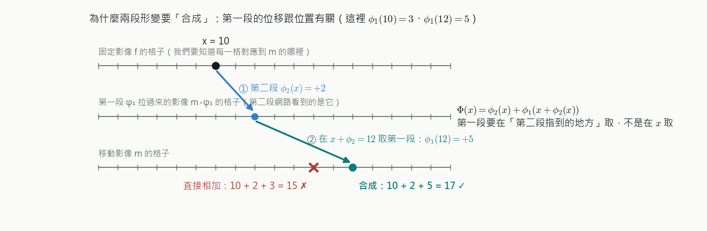
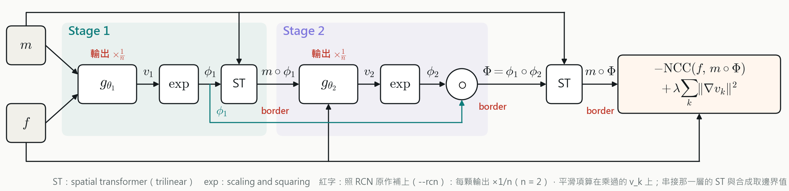
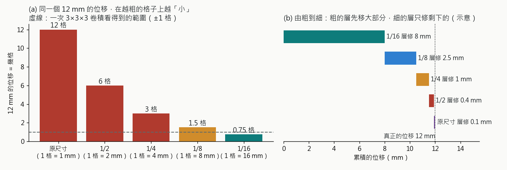
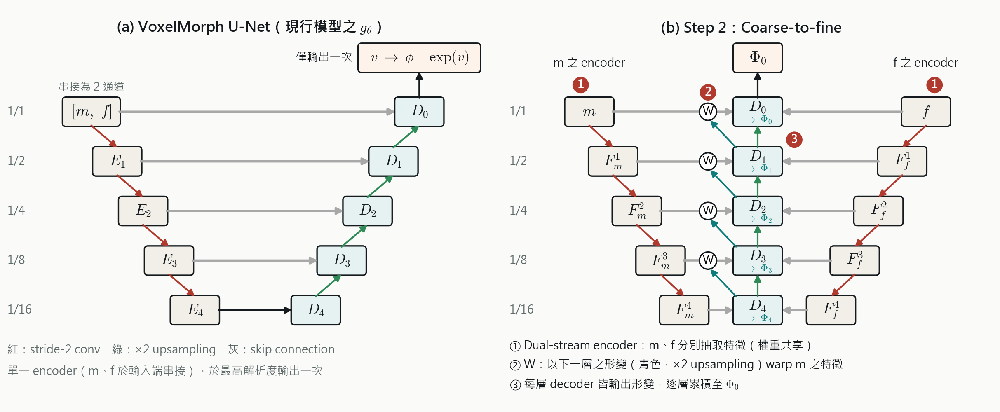
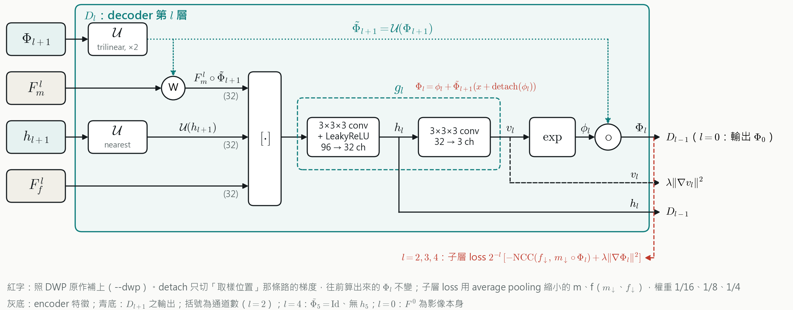
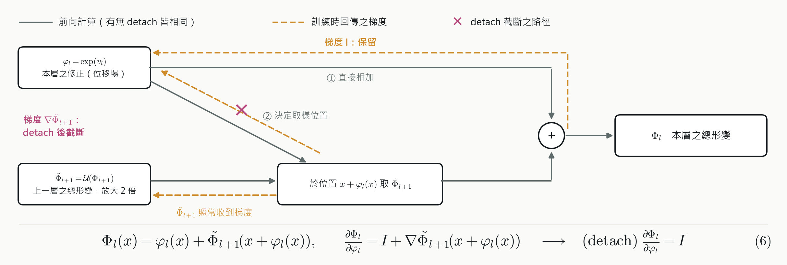
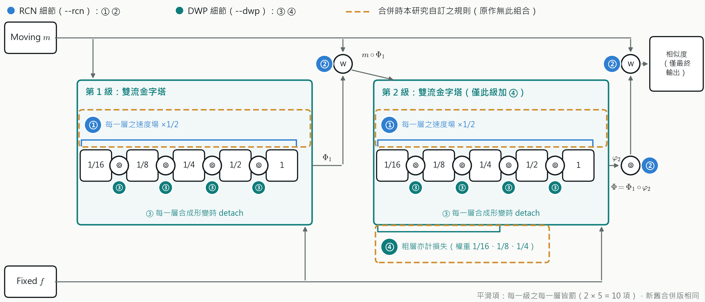

# Cascade 與 Coarse-to-fine（pyramid）：原理筆記

> 寫給自己看的。10-21 初版；11-11 重寫：先給三分鐘版、符號全部統一成 Φ／φ（跟圖一致）、結果併成一張表、加入 rep2 與「只開 --rcn」的結果；11-13 加「只開 --dwp」的結果與五顆拆兩級（第 5 節）。
> 圖都在旁邊的 `img/`：教學圖 `make_cascade_pyramid_explained.py`；架構圖 `make_cp_arch_v2.py`（紅字 = `--rcn`／`--dwp` 才有的部分）；
> `cp_comb_details.png`、`cp_detach.png` 是 11/11 簡報的圖（`ASD/slides_src/2026-11-11_meeting/make_p3_details.py`、`make_p3_detach.py`）複製過來的。
> 程式在 `ASD/arch.py`、`ASD/train_arch.py`；跟原作逐項對照在 `ASD/ASD相關手冊.md` §29、§31.13。

---

## 三分鐘版

1. **兩種設計都在解決同一件事**：大的位移一次猜不準，拆成「先大後小」。
   - **Cascade**：兩顆網路接力，第 2 顆只修第 1 顆剩下的。
   - **Coarse-to-fine**：一顆網路裡，從 1/16 的格子開始，一層一層放大、修細節。
2. **核心都是「合成」**：兩段形變不能直接相加，要用 `Φ(x) = φ₂(x) + φ₁(x + φ₂(x))`（第 1 節）。
3. **結果**（test 51 位；底子是 SVF 的 mix_exp6，0.8051）：cascade 0.8166、coarse-to-fine 0.8162，都是 51/51 位比底子高，兩者打平。
4. **合併**（串兩顆、每顆都由粗到細）：不加原作細節 0.8192（重練一次 0.8198），是全部最高；加了兩組原作細節反而掉到 0.8149。
5. **原因查到一半**（11-13）：只加 RCN 的細節 → 0.8200，沒有掉；只加 DWP 的細節 → 0.8161，掉了 → **是 DWP 的細節**。拆兩級看，最可疑的是我們自己定的「④ 粗層 loss 只加在第 2 級」，正在試改加在第 1 級（第 5 節）。

---

## 0. 符號表（先看這張）

| 符號 | 是什麼 | 備註 |
|---|---|---|
| m、f | 移動影像（受試者）、固定影像（atlas）| |
| x | **位置**：影像裡每一格的座標 | 只有它是位置，其他都是形變 |
| v | 速度場：網路直接輸出的東西 | 3 個通道（x、y、z 方向）|
| exp | 積分（scaling and squaring）：速度場 → 位移場 | 積出來的形變自己不會翻 |
| **φ** | **一段的小修正**（位移場）= exp(v) | cascade 的一顆、或 pyramid 的一層各產生一個 |
| **Φ** | **合成後的總形變**（位移場）| 最後拿 Φ 去搬 m |
| Φ̃_{l+1} | 上一層的 Φ_{l+1} 放大 2 倍後 | = 𝒰(Φ_{l+1}) |
| 𝒰 | 「放大 2 倍」這個**動作**（不是形變）| 形變用 trilinear、向量也乘 2；特徵用 nearest |
| ∘ | 合成（第 1 節那條式子）| `m ∘ Φ` = 用 Φ 把 m 搬過去 |
| W | warping：用形變把東西搬過去 | pyramid 裡用來搬 m 的特徵 |
| D_l | decoder 的第 l 層 | l = 4 是 1/16（最粗、先算），l = 0 是原尺寸（最後）|
| F_m^l、F_f^l | m、f 經 encoder 抽出的第 l 層特徵 | 兩個用同一個 encoder（權重共享）|
| h_l | 第 l 層 decoder 的特徵 | 往下傳，讓下一層知道「上一層看到什麼」|
| λ | 平滑項的權重 | 整個系列都是 1 |
| n | cascade 串幾顆 | 我們是 2 |

⚠️ 以前的版本用 U、u 表示形變，跟 𝒰（放大）很像，容易看錯，11-11 全部改成 Φ、φ。程式 `arch.py` 裡的變數名還是 `U`、`u`，意思相同。

---

## 1. 合成：把兩段形變接起來

- 形變的意思：f 的每一格 x，要去 m 的哪裡取值。
- 第 2 段 φ₂ 是在「已經被第 1 段搬過的影像」上量的。要回到原本的 m，第 1 段要在 **x + φ₂(x)** 這個位置取，不是在 x：

$$\Phi(x) = \varphi_2(x) + \varphi_1\big(x + \varphi_2(x)\big)$$

- 圖上的例子：直接相加得 15（錯），合成得 17（對）。大腦每個位置的位移都不一樣，所以一定要合成。
- 「在 x + φ₂ 取值」要內插，就是程式裡的 `warp(φ₁, φ₂)`。

📌 cascade 在「兩顆之間」用這條式子；coarse-to-fine 在「每一層之間」用這條式子。

---

## 2. Cascade（串兩顆）

### 2.1 怎麼做

1. 第 1 顆看 (m, f)，輸出 φ₁
2. 用 φ₁ 把**原始的** m 搬過去 → m ∘ φ₁（大致對齊了）
3. 第 2 顆看 (m ∘ φ₁, f)，輸出剩下的修正 φ₂
4. 合成 Φ = φ₁ ∘ φ₂，用 Φ 把原始的 m 搬過去

兩顆各自有權重、一起訓練。

### 2.2 為什麼有效

- 第 2 顆面對的是**比較容易的問題**：輸入已經大致對齊，只剩小差距。
- 一起訓練，第 2 顆會學成「專門修細節」。同一顆模型連跑兩次（不重新訓練）也有進步（0.8051 → 0.8136），但 cascade 更好。

### 2.3 loss

- 相似度**只算最後** m ∘ Φ；第 1 顆要對多少，網路自己分配。
- 平滑項**每一顆都算**：λ(‖∇v₁‖² + ‖∇v₂‖²)。

### 2.4 RCN 原作的兩個細節（`--rcn`）

| | 細節 | 出處 | 在哪裡 |
|---|---|---|---|
| ① | 每顆輸出 × 1/n | 只有程式（`flow_multiplier`）| 網路輸出速度場之後，2 顆時乘 0.5 |
| ② | 越界取邊界值 | 論文 §3.1、程式 | 搬 m、合成兩顆形變時，取到影像外面用邊界值，不補 0 |

- ① 讓每顆一開始只動一半，訓練初期比較穩（RCN 最多串 10 顆，不乘一開始會爆）。網路最後能表達的形變不變。
- ② 只影響影像最外圈。

---

## 3. Coarse-to-fine（由粗到細）

### 3.1 核心想法：大位移在粗的格子上變小

- 卷積一次只看 ±1 格。12 mm 的位移在原尺寸是 12 格，看不到。
- 縮到 1/16（每格 16 mm），12 mm 不到 1 格，一次就看得到。
- 所以先在 1/16 決定大方向，每放大一層只剩「一兩格」要修。

### 3.2 整體結構

跟原本的 VoxelMorph（左）比，改了三處（右）：

1. **兩張影像各自抽特徵**（Dual）：同一個 encoder 跑兩次，得到 F_m^l、F_f^l。一定要分開，下一步才能只搬 m 的特徵。
2. **每一層先搬再比**（Warping）：用上一層的形變把 m 的特徵搬過去，再跟 f 的特徵比。
3. **每一層都輸出形變、逐層合成**（Pyramid）：D_4 → D_3 → … → D_0，每層合成一次，D_0 輸出最終的 Φ_0。

### 3.3 一層 D_l 裡面

照箭頭走一遍（圖上通道數是 l = 2 的）：

1. **放大上一層**：Φ_{l+1} 經 𝒰（trilinear ×2）→ Φ̃_{l+1}；h_{l+1} 經 𝒰（nearest ×2）→ 𝒰(h_{l+1})
2. **搬 m 的特徵**：W 用 Φ̃_{l+1} 搬 F_m^l → F_m^l ∘ Φ̃_{l+1}
3. **疊起來**：[F_m^l ∘ Φ̃_{l+1}, 𝒰(h_{l+1}), F_f^l]，32 + 32 + 32 = 96 通道
4. **g_l 算形變**：卷積 → h_l（這層的特徵，往下傳）→ 卷積 → v_l（速度場）
5. **積分**：φ_l = exp(v_l)，這一層的小修正
6. **合成**：∘ 把 φ_l 接到 Φ̃_{l+1} 上 → Φ_l，送進下一層

邊界情況：最粗的 l = 4 沒有上一層（Φ̃₅ = 不移動、沒有 h₅）；原尺寸 l = 0 的特徵就是影像本身，卷積比圖上多幾個。

平滑項：每一層的 v_l 都罰（黑色虛線）。這是我們第一版就有的，**不是** `--dwp` 加的（舊圖誤標成紅色，11-11 更正）。

### 3.4 DWP 原作的兩個細節（`--dwp`，圖上紅字）

| | 細節 | 出處 | 在哪裡 |
|---|---|---|---|
| ③ | 合成時 detach | 只有程式（`vxm_pwc.py` 第 97 行）| 每一層的 ∘ |
| ④ | 粗層也算 loss | 論文 Implementation Details、程式 | 1/16、1/8、1/4 三層的 Φ_l |

**③ detach 是什麼**

- 合成 `Φ_l(x) = φ_l(x) + Φ̃_{l+1}(x + φ_l(x))` 裡，φ_l 用了兩次：直接相加，以及決定去哪裡查 Φ̃。
- 訓練時 φ_l 收到兩條梯度：I（直接相加）和 ∇Φ̃（改變查表位置）。detach 切掉第二條。
- **往前算的形變完全一樣**，只影響訓練時怎麼學；Φ̃ 自己照常收到梯度。
- 原作沒寫原因。推測：∇Φ̃ 是內插的導數，等於相鄰兩格的差，會一格一格跳，切掉比較穩（未驗證）。
- 程式：`U = u + warp(U, u.detach())`。

**④ 粗層 loss**

- 1/16、1/8、1/4 三層，各用當下的 Φ_l 把縮小的 m 搬過去，跟縮小的 f 比 NCC，再加 λ‖∇Φ_l‖²。
- 權重 1/16、1/8、1/4，最後一層權重 1，最後一層還是主角。
- 好處：粗的層有直接的指導（deep supervision），不用等最後的結果間接告訴它。

---

## 4. 結果（test 51 位，30 個結構）

| 模型 | 架構 | 加的原作細節 | Dice | 參數 | 腦內 folding／位 | SDlogJ |
|---|---|---|---|---|---|---|
| mix_exp6 | SVF（底子）| — | 0.8051 | 0.30 M | 0.1 | 0.49 |
| mix_wide_vel | SVF，通道 ×2 | — | 0.8111 | 1.20 M | 0.1 | 0.49 |
| mix_cascade | cascade | 無 | 0.8156 | 0.60 M | 23 | 0.56 |
| mix_cascade_rcn | cascade | ①② | 0.8166 | 0.60 M | 22 | 0.56 |
| mix_pyramid | coarse-to-fine | 無 | 0.8149 | 0.41 M | 4 | 0.53 |
| mix_pyramid_dwp | coarse-to-fine | ③④ | 0.8162 | 0.41 M | 10 | 0.56 |
| mix_cascade_pyramid | 合併 | 無 | **0.8192** | 0.82 M | 67 | 0.61 |
| ⤷ rep2（重練一次）| 合併 | 無 | **0.8198** | 0.82 M | 90 | — |
| mix_cascade_pyramid_rcn | 合併 | ①② | **0.8200** | 0.82 M | 69 | — |
| mix_cascade_pyramid_dwp | 合併 | ③④ | 0.8161 | 0.82 M | 82 | — |
| mix_cascade_pyramid_rcn_dwp | 合併 | ①②③④ | 0.8149 | 0.82 M | 71 | 0.64 |

怎麼看：

- **改結構比單純加大有效**：加寬參數 4 倍 → 0.8111；cascade 2 倍 → 0.8156～0.8166；coarse-to-fine 1.35 倍 → 0.8149～0.8162。
- **cascade 與 coarse-to-fine 打平**（照原作版 p = 0.16），coarse-to-fine 參數少、更平滑。
- **單獨模型加原作細節只多約 0.001**：重練一次本身就會差 0.0006（rep2），所以這 0.001 **看不出差別**（11-11 更正，以前寫「再高 0.001、p < 0.001」，那是把訓練的隨機性忽略了）。
- **合併不加細節是最高的**，兩組細節都加反而變低，原因見第 5 節。
- 合併的代價：folding 和 SDlogJ 都比單獨的高。
- 另：mix_pyramid 練到 500 輪 0.8185（250 輪以後還在慢慢爬）。

---

## 5. 合併為什麼變低（11-11 更新）

### 5.1 合併時要自己決定的規則

兩篇原作都沒有「串兩顆、每顆由粗到細」這種組合，所以下面這幾條是我們自己定的：

- **① 乘在哪**：RCN 每顆只有一個輸出；合併版每顆有 5 層，我們乘在**每一層**（橘色虛線框）。
- **④ 加在哪顆**：DWP 只有一個金字塔；合併版只加在**第 2 顆**，比照 RCN「相似度只算最後」（橘色虛線框）。
- **平滑項**：每顆每層都罰（2 × 5 = 10 項），新舊合併版一樣，不是下降的原因。
- ② ③ 的位置跟原作一樣：② 只在兩顆之間；③ 每顆每層都有。

### 5.2 查的過程

| 步驟 | 模型 | test | val 第 150～250 輪平均 | 結論 |
|---|---|---|---|---|
| 0 | 不加細節（第 1 次）| 0.8192 | 0.8134 | |
| 0 | 兩組都加 | 0.8149 | 0.8107 | 看起來變低了 |
| 1 | rep2：不加細節，重練一次 | 0.8198 | 0.8137 | 跟第 1 次一樣 → **下降是真的**，不是運氣 |
| 2 | 只加 ①②（`--rcn`）| 0.8200 | 0.8129 | 跟不加一樣（26/51，p = 0.59）→ **不是 RCN 細節** |
| 3 | 只加 ③④（`--dwp`）| 0.8161 | 0.8109 | 跟兩組都加一樣低（只有 3/51 位高於重練）→ **是 DWP 細節** |
| 4 | ③④，但 ④ 改加在**第 1 級** | 訓練中 | | 回到 0.82 → ④ 放錯級就是原因；還是低 → 再把 ③ 分開測 |

`--dwp` 放在**單獨的** pyramid 上沒有變差（0.8149 → 0.8162），所以問題不是 ③④ 本身，而是合併時的規則。

### 5.3 拆兩級看（11-13，五顆都拆）

只推論、不訓練（`ASD/analyze_combo_ablation.py`，圖在 `models/combo_ablation/`）：

| | 第 1 級後 Dice | 第 1 級位移 | 第 2 級位移 | 第 2 級在 1/16 層 | 第 2 級細層再加 | 兩級後 |
|---|---|---|---|---|---|---|
| 不加（第 1 次）| 0.7964 | 2.80 mm | 0.79 mm | 0.12 mm | 0.42 mm | 0.8192 |
| 不加（rep2）| 0.8014 | 2.75 | 0.82 | 0.20 | 0.39 | 0.8198 |
| 只加 ①② | 0.7990 | 2.85 | 0.78 | 0.12 | 0.40 | 0.8200 |
| **只加 ③④** | 0.7923 | **3.11** | **0.67** | **0.37** | **0.25** | 0.8161 |
| **兩組都加** | 0.7905 | **3.04** | **0.66** | **0.34** | **0.25** | 0.8150 |

「細層再加」= 第 2 級從 1/4 層到原尺寸多動的量。

- **五顆分成兩群，分界就是 ③④**：有 ③④ 時，第 2 級在 1/16 層就動了 2～3 倍，到細的層反而加得少；第 1 級動得多卻沒更準。
- 訓練過程也一樣分兩群：有 ③④ 的平滑項一直比較高（約 0.016 vs 0.0145），val Dice 第 150 輪後就停在約 0.810。
- ⚠️ 「第 1 級後 Dice」重練一次就差 0.005（0.7964 vs 0.8014），單看不可靠；**位移的兩群沒有重疊，比較可靠**。

**推論**：④ 加在第 2 級，等於要求「只修細節」的第 2 級也要在 1/16、1/8 對齊，把它的力氣拉去做第 1 級已經做過的粗對齊。DWP 原作只有一個金字塔、從頭對齊，粗層監督才合理。所以第 4 步把 ④ 移到第 1 級。③ 還沒排除，要看第 4 步的結果。

### 5.4 學到的事

- **原作的細節是為原作的架構設計的**：RCN 沒有由粗到細，DWP 沒有串接；拼在一起就是兩篇都沒做過的新組合。
- **照原作 ≠ 比較好**：照原作的價值是可以跟論文對照、說得清楚做了什麼。
- **重練一次就會差約 0.0006**，配對 Wilcoxon 還可能判顯著（rep2 vs 第 1 次：35/51，p = 0.016）。差 0.001 以內的比較不要當真。
- **訓練相似度低不等於 Dice 低**：只加 ①② 的版本訓練相似度從頭就較低，Dice 卻沒有變低。
- **深度監督（④）要加在對的地方**：它是給「從頭對齊」的網路用的；加在只修細節的那一級，反而把它拉去做重複的事。
- 拆開看每一段做了多少（5.3），比只看最後的 Dice 更能看出問題在哪。

---

## 6. 常見的誤會

- **「cascade 就是多跑幾次」**：同一顆跑兩次沒有重新訓練，第 2 次沒學過「只修細節」；而且跑 3 次反而變差。
- **「coarse-to-fine 就是縮小再放大」**：`--int-downsize 2` 只是把形變縮小一半積分（省時間），只有一層。coarse-to-fine 是 5 層，每層都看特徵、每層都修。
- **「兩段形變相加就好」**：只有位移到處都一樣才對（第 1 節）。
- **「加寬也是多參數，效果應該差不多」**：見第 4 節，加對位專用的結構比單純變大有效；跟 Jian et al.（WBIR 2024）的結論一致。
- **「SVF 不會翻，為什麼還有 folding」**：每一段自己不會翻，但段和段用內插接起來會有數值誤差。
- **「detach 會改變形變」**：不會，往前算完全一樣，只改訓練時的梯度（3.4）。

---

## 7. 對照程式（`ASD/arch.py`）

| 概念 | 程式（變數名 U、u ＝ 筆記的 Φ、φ）|
|---|---|
| 合成 | `VxmPyramid.fields`：`U = u + self.warp[k](U, ...)`；`VxmCascade.forward`：`U = u + self.transformer(U, u)` |
| cascade 第 2 顆的輸入 m ∘ φ₁ | `VxmCascade.forward`：`src = self.transformer(source, U)` |
| 兩張影像各自抽特徵 | `VxmPyramid.encode`（m、f 各跑一次）|
| 每層先搬 m 的特徵 | `VxmPyramid.fields`：`m_k = self.warp[k](fm[k], U)` |
| ① ×1/n | `flow_mult`（合併版在 `fields` 裡乘每一層的 v）|
| ② 越界取邊界值 | `BorderTransformer`（只用在 `VxmCascade.transformer`）|
| ③ detach | `detach_compose`：`u.detach()` |
| ④ 粗層 loss | `ASD/train_arch.py` 的 `dwp_sublevel_loss`（合併版預設只算最後一顆；`--dwp-ms-stage first` 改算第 1 顆，`VxmCascade.forward` 的 `levels_stage`）|
| 平滑項 | `train_arch.py`：`sum(grad_loss(None, p) for p in pres)`，每顆每層的 v |

## 參考

- RCN：Zhao et al., *Recursive Cascaded Networks for Unsupervised Medical Image Registration*, ICCV 2019. https://arxiv.org/abs/1907.12353 ；程式 https://github.com/microsoft/Recursive-Cascaded-Networks
- DWP：Jian et al., *Mamba? Catch The Hype Or Rethink What Really Helps for Image Registration*, WBIR 2024. https://arxiv.org/abs/2407.19274 ；期刊版 https://arxiv.org/html/2512.01913v1 ；程式 https://github.com/BailiangJ/rethink-reg
- Dual-PRNet：Hu et al., MICCAI 2019；期刊版 Dual-PRNet++（Kang et al., MedIA 2022），程式 https://github.com/kangmiao15/Dual-Stream-PRNet-Plus
- 光流的源頭：PWC-Net（Sun et al., CVPR 2018），pyramid + warping + cost volume
