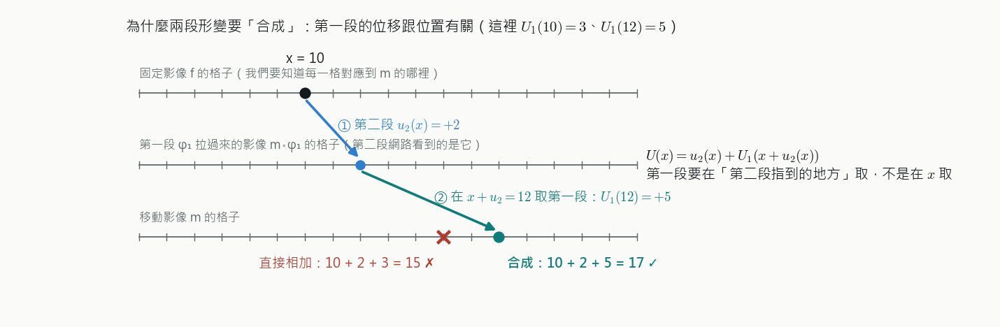
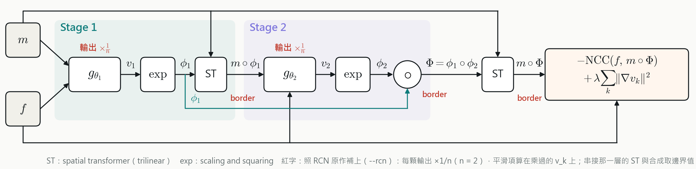
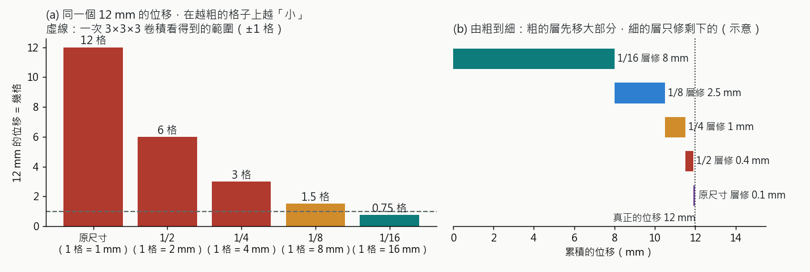
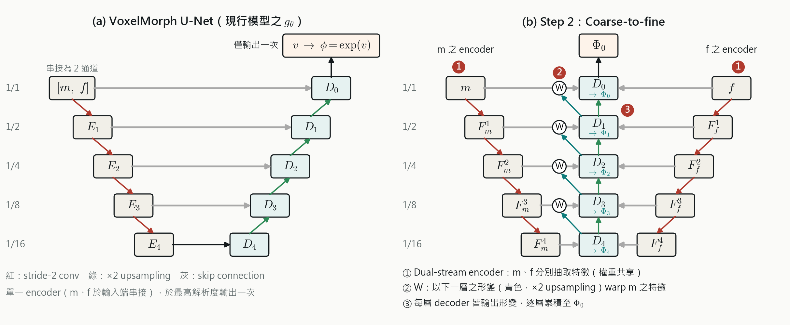
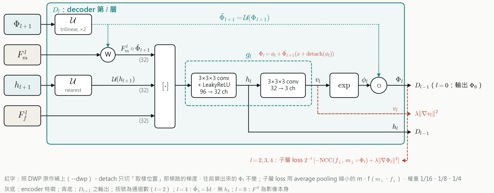

# Cascade 與 Coarse-to-fine（pyramid）：原理筆記

> 2026-10-21 寫給自己看的。目標：搞懂這兩種架構「在解決什麼問題、怎麼解決、為什麼有效」，以及我們的實作跟原作差在哪。
> 圖在旁邊的 `img/cp_*.png`：教學圖 `img/make_cascade_pyramid_explained.py`；架構圖 `img/make_cp_arch_v2.py`（10/14 簡報的畫法，**紅字是 10-21 照原作程式補上的部分**，跟現在的 `ASD/arch.py` 一致）。
> 程式在 `ASD/arch.py`；跟原作程式的逐項對照在 `ASD/ASD相關手冊.md` §29。

---

## 0. 先看地圖

VoxelMorph 原本的做法：**兩張影像疊在一起丟進一個 U-Net，網路一次輸出整個形變場**。我們加的兩種設計都在改這個「一次就要猜完」：

| | 一句話 | 比喻 | 原作 |
|---|---|---|---|
| **Cascade** | 對完一次，用**另一個網路**再對一次剩下的差距 | 先粗剪頭髮，再換一個人修細節 | RCN（Zhao et al., ICCV 2019）|
| **Coarse-to-fine** | **同一個網路裡**，先在很粗的格子上對大方向，再一層一層放大、修細節 | 看地圖先看全國、再看縣市、再看街道 | DWP（Jian et al., WBIR 2024）；概念源自 Dual-PRNet、光流的 PWC-Net |

兩個都在處理同一件事：**大的位移很難一次猜對，拆成「先大後小」比較容易**。差別在拆的方式：cascade 是「整個網路做兩次」，coarse-to-fine 是「一個網路內部分好幾層」。

---

## 1. 共同的基礎：形變怎麼「接起來」

兩種設計都會產生好幾段形變，最後要接成一個。**這一步不能直接相加。**

- 形變的意思是：固定影像 f 的每一格 x，要去移動影像 m 的哪裡取值，即 φ(x) = x + U(x)
- 先用第一段 U₁ 把 m 拉過來，第二段網路看到的是「已經拉過一次的影像」，它說 x 要再往右 2 格（u₂ = +2）
- 那 2 格是在**拉過一次的影像**上量的。要回到原本的 m，第一段的位移要在 **x + 2 這個位置**取，不是在 x 取：

$$U(x) = u_2(x) + U_1\big(x + u_2(x)\big)$$

- 如果第一段的位移到處都一樣，在哪裡取都相同，相加也對；但大腦的形變每個位置都不一樣，所以一定要這樣接。這叫**合成（composition）**
- 「在 x + u₂ 取值」要用內插（grid_sample），這就是程式裡的 `warp(U₁, u₂)`

📌 cascade 是「兩顆網路之間」用這條式子接；coarse-to-fine 是「每一層之間」用這條式子接。**所以兩個架構的核心都是這一條。**

---

## 2. Cascade（串兩顆）

### 2.1 怎麼做

1. 第 1 顆網路看 (m, f)，輸出形變 φ₁
2. 用 φ₁ 把**原始的** m 拉過去，得到 m∘φ₁（已經大致對齊）
3. 第 2 顆網路看 (m∘φ₁, f)，輸出**剩下的修正** φ₂
4. 合成：Φ = φ₁ ∘ φ₂（就是第 1 節那條式子），最後用 Φ 把原始的 m 拉過去

每一顆都是完整的 VoxelMorph（各自的權重），兩顆**一起訓練**。圖上的紅字（輸出 ×1/n、border）是 2.4 的兩個細節。

### 2.2 為什麼有效

- 第 2 顆面對的是**比較容易的問題**：輸入已經大致對齊，只剩小的差距。小差距正好是 VoxelMorph 擅長的範圍（NCC 只看 9×9×9 的小窗格，對小位移最敏感）
- 兩顆一起訓練，第 2 顆會學成「專門修細節」的網路，跟第 1 顆分工
- 對照：**同一顆跑兩次**（我們的 Step 0，不重新訓練）也有進步（mix_exp6 0.8051 → 0.8136），但第 2 次用的是同一組權重，它沒學過「只修細節」；cascade 再多 +0.0020

### 2.3 訓練時怎麼算 loss

- 相似度（NCC）**只算最後的結果** m∘Φ：中間的 m∘φ₁ 沒有被要求要對準，第 1 顆要對多少由網路自己決定
- 平滑項**每一顆都算**，權重相同：λ·(‖∇v₁‖² + ‖∇v₂‖²)

### 2.4 RCN 原作的兩個細節（10-21 讀程式後補上，`--rcn`）

| 細節 | 原作程式 | 意思 |
|---|---|---|
| 每顆的輸出 × 1/n | `flow_multiplier = 1.0 / n_cascades` | 2 顆時每顆輸出先乘 0.5。網路能表達的形變一樣（要 4 mm 就輸出 8），但一開始每顆只動一半，**訓練初期比較穩**。RCN 最多串 10 顆，不這樣做一開始 10 顆疊起來形變會太大 |
| 影像邊界取邊界值 | `tf.clip_by_value` 把座標夾回影像內 | 取到影像外面時用最靠近的邊界值，不補 0。只影響影像最外圈 |

### 2.5 我們的結果（test 51 位）

| | Dice | 比 mix_exp6 | 參數 | 每步時間 | SDlogJ | 腦內 folding／位 |
|---|---|---|---|---|---|---|
| mix_exp6（基準）| 0.8051 | — | 0.30 M | 1× | 0.49 | 0.1 |
| mix_wide_vel（加寬 2 倍）| 0.8111 | +0.0060 | 1.20 M | — | 0.49 | 0.1 |
| **mix_cascade** | **0.8156** | **+0.0105**（51/51）| 0.60 M | 約 1.9× | 0.56 | 23 |

- 參數只多 1 倍，比加寬（多 3 倍）還有效 → **結構比單純變大重要**
- 代價：形變比較不平滑、folding 從 0.1 變 23 個。每一顆的 SVF 自己不會翻，但兩顆用內插接起來會有數值誤差，總形變也變大

---

## 3. Coarse-to-fine（由粗到細）

### 3.1 核心想法：大位移在粗的格子上變小

- 卷積一次只看 3×3×3，也就是 ±1 格。12 mm 的位移在原尺寸是 12 格，遠超過一次卷積看得到的範圍
- 把影像縮小到 1/16（每格 16 mm），同樣 12 mm 不到 1 格，**一次卷積就看得到**
- 所以：先在 1/16 的格子上決定大方向，放大到 1/8 時只剩小差距，再修……一路到原尺寸，每一層都只需要修「一兩格」

### 3.2 怎麼做

左邊是原本的 VoxelMorph：m、f 一開始就疊在一起，最後**只輸出一次**。右邊是 coarse-to-fine，改了三處：

1. **兩張影像各自抽特徵**（dual-stream，同一個 encoder、權重共用）：得到 m 和 f 各自的特徵金字塔 1/2、1/4、1/8、1/16
   - **為什麼一定要分開**：下一步要「只把 m 的特徵照目前的形變拉過去」。原本的 VoxelMorph 一開始就把兩張疊在一起，特徵裡兩張影像混在一起，沒辦法只拉 m
2. **每一層先 warp 再比**：用上一層的形變（放大 2 倍，向量也乘 2）把 m 的特徵拉過去，再跟 f 的特徵放在一起
3. **每一層都輸出形變，逐層合成**：這一層算出小修正 δ，用第 1 節的式子接到上一層的形變上

每一層裡面的細節：

- 輸入：拉過去的 m 特徵、f 特徵、上一層 decoder 的特徵 h（記得「上一層看到了什麼」）
- 卷積 → 速度場 v_l → 積分成 φ_l → 合成
- 平滑項每一層的 v_l 都算
- 紅字是 3.4 補的兩個細節：合成時 detach、l = 2、3、4 的總形變另外算子層 loss

### 3.3 為什麼有效

- 每一層都只要解「一兩格」的小問題，大位移被拆成好幾個小步驟
- 「先 warp 再比」等於每一層都在**已經大致對齊的特徵**上找差距，找對應的範圍大幅縮小
- 參數只多 35%（0.41 M）：每一層的 decoder 只是多吃一份 f 的特徵

### 3.4 DWP 原作的兩個細節（10-21 讀程式後補上，`--dwp`）

| 細節 | 原作程式 | 意思 |
|---|---|---|
| 合成時 δ detach | `warp(prev_flow, δ.detach()) + δ` | δ 在合成式裡出現兩次：直接加上去、以及決定「去哪裡取上一層的形變」。detach 把第二條路的梯度切掉，**往前算的形變完全一樣**，只是訓練時 δ 只透過「直接加上去」學。原作沒寫理由；我們的解讀是內插對位置的梯度在格點之間會跳，切掉比較穩 |
| 粗的層也算相似度 | 1/16、1/8、1/4 三層，權重 1/16、1/8、1/4 | 每一層用當下的總形變，把縮小的 m 拉過去，跟縮小的 f 比 NCC（加平滑項）。這樣**每一層都直接被要求「要對準」**，不是只靠最後的結果間接學（叫 deep supervision）。權重跟解析度成比例，最後一層權重 1，還是主導 |

### 3.5 我們的結果（test 51 位）

| | Dice | 比 mix_exp6 | 參數 | 每步時間 | SDlogJ | 腦內 folding／位 |
|---|---|---|---|---|---|---|
| **mix_pyramid** | **0.8149** | **+0.0099**（51/51）| 0.41 M | 約 1.5× | 0.53 | 4 |
| mix_pyramid_500（練到 500 輪）| 0.8185 | +0.0134 | 0.41 M | — | 0.55 | 5 |

- 跟 cascade 打平（−0.0007），但參數只有它的 2/3、更平滑、folding 更少
- 影像邊界每位有約 1 萬個 folding：粗的層的位移延伸到影像邊界，合成時取到影像外面補 0 造成的，不在腦裡，不影響 Dice（手冊 §28.4）

---

## 4. 兩個比一比，以及疊在一起

| | Cascade | Coarse-to-fine |
|---|---|---|
| 「先大後小」怎麼拆 | 整個網路做兩次 | 一個網路內部分 5 層 |
| 每一段在什麼解析度 | 都是原尺寸 | 1/16 → 原尺寸 |
| 每一段的網路 | 完整的 VoxelMorph，各自的權重 | 每層一個小 decoder，共用 encoder |
| 兩張影像 | 疊在一起進網路 | 各自抽特徵 |
| 參數 | ×2 | ×1.35 |
| 主要的好處 | 第 2 顆專門修細節 | 大位移拆成每層一兩格 |

**疊在一起**（mix_cascade_pyramid：串兩顆，每顆都是由粗到細）= 0.8192，比 mix_exp6 +0.0141（51/51），4 格裡最高。

- 兩者各自的增益加起來是 +0.0204，合併只有 +0.0141（約 7 成）→ **部分可以相加**。兩個設計都在處理「大位移」，好處有重疊
- 代價也疊加：SDlogJ 0.61、腦內 folding 67 個／位（仍遠少於論文 VoxelMorph 的 19,077 個）

---

## 5. 常見的誤會

- **「cascade 就是多跑幾次」**：同一顆跑兩次（Step 0）跟 cascade 不一樣。cascade 是兩組權重一起訓練，第 2 顆學會只修細節；而且同一顆跑 3 次反而變差
- **「coarse-to-fine 就是把影像縮小再放大」**：VoxelMorph 原本的 `--int-downsize 2` 是把形變場縮小一半再積分（省時間），只有一層。coarse-to-fine 是 5 層、每層都看影像特徵、每層都修正
- **「兩段形變相加就好」**：只有位移到處都一樣時才對，見第 1 節
- **「加寬也是多參數，效果應該差不多」**：加寬 4 倍參數 +0.0060；cascade 2 倍參數 +0.0105；coarse-to-fine 1.35 倍參數 +0.0099 → 加對位專用的結構，比單純把網路變大有效。跟 Jian et al.（WBIR 2024）的結論一致：換 backbone 幫助小，對位專用的設計幫助大
- **「SVF 保證不會翻，為什麼還有 folding」**：每一段自己積分出來的形變不會翻；但段和段用內插接起來會有數值誤差，形變越大越明顯

---

## 6. 對照程式

| 概念 | `ASD/arch.py` |
|---|---|
| 合成 U = u + U↑(x + u) | `VxmPyramid.fields` 的 `U = u + self.warp[k](U, ...)`；`VxmCascade.forward` 的 `U = u + self.transformer(U, u)` |
| cascade 每顆的輸入 m∘φ₁ | `VxmCascade.forward` 的 `src = self.transformer(source, U)` |
| 兩張影像各自抽特徵 | `VxmPyramid.encode`（m、f 各跑一次） |
| 每層先 warp m 的特徵 | `VxmPyramid.fields` 的 `m_k = self.warp[k](fm[k], U)` |
| RCN 的 ×1/n、邊界 | `flow_mult`、`BorderTransformer`（`--rcn`）|
| DWP 的 δ detach、粗層 loss | `detach_compose`（`--dwp`）；粗層 loss 在 `ASD/train_arch.py` 的 `dwp_sublevel_loss` |

## 參考

- RCN：Zhao et al., *Recursive Cascaded Networks for Unsupervised Medical Image Registration*, ICCV 2019. https://arxiv.org/abs/1907.12353 ；程式 https://github.com/microsoft/Recursive-Cascaded-Networks
- DWP：Jian et al., *Mamba? Catch The Hype Or Rethink What Really Helps for Image Registration*, WBIR 2024. https://arxiv.org/abs/2407.19274 ；期刊版 https://arxiv.org/html/2512.01913v1 ；程式 https://github.com/BailiangJ/rethink-reg
- Dual-PRNet：Hu et al., MICCAI 2019；期刊版 Dual-PRNet++（Kang et al., MedIA 2022），程式 https://github.com/kangmiao15/Dual-Stream-PRNet-Plus
- 光流的源頭：PWC-Net（Sun et al., CVPR 2018），pyramid + warping + cost volume
